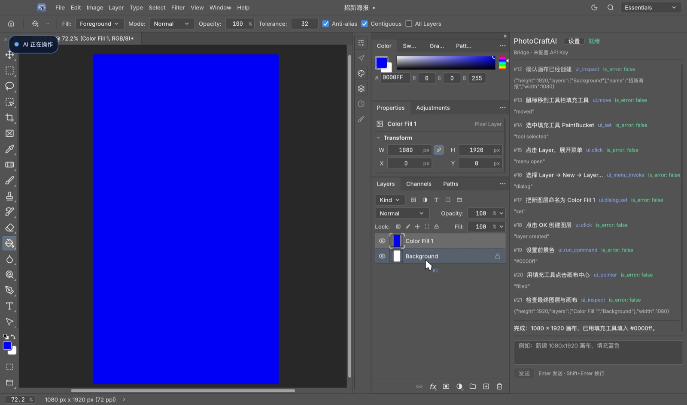
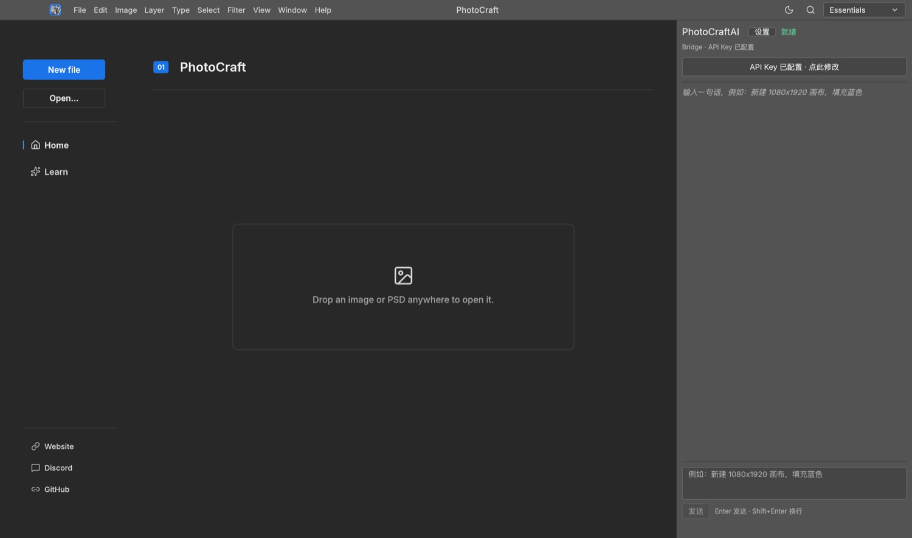

# PhotoCraftAI

**在真正的 PhotoCraft 桌面版里，直接内置一个会动手的 AI 操作员。**

PhotoCraftAI 不是外挂网页，也不是后台 headless。它把聊天面板嵌入原版 PhotoCraft 的
egui 界面右侧；你说话，它在左侧真实地展开菜单、移动指针、切换工具、创建图层。
原有菜单、工具栏、图层面板、画布全部保留。



<p align="center"><sub>左侧是原版 PhotoCraft，右侧是 PhotoCraftAI 的实时执行日志</sub></p>

## 它能做什么

- **原版界面，一个不少**：File / Edit / Image / Layer / Type / Select / Filter / View / Window / Help、工具栏、属性、颜色、图层、通道、路径全部保留。
- **看得见的自动化**：新建画布时会真的点开 File 菜单、打开 New Document 弹窗、填写尺寸、点 Create；随后切到 Paint Bucket、创建 Color Fill 1 图层、把画布填成指定颜色。
- **Bridge 控制，不是 headless**：通过 `photocraft-cli mcp --bridge 127.0.0.1:7878` 控制正在运行的桌面 App，所以每一步都有画面。
- **任意编辑走模型**：除了“新建画布 + 填充”的可视化流程，其他指令（改颜色、改图层名、改尺寸、加文字等）交给配置的大模型，让它从真实 Bridge 工具里选择并执行，一步一调，每步自动 `ui_inspect`。
- **API Key 内置设置页**：支持 DeepSeek / Qwen（DashScope 兼容模式）/ OpenAI；Key 只存在本机。
- **中文对话**：全中文界面，支持中文输入法和自然语言。
- **网页预览（可选）**：同一套后端也能被 React 页面使用，方便录屏或远程查看。



## 架构

```text
┌──────────────────────────── PhotoCraft 桌面 App ───────────────────────────┐
│  File / Edit / ... / Layers（原版 UI）          │  PhotoCraftAI 面板       │
│                                                  │  聊天 + 执行日志         │
│  控制端口 7878  ◄──────── ui.pointer / ui.click / ui.menu.invoke ────────┐ │
└──────────────────────────────────────────────────┼───────────────────────┼─┘
                                                   │                       │
                                      ┌────────────▼──────────┐            │
                                      │ photocraft-cli mcp    │            │
                                      │ --bridge 127.0.0.1:7878│           │
                                      └────────────┬──────────┘            │
                                                   │ MCP stdio             │
                                      ┌────────────▼──────────┐            │
                                      │ FastAPI + 可视化 Agent │◄───────────┘
                                      │ POST /chat/stream      │  SSE
                                      │ GET/POST /settings    │
                                      └────────────┬──────────┘
                                                   │ OpenAI-compatible
                                      ┌────────────▼──────────┐
                                      │ DeepSeek / Qwen / OpenAI│
                                      └───────────────────────┘
```

- **可见流程**：`visual.py` 负责新建画布/填充这套“像人一样”的动作。
- **通用操作**：`bridge_agent.py` 把 26 个真实 Bridge 工具转成 function calling，模型每次只调一个，执行完自动检查。
- **设置**：`settings_store.py` 保存 provider、模型、Base URL 和 Key；Key 不写进仓库。
- **后端入口**：`main.py` 提供 SSE、设置、健康检查和截图接口。
- **原生面板**：`crates/ui-egui/src/ai_chat.rs`，作为右侧 SidePanel 嵌入 App。

## 快速开始（macOS，Apple Silicon / Intel）

### 1. 编译原版 App 和 CLI

需要 Rust stable，项目要求 `rust-version = 1.95`。

```bash
cd photocraft-AI-version

# CLI：Bridge MCP 由它启动
cargo build --release -p photocraft-cli --no-default-features

# 桌面 App：带 PhotoCraftAI 右侧面板
cargo build --release -p photocraft
```

### 2. 安装后端

```bash
cd ai-agent

python3 -m venv .venv
source .venv/bin/activate
python -m pip install -r requirements.txt
```

### 3. 一条命令启动

```bash
cd ai-agent
source .venv/bin/activate
uvicorn main:app --host 127.0.0.1 --port 8000
```

后端默认会自动启动 `target/release/photocraft`（带控制端口和 `--in-window-menus`）。
启动后你会看到：

- 原版 PhotoCraft 窗口
- 右侧 **PhotoCraftAI** 面板
- 面板顶部 **API Key** 按钮

点 **API Key**，选择服务商，粘贴 Key，点 **保存并测试**。

如果不想让后端自动启动 App：

```bash
PHOTOCRAFT_AUTO_START_APP=0 uvicorn main:app --host 127.0.0.1 --port 8000
```

然后手动启动：

```bash
PHOTOCRAFT_CONFIG_DIR="$PWD/ai-agent/runtime/config" \
./target/release/photocraft \
  --control 7878 \
  --control-token-file ai-agent/runtime/control.token \
  --automation-read-root "$PWD/ai-agent/workspace" \
  --automation-write-root "$PWD/ai-agent/workspace" \
  --in-window-menus
```

### 4. 开始使用

在右侧输入：

```text
新建 1080x1920 画布，填充蓝色
```

或者：

```text
把画布改成红色
```

前者走完整可视化流程；后者让模型选择真实命令并执行。

## 可选：网页版

原生面板是主入口。网页版用于投屏/远程查看同一台机器上的 App：

```bash
cd ai-agent/web
npm install
npm run dev
# http://127.0.0.1:5173
```

Vite 把 `/api` 代理到 `127.0.0.1:8000`。

## 配置

后端读取 `ai-agent/.env`（可选），但更推荐在 App 的 API Key 设置页里填：

```dotenv
LLM_PROVIDER=deepseek
DEEPSEEK_API_KEY=
DASHSCOPE_API_KEY=
OPENAI_API_KEY=
LLM_MODEL=deepseek-chat
LLM_BASE_URL=https://api.deepseek.com
```

设置页保存位置：

```text
ai-agent/runtime/ai_settings.json   # 已 gitignore，权限 0600
ai-agent/runtime/control.token      # App/CLI 共享控制令牌，已 gitignore
```

## 支持的服务商

| Provider | 默认模型 | Base URL |
| --- | --- | --- |
| DeepSeek | `deepseek-chat` | `https://api.deepseek.com` |
| Qwen | `qwen-plus` | `https://dashscope.aliyuncs.com/compatible-mode/v1` |
| OpenAI | `gpt-4o-mini` | `https://api.openai.com/v1` |

三者都走 OpenAI-compatible 接口，可以在设置页改模型和 Base URL。

## 当前边界

- 新建画布/填充的**菜单、鼠标、工具、图层**流程是脚本化可视流程，稳定、适合演示。
- 其他编辑由模型规划，能力取决于模型和 PhotoCraft 真实命令表；不是 Photoshop 全功能自然语言接口。
- 目前验证环境是 macOS；Windows/Linux 需要对应编译产物，Bridge 参数相同。
- 不修改原项目的 MIT / Apache-2.0 协议；本 Fork 新增代码同样使用 `MIT OR Apache-2.0`。

## License

MIT OR Apache-2.0，见仓库根目录 `LICENSE-MIT`、`LICENSE-APACHE`。

原项目：[storytold/photocraft](https://github.com/storytold/photocraft)
Fork：[Jianheng71/photocraft-AI-version](https://github.com/Jianheng71/photocraft-AI-version)
