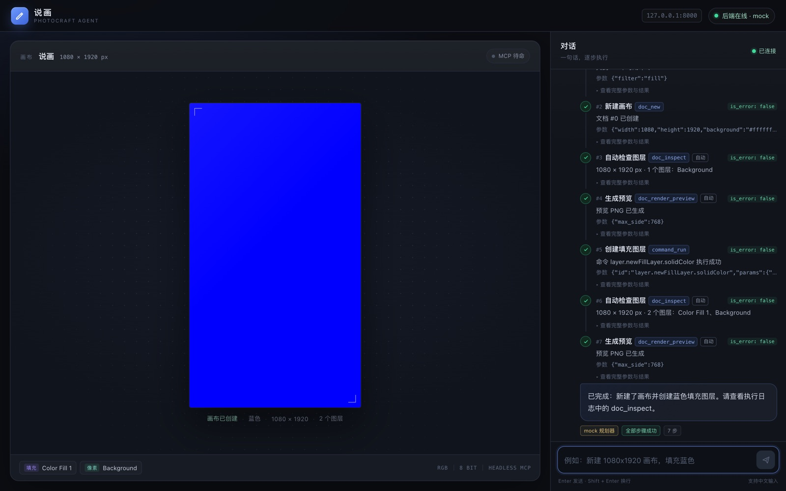

# PhotoCraftAI Web（可选预览）



React + Vite 的聊天界面：左侧画布，右侧对话。只改前端，不改后端 Agent，不改 Rust。

## 目录

```text
ai-agent/web/
├── index.html
├── package.json
├── vite.config.js          # /api -> 127.0.0.1:8000 代理
├── src/
│   ├── main.jsx
│   ├── App.jsx             # 状态、调 /chat、逐条播放日志
│   ├── api.js              # /health、/chat
│   ├── styles.css
│   ├── components/
│   │   ├── CanvasStage.jsx # 左侧画布 + 图层条
│   │   ├── ChatPanel.jsx   # 对话、输入框、后端离线提示
│   │   └── LogTimeline.jsx # 每一步日志与 is_error
│   └── lib/
│       └── steps.js        # 工具名/状态/颜色/结果摘要
└── README.md
```

## 启动

先起后端（在 `ai-agent/`）：

```sh
cd ai-agent
source .venv/bin/activate
uvicorn main:app --host 127.0.0.1 --port 8000
```

再起前端：

```sh
cd ai-agent/web
npm install
npm run dev
```

打开 <http://127.0.0.1:5173>。

生产构建：

```sh
npm run build
npm run preview   # http://127.0.0.1:4173
```

`npm run dev` 和 `npm run preview` 都把 `/api/*` 代理到 `http://127.0.0.1:8000`，
所以浏览器不会遇到 CORS。后端换端口时：

```sh
VITE_PROXY_TARGET=http://127.0.0.1:8001 npm run dev
```

## 连接方式

```text
浏览器 -> http://127.0.0.1:5173/api/chat
      -> Vite proxy (去掉 /api)
      -> http://127.0.0.1:8000/chat
```

- `GET /health`：页面顶部状态点、离线提示、每 15 秒轮询。
- `POST /chat`：`{"message": "..."}`；返回 `reply`、`steps`、`document`。
- 左侧画布从 `doc_inspect` 的 `document` 读取尺寸/图层；填充色从 `command_run`
  的 `params.color` 推断，因此不需要后端提供图片静态服务。

## 已知限制

当前后端 `/chat` 是**一次性 JSON 返回**，不是 SSE/流式。前端在请求期间显示
“正在连接/正在调用 MCP…”的状态，收到响应后按 300–520ms 一条把真实日志逐条播放，
避免一次性刷屏；这不是网络层流式。若需要严格的“服务端边执行边推送”，下一步需要给
FastAPI 增加 SSE 端点（本次按“不改后端 Agent”的要求没有做）。

## 常见问题

| 现象 | 解决 |
| --- | --- |
| 页面提示“后端没启动” | 按提示在 `ai-agent/` 跑 `uvicorn main:app --host 127.0.0.1 --port 8000` |
| `npm install` 报 EPERM（缓存目录 root 所有） | `npm install --cache "$PWD/.npm-cache"` |
| 5173 被占用 | Vite 配了 `strictPort`，先释放端口或改 `vite.config.js` 的 `port` |
| 改了后端端口 | `VITE_PROXY_TARGET=http://127.0.0.1:8001 npm run dev` |
| 画布是白色/没有颜色 | 说明这轮没有 `layer.newFillLayer.solidColor` 的 `params.color`；看日志确认模型用了哪个命令 |
| 日志一次性出现 | 当前后端非流式，前端只能收到响应后逐条播放；见“已知限制” |

## 许可

`MIT OR Apache-2.0`，与上游一致。
