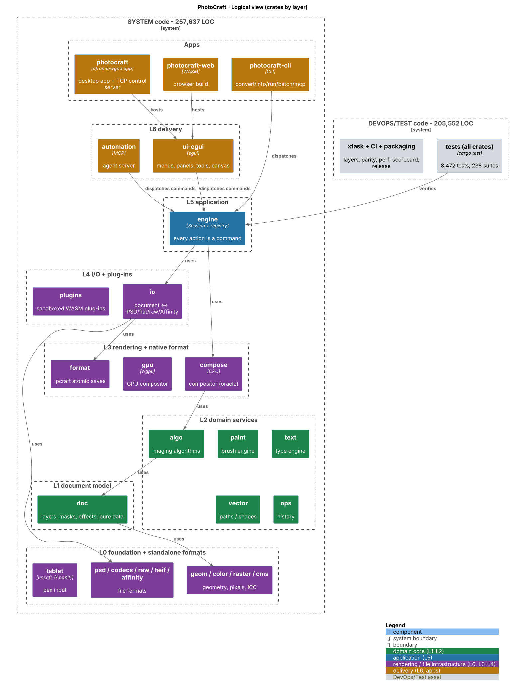
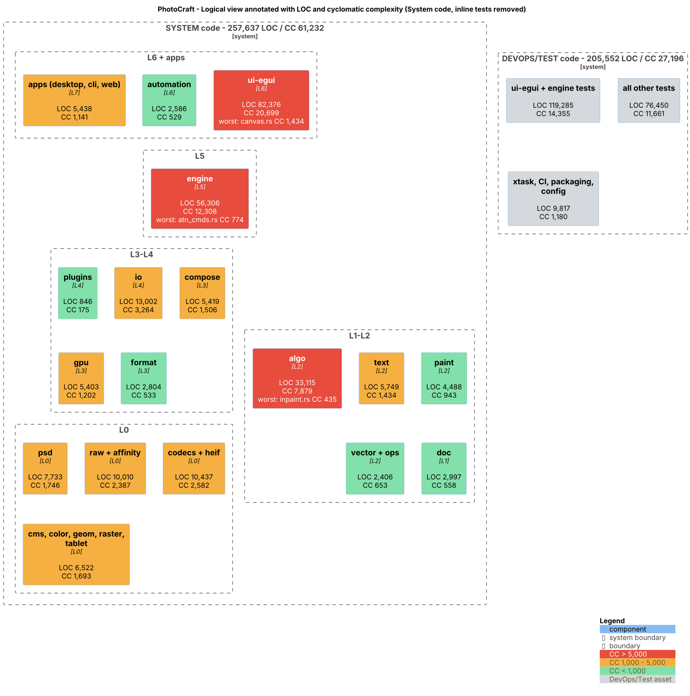
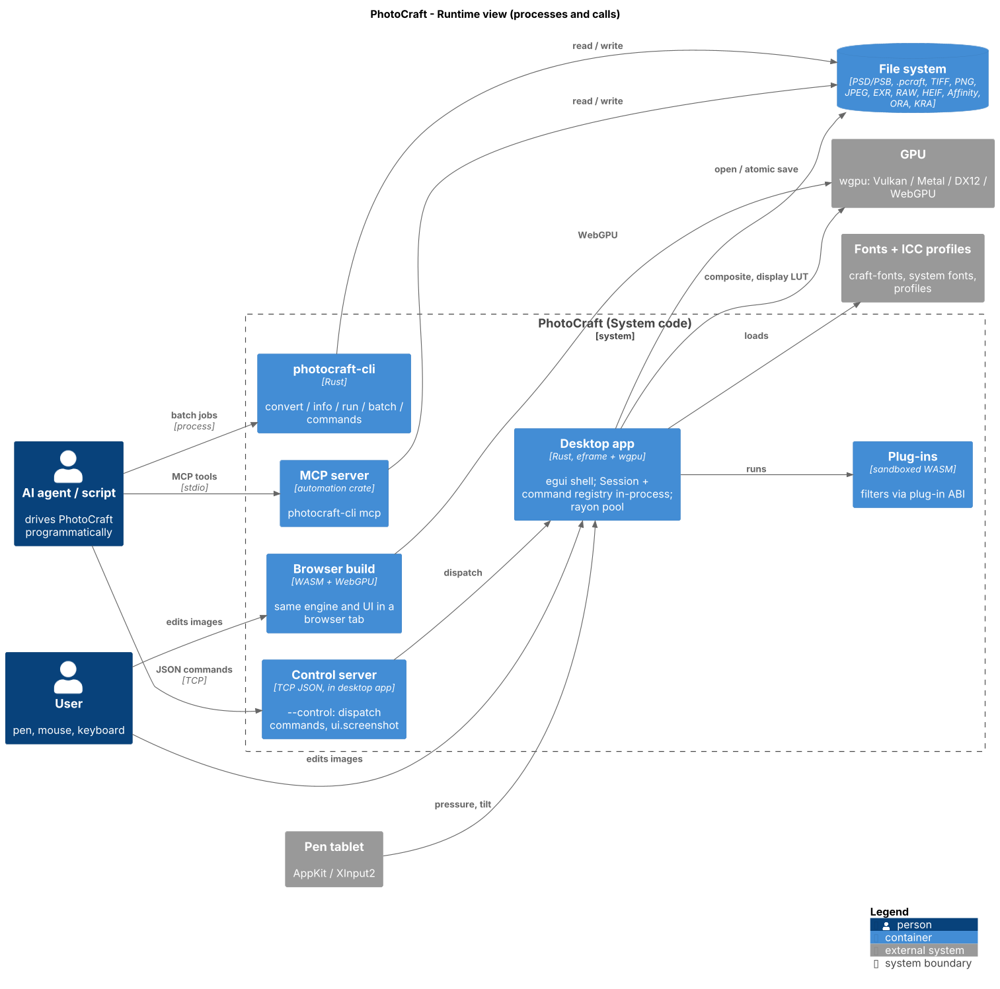
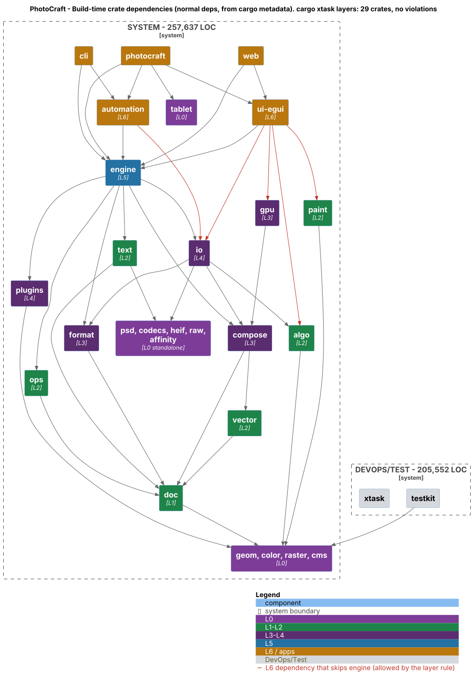
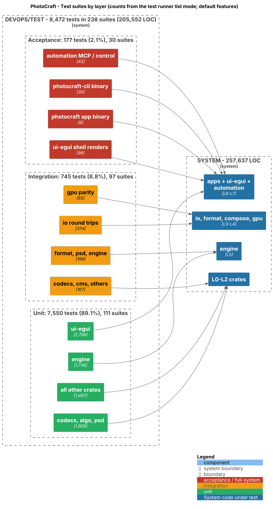
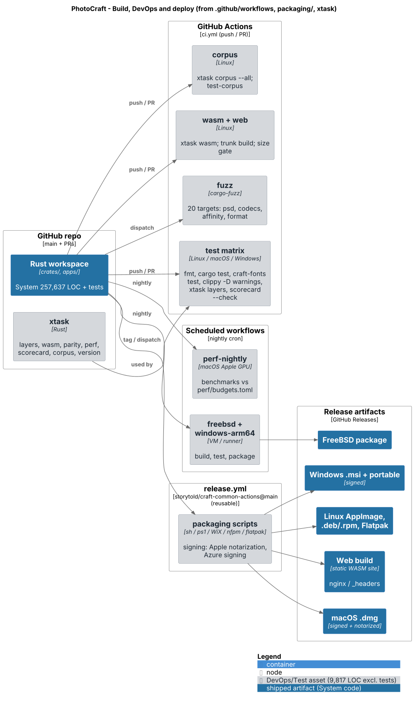

# PhotoCraft - Codebase Cartography Audit

Workspace audited: `jeffreypalermo/photocraft-study` at commit `366002f` (2026-10-14), Rust workspace of 25 library crates, 3 apps and `xtask`.
Produced with the `codebase-cartography-audit` skill (PhotoCraft edition, `.claude/skills/codebase-cartography-audit/`).

**Scope of this edition.** Inventory, metrics, function-point sizing, economic valuation, test-suite analysis and six architecture diagrams.
At the requester's direction, **the duplication scan (jscpd) and the defect/code-smell findings (report sections 5 and 7: prioritized findings and refactoring backlog) were not produced.**
Every number below comes from a recorded command; nothing is hand-counted.

## 1. How to reproduce

| Tool | Version | Obtained by |
|---|---|---|
| scc | 3.5.0 | `go install github.com/boyter/scc/v3@v3.5.0` |
| rustc / clippy | 1.97.0 / 0.1.97 | rustup toolchain in the container |
| PlantUML | 1.2025.4 (bundled C4 stdlib) | release jar, run with the preinstalled JRE |
| Graphviz | 2.43.0 | `apt-get install graphviz` |
| `metrics`, `testlist`, `fpcount`, `sizing` | skill helpers | std-only Rust, compiled with `rustc` by `scripts/setup-tools.sh` |

```sh
.claude/skills/codebase-cartography-audit/scripts/setup-tools.sh
SKIP_JSCPD=1 .claude/skills/codebase-cartography-audit/scripts/measure.sh . codebase-audit-report
cargo run -q -p photocraft-cli -- commands --json > codebase-audit-report/metrics/commands.json
~/.cache/cartography/bin/fpcount metrics/commands.json > metrics/fp-transactions.md
~/.cache/cartography/bin/sizing metrics/sizing-inputs.txt metrics/category-language.tsv > metrics/sizing.md
java -jar ~/.local/share/plantuml/plantuml.jar -tpng -o ../images diagrams/*.puml
```

Every command actually run is logged in [`metrics/commands.txt`](metrics/commands.txt); versions in [`metrics/versions.txt`](metrics/versions.txt).
Builds used `CARGO_TARGET_DIR=target/agent-audit` without debuginfo (a default debug build exceeded the container's disk allowance).
Test counts use default features: the opt-in `corpus` feature tests and fuzz targets are not in the counts. Clippy ran on non-test code only (no `--all-targets`); `metrics/clippy.jsonl.gz` is the raw output.

## 2. Executive summary

- **Size.** 479,201 physical code lines in the repo; **257,637 System** (shipped product) and **205,552 DevOps/Test** (tests, xtask, CI, packaging), plus 16,012 excluded non-code/generated lines. The test and tooling estate is 44% of authored code; unit tests kept inline in `src/` (`#[cfg(test)]` modules) are counted there, not in System.
- **Functional size and value.** **3,899 System function points** (IFPUG AFP: 907 registry commands -> 824 EI, 43 EQ, 28 EO; 10 ILF; 11 EIF; VAF 1.03), within 7.5% of an independent Jones backfiring estimate (3,605 FP). Full-lifecycle **replacement cost $9.0M-$10.6M** (554 staff-months at 7 FP/staff-month), or $1.7M-$2.0M for an elite coding-centric team.
- **Architecture.** `cargo xtask layers` passes: 29 crates, **no layering violations**. All four clients (desktop, CLI, web, MCP) reach behaviour through `engine`'s command registry. Allowed but notable: `ui-egui` also depends directly on `io`, `gpu`, `algo`, `paint` and other L2-L4 crates (red edges in the dependency view), so the UI is not limited to the engine seam.
- **Complexity concentration.** `ui-egui` (82,376 LOC, CC 20,699) and `engine` (56,306 LOC, CC 12,308) hold 54% of System code and 54% of its cyclomatic complexity. The five most complex files are all in those two crates; `canvas.rs` alone has CC 1,434. Clippy's pedantic `too_many_lines` flags 194 functions over 100 lines.
- **Never-crash rule.** In non-test code clippy finds 0 `unwrap`, 1 `expect`, 1 `panic!`, but **7,765 unchecked index/slice operations** (`clippy::indexing_slicing`); this is the measurable remainder of the "use `get()` for input-derived indices" rule.
- **Tests.** 8,472 tests in 238 suites, counted by the runner: 89.1% unit, 8.8% integration, 2.1% acceptance. A healthy pyramid, not an ice-cream cone; every crate has tests.

## 3. Architecture diagrams

All six PNGs were opened and visually inspected after rendering. Verdicts are in section 8.

### 3.1 Logical view


Crates grouped by the project's own L0-L6 layers. `engine` (L5) is the single application seam: the desktop app, web build, MCP server and CLI all dispatch commands to it. The domain core is `doc` (pure data, L1) with L2 services (algo, paint, text, vector, ops) around it; file formats and rendering sit in L0 and L3-L4. DevOps/Test code is in its own boundary.

### 3.2 Logical view annotated with LOC and cyclomatic complexity


Box numbers come from `metrics/component-rollup.txt` (System code, inline tests removed). Red boxes (CC > 5,000) are `ui-egui`, `engine` and `algo`: together 171,797 LOC and CC 40,886, i.e. 67% of System LOC and complexity. The L0-L1 core is comparatively small (`doc` 2,997 LOC, CC 558).

### 3.3 Runtime view


One desktop process hosts the egui shell, the in-process Session/command registry, the TCP control server (`--control`) and sandboxed WASM plug-ins, and talks to the GPU through wgpu. Agents reach the same commands three ways: TCP JSON, MCP over stdio, or the CLI. The browser build runs the same engine and UI on WebGPU. Persistent state lives only in files (PSD/PSB, `.pcraft` with atomic saves, flat and raw formats); there is no server or database.

### 3.4 Build-time dependencies


Normal (non-dev) crate dependencies from `cargo metadata`, with repeated edges into the L0 foundation collapsed for readability. All arrows point down the layer stack; there are no cycles (Cargo forbids them) and `cargo xtask layers` reports no violations. Red edges mark L6 crates that depend directly on L2-L4 crates instead of only on `engine`: permitted by the layer rule, but they widen the UI's coupling surface.

### 3.5 Testing view


Suites grouped by layer, with counts from `cargo test -p <pkg> -- --list`. Unit tests dominate (7,550), integration tests (745) concentrate on `io` round trips (374) and GPU/CPU parity (65), and the acceptance layer (177) drives the real app binary, CLI binary, MCP/control channel and headless renders of the egui shell.

### 3.6 Build, DevOps and deploy


`ci.yml` runs on every push/PR: fmt, tests on Linux/macOS/Windows (with and without craft-fonts), clippy `-D warnings`, `xtask layers`, scorecard check, the corpus job, the wasm/web build with a size gate, and 20 fuzz targets on dispatch. Nightly jobs run perf budgets on Apple GPUs and FreeBSD / Windows ARM64 builds. Releases use the shared `storytold/craft-common-actions` workflow (pinned to `@main`), which signs and notarizes macOS, signs Windows, and packages Linux (AppImage, deb/rpm, Flatpak), FreeBSD and the web build.

## 4. Inventory and metrics

### 4.1 Language breakdown (scc, whole repo)

```
Language                 Files     Lines   Blanks  Comments     Code Complexity
───────────────────────────────────────────────────────────────────────────────
Rust                      1306    539017    31242     50788   456987      73021
SVG                        151      2246        5        14     2227          0
Markdown                   102     10752     1968         0     8784          0
TOML                        52      3285      363       218     2704         26
Shell                       16      1291      104       254      933        190
Plain Text                  12      1159      199         0      960          0
YAML                        11       795       56       142      597          0
JSON                         4      3801        0         0     3801          0
Powershell                   3       322       11        54      257         35
Autoconf                     2       311        2         0      309          1
License                      2       198       31         0      167          0
Python                       2       275       18        47      210         21
Docker ignore                1        18        0         0       18          0
Dockerfile                   1        68        3        17       48          6
HTML                         1        30        0         0       30          0
WebGPU Shading Lang…         1      1363       86       141     1136        315
XML                          1        35        0         2       33          0
───────────────────────────────────────────────────────────────────────────────
```

### 4.2 Lines of code: System / DevOps-Test / Total

| Category | LOC | Share of authored | Files | Types | Fns | CC |
|---|--:|--:|--:|--:|--:|--:|
| System | 257,637 | 55.6% | 772 | 1,717 | 13,289 | 61,232 |
| DevOps/Test | 205,552 | 44.4% | 1,113 | 114 | 11,666 | 27,196 |
| **Total (authored)** | **463,189** | 100% | 1,885 | 1,831 | 24,955 | 88,428 |
| Excluded (non-code / generated) | 16,012 | - | | | | |

### 4.3 Per-component rollup, reconciliation, excluded bucket, largest and most complex files

Verbatim output of `metrics` ([`metrics/component-rollup.txt`](metrics/component-rollup.txt)). Rust CC is extended (CC2-style) McCabe: `max(fns,1) + if/while/for + match arms beyond the first + binary &&/||`; `?` early returns are counted separately; `=>` arms inside `macro_rules!` are included (small overstatement). "Types" counts `struct`/`enum`/`trait` (Rust has no classes), so CC per fn is the more telling ratio.

#### Per-component rollup (Rust CC = extended McCabe; other languages = scc proxy)

| Component | Category | Files | LOC | Types | Fns | CC | CC/type | CC/fn | Density | `?` | Hottest file (CC) |
|---|---|--:|--:|--:|--:|--:|--:|--:|--:|--:|---|
| crates/ui-egui | System | 229 | 82,376 | 424 | 4,082 | 20,699 | 48.8 | 5.07 | 0.251 | 1,463 | crates/ui-egui/src/canvas.rs (1,434) |
| crates/engine | System | 136 | 56,306 | 210 | 3,059 | 12,308 | 58.6 | 4.02 | 0.219 | 4,128 | crates/engine/src/atn_cmds.rs (774) |
| crates/algo | System | 107 | 33,115 | 235 | 1,361 | 7,879 | 33.5 | 5.79 | 0.238 | 661 | crates/algo/src/inpaint.rs (435) |
| crates/io | System | 35 | 13,002 | 51 | 663 | 3,264 | 64.0 | 4.92 | 0.251 | 971 | crates/io/src/psd_export.rs (394) |
| crates/codecs | System | 36 | 10,325 | 80 | 489 | 2,563 | 32.0 | 5.24 | 0.248 | 696 | crates/codecs/src/codecs/tiff.rs (306) |
| crates/psd | System | 29 | 7,733 | 93 | 516 | 1,746 | 18.8 | 3.38 | 0.226 | 1,082 | crates/psd/src/tiff.rs (345) |
| crates/raw | System | 26 | 7,173 | 66 | 323 | 1,682 | 25.5 | 5.21 | 0.234 | 293 | crates/raw/src/testgen.rs (233) |
| crates/text | System | 16 | 5,749 | 55 | 318 | 1,434 | 26.1 | 4.51 | 0.249 | 149 | crates/text/src/layout.rs (287) |
| crates/compose | System | 14 | 5,419 | 32 | 345 | 1,506 | 47.1 | 4.37 | 0.278 | 15 | crates/compose/src/effects.rs (480) |
| crates/gpu | System | 7 | 5,403 | 39 | 204 | 1,202 | 30.8 | 5.89 | 0.222 | 58 | crates/gpu/src/plan.rs (340) |
| crates/paint | System | 15 | 4,488 | 53 | 229 | 943 | 17.8 | 4.12 | 0.210 | 6 | crates/paint/src/render.rs (261) |
| apps/photocraft | System | 24 | 4,022 | 33 | 232 | 879 | 26.6 | 3.79 | 0.219 | 166 | apps/photocraft/src/screen_color.rs (104) |
| crates/cms | System | 13 | 3,484 | 26 | 191 | 866 | 33.3 | 4.53 | 0.249 | 126 | crates/cms/src/profile.rs (201) |
| crates/doc | System | 15 | 2,997 | 113 | 227 | 558 | 4.9 | 2.46 | 0.186 | 24 | crates/doc/src/lib.rs (185) |
| crates/affinity | System | 12 | 2,837 | 41 | 141 | 705 | 17.2 | 5.00 | 0.249 | 290 | crates/affinity/src/model.rs (121) |
| crates/format | System | 10 | 2,804 | 54 | 231 | 533 | 9.9 | 2.31 | 0.190 | 203 | crates/format/src/store.rs (195) |
| crates/automation | System | 12 | 2,586 | 38 | 163 | 529 | 13.9 | 3.25 | 0.205 | 148 | crates/automation/src/server.rs (146) |
| crates/vector | System | 8 | 2,137 | 13 | 129 | 588 | 45.2 | 4.56 | 0.275 | 24 | crates/vector/src/trace.rs (124) |
| crates/geom | System | 2 | 994 | 9 | 77 | 316 | 35.1 | 4.10 | 0.318 | 0 | crates/geom/src/warp.rs (270) |
| crates/raster | System | 2 | 906 | 7 | 71 | 209 | 29.9 | 2.94 | 0.231 | 21 | crates/raster/src/lib.rs (197) |
| apps/photocraft-web | System | 6 | 886 | 6 | 43 | 167 | 27.8 | 3.88 | 0.188 | 60 | apps/photocraft-web/src/web.rs (78) |
| crates/plugins | System | 5 | 846 | 12 | 50 | 175 | 14.6 | 3.50 | 0.207 | 52 | crates/plugins/src/manifest.rs (71) |
| crates/color | System | 3 | 695 | 7 | 58 | 220 | 31.4 | 3.79 | 0.317 | 4 | crates/color/src/blend.rs (156) |
| apps/photocraft-cli | System | 2 | 530 | 2 | 26 | 95 | 47.5 | 3.65 | 0.179 | 51 | apps/photocraft-cli/src/lib.rs (94) |
| crates/tablet | System | 5 | 443 | 10 | 25 | 82 | 8.2 | 3.28 | 0.185 | 11 | crates/tablet/src/xi.rs (29) |
| crates/ops | System | 2 | 269 | 4 | 27 | 65 | 16.2 | 2.41 | 0.242 | 2 | crates/ops/src/lib.rs (44) |
| crates/heif | System | 1 | 112 | 4 | 9 | 19 | 4.8 | 2.11 | 0.170 | 3 | crates/heif/src/lib.rs (19) |
| **System subtotal** | | **772** | **257,637** | **1,717** | **13,289** | **61,232** | 35.7 | 4.61 | 0.238 | 10,707 | |
| crates/ui-egui (tests) | DevOps/Test | 312 | 75,302 | 33 | 4,278 | 9,061 | 274.6 | 2.12 | 0.120 | 229 | crates/ui-egui/src/panels.rs (232) |
| crates/engine (tests) | DevOps/Test | 198 | 43,983 | 7 | 2,494 | 5,294 | 756.3 | 2.12 | 0.120 | 129 | crates/engine/src/retouch_cmds/tests.rs (305) |
| crates/io (tests) | DevOps/Test | 97 | 15,565 | 8 | 865 | 2,152 | 269.0 | 2.49 | 0.138 | 21 | crates/io/tests/flat.rs (128) |
| crates/algo (tests) | DevOps/Test | 89 | 13,127 | 1 | 694 | 2,645 | 2645.0 | 3.81 | 0.201 | 28 | crates/algo/src/segment/tests.rs (146) |
| crates/codecs (tests) | DevOps/Test | 51 | 8,121 | 12 | 623 | 1,510 | 125.8 | 2.42 | 0.186 | 10 | crates/codecs/tests/deep_exr.rs (136) |
| crates/psd (tests) | DevOps/Test | 48 | 5,981 | 2 | 419 | 848 | 424.0 | 2.02 | 0.142 | 31 | crates/psd/tests/swatch_malformed.rs (105) |
| crates/compose (tests) | DevOps/Test | 18 | 5,402 | 1 | 347 | 812 | 812.0 | 2.34 | 0.150 | 3 | crates/compose/src/tests.rs (332) |
| xtask | DevOps/Test | 12 | 4,393 | 30 | 232 | 832 | 27.7 | 3.59 | 0.189 | 171 | xtask/src/perf.rs (166) |
| crates/raw (tests) | DevOps/Test | 31 | 3,681 | 3 | 235 | 562 | 187.3 | 2.39 | 0.153 | 2 | crates/raw/tests/dng.rs (84) |
| crates/automation (tests) | DevOps/Test | 18 | 3,614 | 4 | 182 | 362 | 90.5 | 1.99 | 0.100 | 2 | crates/automation/tests/mcp.rs (125) |
| crates/gpu (tests) | DevOps/Test | 10 | 3,281 | 1 | 139 | 379 | 379.0 | 2.73 | 0.116 | 19 | crates/gpu/tests/parity.rs (215) |
| crates/text (tests) | DevOps/Test | 18 | 3,155 | 0 | 185 | 424 | 0.0 | 2.29 | 0.134 | 0 | crates/text/src/tests.rs (220) |
| apps/photocraft (tests) | DevOps/Test | 25 | 2,627 | 1 | 186 | 307 | 307.0 | 1.65 | 0.117 | 2 | apps/photocraft/src/services.rs (57) |
| crates/format (tests) | DevOps/Test | 17 | 2,486 | 9 | 167 | 266 | 29.6 | 1.59 | 0.107 | 6 | crates/format/tests/roundtrip.rs (70) |
| crates/paint (tests) | DevOps/Test | 13 | 2,072 | 0 | 124 | 335 | 0.0 | 2.70 | 0.162 | 0 | crates/paint/src/brush_tests.rs (207) |
| devops: packaging/ | DevOps/Test | 24 | 1,776 | 0 | 0 | 244 | 0.0 | 0.00 | 0.137 | 0 | packaging/linux/apprun-test.sh (36) |
| build: Cargo manifests + build.rs | DevOps/Test | 40 | 1,323 | 0 | 15 | 58 | 0.0 | 3.87 | 0.044 | 24 | crates/ui-egui/build.rs (32) |
| devops: scorecard/ | DevOps/Test | 8 | 1,072 | 0 | 0 | 20 | 0.0 | 0.00 | 0.019 | 0 | scorecard/tools.toml (7) |
| crates/cms (tests) | DevOps/Test | 9 | 1,065 | 0 | 64 | 189 | 0.0 | 2.95 | 0.177 | 0 | crates/cms/tests/cms.rs (125) |
| crates/vector (tests) | DevOps/Test | 9 | 1,009 | 0 | 75 | 139 | 0.0 | 1.85 | 0.138 | 0 | crates/vector/src/tests.rs (59) |
| apps/photocraft-cli (tests) | DevOps/Test | 3 | 937 | 0 | 49 | 102 | 0.0 | 2.08 | 0.109 | 0 | apps/photocraft-cli/tests/cli.rs (76) |
| crates/doc (tests) | DevOps/Test | 14 | 829 | 0 | 66 | 91 | 0.0 | 1.38 | 0.110 | 0 | crates/doc/src/lib.rs (32) |
| crates/affinity (tests) | DevOps/Test | 5 | 508 | 0 | 33 | 69 | 0.0 | 2.09 | 0.136 | 1 | crates/affinity/src/tests.rs (49) |
| crates/ops (tests) | DevOps/Test | 2 | 495 | 0 | 21 | 55 | 0.0 | 2.62 | 0.111 | 0 | crates/ops/src/lib.rs (41) |
| crates/raster (tests) | DevOps/Test | 2 | 478 | 0 | 27 | 77 | 0.0 | 2.85 | 0.161 | 0 | crates/raster/src/lib.rs (75) |
| ci: .github | DevOps/Test | 8 | 466 | 0 | 0 | 0 | 0.0 | 0.00 | 0.000 | 0 |  (0) |
| crates/color (tests) | DevOps/Test | 3 | 460 | 0 | 29 | 108 | 0.0 | 3.72 | 0.235 | 0 | crates/color/src/blend.rs (80) |
| devops: perf/ | DevOps/Test | 1 | 451 | 0 | 0 | 1 | 0.0 | 0.00 | 0.002 | 0 | perf/budgets.toml (1) |
| crates/plugins (tests) | DevOps/Test | 4 | 450 | 0 | 26 | 48 | 0.0 | 1.85 | 0.107 | 0 | crates/plugins/tests/abi.rs (31) |
| crates/geom (tests) | DevOps/Test | 2 | 365 | 0 | 24 | 88 | 0.0 | 3.67 | 0.241 | 0 | crates/geom/src/warp.rs (79) |
| crates/tablet (tests) | DevOps/Test | 5 | 302 | 0 | 26 | 43 | 0.0 | 1.65 | 0.142 | 1 | crates/tablet/src/appkit.rs (17) |
| apps/photocraft-web (tests) | DevOps/Test | 2 | 212 | 0 | 13 | 16 | 0.0 | 1.23 | 0.075 | 0 | apps/photocraft-web/src/preset_bridge.rs (14) |
| crates/testkit | DevOps/Test | 3 | 192 | 2 | 19 | 26 | 13.0 | 1.37 | 0.135 | 8 | crates/testkit/src/perf.rs (21) |
| devops: contributors/ | DevOps/Test | 1 | 102 | 0 | 0 | 0 | 0.0 | 0.00 | 0.000 | 0 |  (0) |
| devops: scripts/ | DevOps/Test | 2 | 91 | 0 | 0 | 3 | 0.0 | 0.00 | 0.033 | 0 | scripts/layered_tiff_fixtures.py (3) |
| build: repo root config | DevOps/Test | 4 | 72 | 0 | 0 | 6 | 0.0 | 0.00 | 0.083 | 0 | Dockerfile (6) |
| devops: examples/ | DevOps/Test | 2 | 64 | 0 | 5 | 16 | 0.0 | 3.20 | 0.250 | 0 | examples/plugins/invert-rs/src/lib.rs (16) |
| crates/heif (tests) | DevOps/Test | 1 | 36 | 0 | 4 | 8 | 0.0 | 2.00 | 0.222 | 0 | crates/heif/src/lib.rs (8) |
| devops: .config/ | DevOps/Test | 1 | 5 | 0 | 0 | 0 | 0.0 | 0.00 | 0.000 | 0 |  (0) |
| devops: .cargo/ | DevOps/Test | 1 | 2 | 0 | 0 | 0 | 0.0 | 0.00 | 0.000 | 0 |  (0) |
| **DevOps/Test subtotal** | | **1,113** | **205,552** | **114** | **11,666** | **27,196** | 238.6 | 2.33 | 0.132 | 687 | |
| Excluded: Markdown | Excluded | 102 | 8,784 | 0 | 0 | 0 | 0.0 | 0.00 | 0.000 | 0 |  (0) |
| Excluded: JSON | Excluded | 4 | 3,801 | 0 | 0 | 0 | 0.0 | 0.00 | 0.000 | 0 |  (0) |
| Excluded: SVG | Excluded | 151 | 2,227 | 0 | 0 | 0 | 0.0 | 0.00 | 0.000 | 0 |  (0) |
| Excluded: Plain Text | Excluded | 12 | 960 | 0 | 0 | 0 | 0.0 | 0.00 | 0.000 | 0 |  (0) |
| Excluded: License | Excluded | 2 | 167 | 0 | 0 | 0 | 0.0 | 0.00 | 0.000 | 0 |  (0) |
| Excluded: generated Rust | Excluded | 1 | 46 | 1 | 0 | 1 | 1.0 | 0.00 | 0.022 | 0 | crates/raw/src/tone/tables.rs (1) |
| Excluded: book/ | Excluded | 1 | 27 | 0 | 0 | 0 | 0.0 | 0.00 | 0.000 | 0 |  (0) |
| **Excluded subtotal** | | **273** | **16,012** | **1** | **0** | **1** | 1.0 | 0.00 | 0.000 | 0 | |
| **GRAND TOTAL (System + DevOps/Test)** | | | **463,189** | | | | | | | | |

#### Reconciliation

- Σ(System components) = 257,637 == subtotal 257,637 -> OK
- Σ(DevOps/Test components) = 205,552 == subtotal 205,552 -> OK
- Σ(Excluded components) = 16,012 == subtotal 16,012 -> OK
- Σ(System) + Σ(DevOps/Test) + Σ(Excluded) = 257,637 + 205,552 + 16,012 = 479,201 == scc whole-repo code total 479,201 -> OK
- System / DevOps-Test split: 55.6% / 44.4%

#### Excluded (non-authored / non-code) bucket

- Excluded: JSON: 3,801 LOC - docs/data/assets, not program code
- Excluded: License: 167 LOC - docs/data/assets, not program code
- Excluded: Markdown: 8,784 LOC - docs/data/assets, not program code
- Excluded: Plain Text: 960 LOC - docs/data/assets, not program code
- Excluded: SVG: 2,227 LOC - docs/data/assets, not program code
- Excluded: book/: 27 LOC - documentation sources
- Excluded: generated Rust: 46 LOC - header marks file as generated

#### LOC by category and language (backfiring input)

| Category | Language | LOC |
|---|---|--:|
| DevOps/Test | Autoconf | 309 |
| DevOps/Test | Docker ignore | 18 |
| DevOps/Test | Dockerfile | 48 |
| DevOps/Test | Powershell | 257 |
| DevOps/Test | Python | 210 |
| DevOps/Test | Rust | 200,478 |
| DevOps/Test | Shell | 933 |
| DevOps/Test | TOML | 2,669 |
| DevOps/Test | XML | 33 |
| DevOps/Test | YAML | 597 |
| Excluded | JSON | 3,801 |
| Excluded | License | 167 |
| Excluded | Markdown | 8,784 |
| Excluded | Plain Text | 960 |
| Excluded | Rust | 46 |
| Excluded | SVG | 2,227 |
| Excluded | TOML | 27 |
| System | HTML | 30 |
| System | Rust | 256,463 |
| System | TOML | 8 |
| System | WebGPU Shading Language | 1,136 |

#### Files over 2,000 code LOC (confirm each is authored source)

- crates/ui-egui/src/canvas.rs: 6,635 LOC (System)
- crates/ui-egui/src/panels.rs: 5,197 LOC (System)
- crates/ui-egui/src/transform_tool.rs: 4,115 LOC (System)
- crates/engine/src/atn_cmds.rs: 2,910 LOC (System)
- crates/ui-egui/src/prefs_ui.rs: 2,896 LOC (System)
- crates/ui-egui/src/control.rs: 2,607 LOC (System)
- crates/ui-egui/src/type_tool.rs: 2,598 LOC (System)
- contributors/contributors.json: 2,578 LOC (Excluded)
- crates/compose/src/effects.rs: 2,550 LOC (System)
- crates/compose/src/tests.rs: 2,251 LOC (DevOps/Test)
- crates/ui-egui/src/filter_dialog.rs: 2,249 LOC (System)
- crates/engine/src/layer_multi_cmds.rs: 2,245 LOC (System)
- crates/ui-egui/src/vector_ui.rs: 2,239 LOC (System)
- crates/ui-egui/src/lib.rs: 2,196 LOC (System)
- crates/gpu/tests/parity.rs: 2,146 LOC (DevOps/Test)
- crates/gpu/src/lib.rs: 2,103 LOC (System)
- crates/psd/src/tiff.rs: 2,031 LOC (System)
- crates/ui-egui/src/widgets.rs: 2,028 LOC (System)
- crates/algo/src/inpaint.rs: 2,007 LOC (System)

#### Top 15 most complex Rust files (System + DevOps/Test; inline tests removed from System files)

| # | File | CC | LOC | Density |
|--:|---|--:|--:|--:|
| 1 | crates/ui-egui/src/canvas.rs | 1,434 | 4,666 | 0.307 |
| 2 | crates/ui-egui/src/panels.rs | 896 | 3,368 | 0.266 |
| 3 | crates/engine/src/atn_cmds.rs | 774 | 2,910 | 0.266 |
| 4 | crates/ui-egui/src/transform_tool.rs | 652 | 2,434 | 0.268 |
| 5 | crates/ui-egui/src/type_tool.rs | 566 | 2,369 | 0.239 |
| 6 | crates/compose/src/effects.rs | 480 | 1,732 | 0.277 |
| 7 | crates/ui-egui/src/menus.rs | 480 | 1,325 | 0.362 |
| 8 | crates/ui-egui/src/prefs_ui.rs | 467 | 1,749 | 0.267 |
| 9 | crates/algo/src/inpaint.rs | 435 | 1,625 | 0.268 |
| 10 | crates/ui-egui/src/vector_ui.rs | 420 | 1,564 | 0.269 |
| 11 | crates/engine/src/layer_multi_cmds.rs | 410 | 1,223 | 0.335 |
| 12 | crates/engine/src/channel_cmds.rs | 398 | 1,615 | 0.246 |
| 13 | crates/io/src/psd_export.rs | 394 | 1,473 | 0.267 |
| 14 | crates/compose/src/lib.rs | 385 | 1,381 | 0.279 |
| 15 | crates/engine/src/vector_cmds.rs | 371 | 1,703 | 0.218 |

### 4.4 Clippy (non-test code, pedantic + never-crash restriction lints)

25,244 warnings across 73 lints. Top 20 by count ([`metrics/clippy-by-lint.txt`](metrics/clippy-by-lint.txt)):

| Lint | Count |
|---|--:|
| `clippy::indexing_slicing` | 7765 |
| `clippy::cast_possible_truncation` | 3483 |
| `clippy::must_use_candidate` | 2441 |
| `clippy::cast_precision_loss` | 2179 |
| `clippy::many_single_char_names` | 1696 |
| `clippy::cast_sign_loss` | 1639 |
| `clippy::cast_possible_wrap` | 1079 |
| `clippy::cast_lossless` | 793 |
| `clippy::doc_markdown` | 632 |
| `clippy::missing_errors_doc` | 595 |
| `clippy::needless_raw_string_hashes` | 536 |
| `clippy::redundant_closure_for_method_calls` | 238 |
| `clippy::unreadable_literal` | 218 |
| `clippy::too_many_lines` | 194 |
| `clippy::float_cmp` | 191 |
| `clippy::default_trait_access` | 142 |
| `clippy::map_unwrap_or` | 138 |
| `clippy::manual_midpoint` | 130 |
| `clippy::single_match_else` | 119 |
| `clippy::assigning_clones` | 88 |

Never-crash restriction lints: `indexing_slicing` 7,765; `expect_used` 1; `panic` 1; `unwrap_used`, `todo`, `unimplemented`, `unreachable`: 0. The project's CI runs clippy with default lints (`-D warnings`), which is clean; the counts above come from the stricter lint set enabled only for this audit.

### 4.5 Duplication

Not measured in this edition (jscpd skipped at the requester's direction).

### 4.6 Function points

Transaction counts come from the command registry via `fpcount` ([`metrics/fp-transactions.md`](metrics/fp-transactions.md)); data functions, GSCs and ratios are analyst inputs with their basis in [`metrics/sizing-inputs.txt`](metrics/sizing-inputs.txt). The tables are the verbatim output of `sizing` ([`metrics/sizing.md`](metrics/sizing.md)).

#### Transaction functions from the command registry

Registry commands: 907; after collapsing parameter-only families: 895.

| Type | Count | Rule |
|---|--:|---|
| EI | 824 | every state-changing command not matched below |
| EQ | 43 | last segment info/list/get/inspect/printers/browse, `*Info`, `list*` |
| EO | 28 | export, print, saveACopy, saveContents, presets/actions save, package, contactSheet, renderVideo, imageAssets |

Collapsed: trailing `More`, `slotN`, `bits8/16/32` variants count once.

| Command prefix | EI | EQ | EO |
|---|--:|--:|--:|
| actions | 14 | 2 | 1 |
| brush | 11 | 2 | 1 |
| channel | 15 | 1 | 0 |
| cloneSource | 4 | 1 | 0 |
| color | 1 | 0 | 0 |
| command | 0 | 1 | 0 |
| count | 7 | 0 | 0 |
| document | 6 | 4 | 1 |
| edit | 76 | 1 | 2 |
| file | 32 | 3 | 17 |
| filter | 122 | 0 | 0 |
| gradient | 10 | 2 | 0 |
| history | 9 | 0 | 0 |
| image | 61 | 2 | 0 |
| jobs | 1 | 1 | 0 |
| layer | 210 | 1 | 3 |
| layerComp | 12 | 1 | 0 |
| measurementLog | 1 | 1 | 1 |
| notes | 3 | 1 | 0 |
| paint | 26 | 0 | 0 |
| path | 19 | 2 | 0 |
| pattern | 7 | 2 | 1 |
| plugin | 4 | 1 | 0 |
| prefs | 2 | 1 | 0 |
| select | 35 | 0 | 0 |
| session | 0 | 1 | 0 |
| shape | 7 | 2 | 0 |
| slice | 6 | 1 | 0 |
| style | 4 | 1 | 0 |
| swatches | 10 | 1 | 1 |
| timeline | 6 | 1 | 0 |
| tool | 4 | 1 | 0 |
| tools | 9 | 0 | 0 |
| type | 61 | 3 | 0 |
| variables | 0 | 1 | 0 |
| view | 29 | 1 | 0 |


#### IFPUG function-type table (System)

| Type | Name | Count | Complexity | Weight | FP | Basis |
|---|---|--:|---|--:|--:|---|
| EI | External Input | 824 | average | 4 | 3,296 | state-changing engine commands from the registry (907 commands, 12 parameter-only variants collapsed); see fp-transactions.md |
| EO | External Output | 28 | average | 5 | 140 | export, print, save-a-copy, preset/action save, package, contact sheet, render video, image assets; listed in fp-transactions.md |
| EQ | External Inquiry | 43 | average | 4 | 172 | read-only registry commands (info / list / get / inspect / printers / browse); listed in fp-transactions.md |
| ILF | Internal Logical File | 10 | average | 10 | 100 | logical files maintained: document (.pcraft incl. layers/channels/paths/history), preferences, shortcuts+workspaces, brush presets, swatches, gradients, patterns, layer styles, actions, tool/document/shape presets |
| EIF | External Interface File | 11 | average | 7 | 77 | logical groups read from elsewhere: PSD/PSB, flat raster codecs, HDR (EXR/DPX), camera raw/DNG, HEIF, Affinity, Krita/OpenRaster, Photoshop preset files (ABR/ASE/ACO/GRD/PAT/ATN/ASL), ICC profiles, fonts, plug-ins |
| **UFP** | | | | | **3,785** | |

#### General System Characteristics

| # | Characteristic | DI (0-5) | Justification |
|--:|---|--:|---|
| 1 | Data communications | 2 | Data communications: local TCP control channel and MCP over stdio; no network service |
| 2 | Distributed data processing | 1 | Distributed data processing: none beyond sandboxed in-process WASM plug-ins |
| 3 | Performance | 4 | Performance: explicit budgets (perf/budgets.toml), 24-36 MP targets, GPU compositor, nightly perf runs |
| 4 | Heavily used configuration | 2 | Heavily used configuration: runs on the user's own machine; varied GPUs handled by wgpu |
| 5 | Transaction rate | 1 | Transaction rate: single-user interactive editing |
| 6 | Online data entry | 3 | Online data entry: all editing is interactive (dialogs, tools, canvas) |
| 7 | End-user efficiency | 4 | End-user efficiency: Photoshop-parity menus, shortcuts, panels, command palette are a stated goal |
| 8 | Online update | 3 | Online update: interactive updates of the document ILF with undo and atomic saves |
| 9 | Complex processing | 4 | Complex processing: imaging algorithms, ICC colour management, compositing, type layout (rated 4, not 5) |
| 10 | Reusability | 3 | Reusability: psd, codecs, cms are designed as publishable standalone crates |
| 11 | Installation ease | 3 | Installation ease: signed installers for macOS, Windows, Linux, FreeBSD, plus a web build |
| 12 | Operational ease | 2 | Operational ease: autosave and recovery; no operator role |
| 13 | Multiple sites | 3 | Multiple sites: five platforms incl. browser from one codebase |
| 14 | Facilitate change | 3 | Facilitate change: data-driven command registry, preferences, actions/scripting |
| | **ΣGSC** | **38** | |

VAF = 0.65 + 0.01 x 38 = **1.03**; AFP = UFP x VAF = 3,785 x 1.03 = **3,899**

System FP carried into the valuation: **3,899** (AFP).

#### Backfiring - System

| Language | Physical LOC | LOC/FP | FP (raw physical) | FP (/ 1.3 physical->logical) | Ratio source |
|---|--:|--:|--:|--:|---|
| HTML | 30 | 40 | 1 | 1 | analyst-assumed markup ratio |
| Rust | 256,463 | 55 | 4,663 | 3,587 | analyst-assumed: no SPR/QSM ratio for Rust; nearest SPR peers C++ 55, Java 53 |
| TOML | 8 | 50 | 0 | 0 | analyst-assumed for TOML/YAML/shell/PowerShell/Python/other build assets |
| WebGPU Shading Language | 1,136 | 50 | 23 | 17 | analyst-assumed shader ratio |
| **System total** | **257,637** | | **4,687** | **3,605** | |

Sensitivity band (physical->logical 1.5 .. 1.0): 3,124 .. 4,687 FP; point estimate 3,605 FP.

#### Backfiring - DevOps/Test

| Language | Physical LOC | LOC/FP | FP (raw physical) | FP (/ 1.3 physical->logical) | Ratio source |
|---|--:|--:|--:|--:|---|
| Autoconf | 309 | 50 | 6 | 5 | analyst-assumed for TOML/YAML/shell/PowerShell/Python/other build assets |
| Docker ignore | 18 | 50 | 0 | 0 | analyst-assumed for TOML/YAML/shell/PowerShell/Python/other build assets |
| Dockerfile | 48 | 50 | 1 | 1 | analyst-assumed for TOML/YAML/shell/PowerShell/Python/other build assets |
| Powershell | 257 | 50 | 5 | 4 | analyst-assumed for TOML/YAML/shell/PowerShell/Python/other build assets |
| Python | 210 | 50 | 4 | 3 | analyst-assumed for TOML/YAML/shell/PowerShell/Python/other build assets |
| Rust | 200,478 | 55 | 3,645 | 2,804 | analyst-assumed: no SPR/QSM ratio for Rust; nearest SPR peers C++ 55, Java 53 |
| Shell | 933 | 50 | 19 | 14 | analyst-assumed for TOML/YAML/shell/PowerShell/Python/other build assets |
| TOML | 2,669 | 50 | 53 | 41 | analyst-assumed for TOML/YAML/shell/PowerShell/Python/other build assets |
| XML | 33 | 50 | 1 | 1 | analyst-assumed for TOML/YAML/shell/PowerShell/Python/other build assets |
| YAML | 597 | 50 | 12 | 9 | analyst-assumed for TOML/YAML/shell/PowerShell/Python/other build assets |
| **DevOps/Test total** | **205,552** | | **3,747** | **2,882** | |

Sensitivity band (physical->logical 1.5 .. 1.0): 2,498 .. 3,747 FP; point estimate 2,882 FP.

#### System reconciliation (IFPUG vs backfiring)

| Method | System FP |
|---|--:|
| IFPUG (AFP) | 3,899 |
| Backfiring (point) | 3,605 |
| Divergence | -7.5% |
| Verdict (±30%) | agree |

System physical LOC per IFPUG FP: 66

#### Function points: subtotals and total

| Category | Method | FP | Share |
|---|---|--:|--:|
| System | IFPUG AFP | 3,899 | 57.5% |
| DevOps/Test | backfired equivalent FP | 2,882 | 42.5% |
| **Total** | | **6,780** | 100% |


Notes: the IFPUG count weights every function at average complexity. ILF and EIF are counted as logical files (the whole document model is one ILF; the flat raster codecs form one EIF group), not per struct or per format. Rust has no published SPR/QSM LOC-per-FP ratio; 55 is an analyst assumption (C++ 55, Java 53), so the backfiring band above should be read as approximate. The two methods agree within 7.5%, which is consistency, not proof.

### 4.7 Economic valuation (effort, cost, schedule)

Salary sources: the three searches below gave the figures in the table. Two are secondary citations and one is from a non-official mirror, as each row notes; verify against bls.gov, payscale.com and salary.com before quoting externally. Sources: [BLS OOH software developers](https://www.bls.gov/ooh/computer-and-information-technology/software-developers.htm), [Scaler salary guide citing BLS and PayScale](https://www.scaler.com/topics/software-engineer-salary-in-us/), [PayScale Software Engineer III](https://www.payscale.com/research/US/Job=Software_Engineer_III/Salary).

#### Salary inputs

| Source | Annual base (USD) | Note |
|---|--:|---|
| bls | $133,080 | US BLS Occupational Outlook Handbook, software developers median annual wage May 2024 (cited via scaler.com; secondary sites report $135,980 for May 2025), accessed 2026-10-14 |
| payscale | $98,101 | PayScale software engineer average base pay, self-reported (cited via scaler.com; not verified on payscale.com), accessed 2026-10-14 |
| salarycom | $128,709 | Salary.com Software Engineer III US median, Oct 2025 (from a non-official mirror of the Salary.com page), accessed 2026-10-14 |

Blended median base = median of the sources = **$128,709**; burden 1.5x-1.75x; fully-loaded day rate = base x burden / 260 = **$743 - $866**.

#### Effort by productivity band

| FP/man-day | ~FP/staff-month | Level | ~System LOC/man-day | System man-months | DevOps/Test man-months | Total man-months (coding-centric) |
|--:|--:|---|--:|--:|--:|--:|
| 0.32 | 7 | Jones full-lifecycle baseline (headline) | 21 | 554 | n/a (in System) | n/a (in System) |
| 0.5 | 11 | below baseline (large / high-ceremony) | 33 | 354 | 262 | 616 |
| 1 | 22 | coding-centric / well-run | 66 | 177 | 131 | 308 |
| 2 | 44 | high-performing small team | 132 | 89 | 65 | 154 |
| 3 | 66 | elite / best-in-class | 198 | 59 | 44 | 103 |

#### Cost by productivity band (fully-loaded, burden 1.5x - 1.75x)

| FP/man-day | System | DevOps/Test | Total (coding-centric) |
|--:|---|---|---|
| 0.32 | $9,046,487 - $10,554,235 | n/a (in System) | n/a (in System) |
| 0.5 | $5,789,752 - $6,754,710 | $4,279,995 - $4,993,327 | $10,069,746 - $11,748,037 |
| 1 | $2,894,876 - $3,377,355 | $2,139,997 - $2,496,663 | $5,034,873 - $5,874,019 |
| 2 | $1,447,438 - $1,688,678 | $1,069,999 - $1,248,332 | $2,517,437 - $2,937,009 |
| 3 | $964,959 - $1,125,785 | $713,332 - $832,221 | $1,678,291 - $1,958,006 |

**Headline (System, full-lifecycle 0.32 FP/day): $9,046,487 - $10,554,235.** Coding-centric best case (System + DevOps/Test at 3 FP/day): $1,678,291 - $1,958,006. Range across all System bands: $964,959 - $10,554,235.

#### Schedule sanity check

| Quantity | Value |
|---|--:|
| System FP | 3,899 |
| Exponent (mid-to-large commercial desktop product (Jones: ~0.4 mid-sized, ~0.45 large systems)) | 0.42 |
| Calendar months = FP^exp | 32.2 |
| Staff-months at 0.32 FP/day | 554 |
| Implied average team | 17.2 |

Replacement cost, not market value; order-of-magnitude only. Productivity: Capers Jones, "Software Economics and Function Point Metrics" (IFPUG, 2017) for ~7 FP/staff-month full lifecycle; Steve McConnell, "Software Estimation" (2006) for the 10x productivity spread.

Reading: the **headline replacement cost is the System full-lifecycle figure, $9.0M-$10.6M** (3,899 FP / 0.32 FP per day = 12,184 staff-days = 554 staff-months). It already includes writing the system's tests, so DevOps/Test is not added at that rate. The coding-centric rows price System and DevOps/Test as separate bodies of code; their Total is not a lifecycle cost. The implied team of about 17 people for 32 months is a plausible shape for a product of this size. This is replacement cost, not market value.

## 5. Prioritized findings

Not produced in this edition (defect and code-smell findings were excluded at the requester's direction).

## 6. Testing assessment

#### Pyramid

| Layer | Suites | Tests | Share |
|---|--:|--:|--:|
| unit | 111 | 7550 | 89.1% |
| integration | 97 | 745 | 8.8% |
| acceptance | 30 | 177 | 2.1% |
| **Total** | | **8472** | |

- **Shape:** a proper pyramid (89 / 9 / 2), not an ice-cream cone or hourglass.
- **Coverage follows size:** the two largest and most complex crates have the most tests: `ui-egui` 2,808 tests (2,708 unit, 98 acceptance, 2 integration) and `engine` 1,794 (1,736 unit, 58 integration). Their test code (119,285 LOC) is 86% of their System LOC (138,682). The test counts don't show whether the most complex functions are covered; no coverage tool was run.
- **Seams:** file formats have integration tests (`io` 374, `format` 82, `psd` 59, `codecs` 44), GPU parity against the CPU oracle has 65, plug-in ABI has 14, and the control/MCP channel and both binaries have acceptance tests (79 combined).
- **Not in these counts:** the `corpus`-feature real-file tests, 20 `cargo-fuzz` targets, ignored tests such as `panic_hunt` (listed under "of which #[ignore]" in the matrix), and perf budgets.
- **Classification check:** layers are assigned by evidence in each suite's source (`CARGO_BIN_EXE_`, `TcpStream`, `--control`, wgpu, filesystem, `photocraft_io`). `automation/tests/mcp.rs` was labelled acceptance because its source contains `--control`; this was not verified by hand, and suites like it could be misfiled either way.

The full suite matrix (238 suites) is in Appendix A.

## 7. Refactoring backlog

Not produced in this edition (it depends on the findings in section 5).

## 8. Self-check

| Item | Present |
|---|---|
| 5-row IFPUG function-type table | yes (4.6) |
| 14-row GSC table + VAF math | yes (4.6) |
| Per-category backfiring tables | yes (4.6: System, DevOps/Test) |
| `Σ(components) == subtotal` reconciliation + Excluded bucket | yes (4.3: all OK, 479,201 == scc total) |
| Per-band cost table, 0.32 row "n/a (in System)" | yes (4.7) |
| System / DevOps-Test / Total for LOC, FP, cost | yes (4.2, 4.6, 4.7) |
| Diagram legibility, each PNG opened | 01-logical: pass. 01-logical-annotated: pass. 02-runtime: pass (one edge crosses the boundary title, still readable). 03-dependencies: pass. 04-testing: pass after fixing a title that rendered `--` wrongly. 05-deploy: failed first render (white text on grey), fixed font colour, pass. In every diagram the two legend symbols render as small empty boxes (a known PlantUML C4 quirk, cosmetic). |
| Duplication, findings, backlog | not produced (out of scope by request) |

## Appendix A. Test-suite matrix (verbatim `testlist` output)

#### Test-suite matrix (counts from `cargo test -- --list`)

| Package | Suite | Kind | Tests | of which #[ignore] | Layer | Deciding signal |
|---|---|---|--:|--:|---|---|
| photocraft | src/main.rs | in-crate | 128 | 1 | unit | in-crate #[cfg(test)] modules |
| photocraft | tests/control_exit_code.rs | test target | 4 | 0 | acceptance | spawns the built app binary (`CARGO_BIN_EXE_`) |
| photocraft | tests/startup_without_display.rs | test target | 2 | 0 | acceptance | spawns the built app binary (`CARGO_BIN_EXE_`) |
| photocraft-affinity | src/lib.rs | in-crate | 20 | 0 | unit | in-crate #[cfg(test)] modules |
| photocraft-affinity | tests/real_files.rs | test target | 2 | 0 | integration | real-file corpus (`corpus`) |
| photocraft-algo | src/lib.rs | in-crate | 570 | 22 | unit | in-crate #[cfg(test)] modules |
| photocraft-algo | tests/retouch_blur_exact.rs | test target | 2 | 0 | unit | pure in-memory API calls (no I/O, GPU or process signal) |
| photocraft-automation | src/lib.rs | in-crate | 68 | 0 | unit | in-crate #[cfg(test)] modules |
| photocraft-automation | tests/agent_tasks.rs | test target | 5 | 0 | integration | filesystem I/O (`std::fs`) |
| photocraft-automation | tests/agent_tasks_more.rs | test target | 1 | 0 | integration | filesystem I/O (`std::fs`) |
| photocraft-automation | tests/bridge.rs | test target | 3 | 0 | acceptance | drives the TCP control channel (`TcpStream`) |
| photocraft-automation | tests/inactive_save.rs | test target | 1 | 0 | integration | filesystem I/O (`std::fs`) |
| photocraft-automation | tests/krita.rs | test target | 1 | 0 | integration | filesystem I/O (`std::fs`) |
| photocraft-automation | tests/layered_save_dirty.rs | test target | 2 | 0 | integration | filesystem I/O (`std::fs`) |
| photocraft-automation | tests/mcp.rs | test target | 40 | 0 | acceptance | launches the app with --control (`--control`) |
| photocraft-automation | tests/mcp_wire.rs | test target | 2 | 0 | integration | filesystem I/O (`std::fs`) |
| photocraft-automation | tests/missing_font_warnings.rs | test target | 1 | 0 | integration | filesystem I/O (`std::fs`) |
| photocraft-automation | tests/native_save_name.rs | test target | 2 | 0 | integration | filesystem I/O (`std::fs`) |
| photocraft-automation | tests/openraster.rs | test target | 3 | 0 | integration | filesystem I/O (`std::fs`) |
| photocraft-cli | src/lib.rs | in-crate | 4 | 0 | unit | in-crate #[cfg(test)] modules |
| photocraft-cli | tests/cli.rs | test target | 29 | 0 | acceptance | spawns the built app binary (`CARGO_BIN_EXE_`) |
| photocraft-cli | tests/orientation.rs | test target | 1 | 0 | acceptance | spawns the built app binary (`CARGO_BIN_EXE_`) |
| photocraft-cms | src/lib.rs | in-crate | 23 | 0 | unit | in-crate #[cfg(test)] modules |
| photocraft-cms | tests/bench.rs | test target | 1 | 1 | unit | pure in-memory API calls (no I/O, GPU or process signal) |
| photocraft-cms | tests/cms.rs | test target | 26 | 0 | integration | filesystem I/O (`std::fs`) |
| photocraft-cms | tests/regen.rs | test target | 1 | 0 | integration | filesystem I/O (`std::fs`) |
| photocraft-codecs | src/lib.rs | in-crate | 65 | 0 | unit | in-crate #[cfg(test)] modules |
| photocraft-codecs | tests/camera_raw.rs | test target | 7 | 0 | unit | pure in-memory API calls (no I/O, GPU or process signal) |
| photocraft-codecs | tests/dds.rs | test target | 13 | 0 | unit | pure in-memory API calls (no I/O, GPU or process signal) |
| photocraft-codecs | tests/decode_warnings.rs | test target | 14 | 0 | unit | pure in-memory API calls (no I/O, GPU or process signal) |
| photocraft-codecs | tests/deep_exr.rs | test target | 15 | 0 | integration | real-file corpus (`corpus`) |
| photocraft-codecs | tests/detect_caps.rs | test target | 29 | 0 | unit | pure in-memory API calls (no I/O, GPU or process signal) |
| photocraft-codecs | tests/dpx.rs | test target | 13 | 0 | unit | pure in-memory API calls (no I/O, GPU or process signal) |
| photocraft-codecs | tests/exr_cryptomatte.rs | test target | 13 | 0 | unit | pure in-memory API calls (no I/O, GPU or process signal) |
| photocraft-codecs | tests/exr_multipart.rs | test target | 10 | 0 | unit | pure in-memory API calls (no I/O, GPU or process signal) |
| photocraft-codecs | tests/fidelity.rs | test target | 27 | 0 | unit | pure in-memory API calls (no I/O, GPU or process signal) |
| photocraft-codecs | tests/gif_frames.rs | test target | 10 | 0 | unit | pure in-memory API calls (no I/O, GPU or process signal) |
| photocraft-codecs | tests/limits.rs | test target | 27 | 0 | unit | pure in-memory API calls (no I/O, GPU or process signal) |
| photocraft-codecs | tests/malformed.rs | test target | 14 | 0 | integration | real-file corpus (`corpus`) |
| photocraft-codecs | tests/metadata.rs | test target | 27 | 0 | unit | pure in-memory API calls (no I/O, GPU or process signal) |
| photocraft-codecs | tests/orientation.rs | test target | 20 | 1 | unit | pure in-memory API calls (no I/O, GPU or process signal) |
| photocraft-codecs | tests/pcx.rs | test target | 6 | 0 | unit | pure in-memory API calls (no I/O, GPU or process signal) |
| photocraft-codecs | tests/png_jpeg.rs | test target | 14 | 0 | integration | real-file corpus (`corpus`) |
| photocraft-codecs | tests/pnm_peak_memory.rs | test target | 1 | 0 | integration | filesystem I/O (`std::fs`) |
| photocraft-codecs | tests/resolution.rs | test target | 18 | 0 | unit | pure in-memory API calls (no I/O, GPU or process signal) |
| photocraft-codecs | tests/roundtrip.rs | test target | 348 | 0 | unit | pure in-memory API calls (no I/O, GPU or process signal) |
| photocraft-codecs | tests/source_settings.rs | test target | 5 | 0 | unit | pure in-memory API calls (no I/O, GPU or process signal) |
| photocraft-codecs | tests/tiff_bench.rs | test target | 1 | 1 | unit | pure in-memory API calls (no I/O, GPU or process signal) |
| photocraft-codecs | tests/tiff_exif.rs | test target | 3 | 0 | unit | pure in-memory API calls (no I/O, GPU or process signal) |
| photocraft-codecs | tests/tiff_pages.rs | test target | 20 | 1 | unit | pure in-memory API calls (no I/O, GPU or process signal) |
| photocraft-codecs | tests/tiff_photoshop.rs | test target | 4 | 0 | unit | pure in-memory API calls (no I/O, GPU or process signal) |
| photocraft-codecs | tests/tiff_regressions.rs | test target | 5 | 0 | unit | pure in-memory API calls (no I/O, GPU or process signal) |
| photocraft-codecs | tests/webp_lossy.rs | test target | 8 | 0 | unit | pure in-memory API calls (no I/O, GPU or process signal) |
| photocraft-codecs | tests/xpm.rs | test target | 9 | 0 | unit | pure in-memory API calls (no I/O, GPU or process signal) |
| photocraft-color | src/lib.rs | in-crate | 26 | 0 | unit | in-crate #[cfg(test)] modules |
| photocraft-compose | src/lib.rs | in-crate | 260 | 1 | unit | in-crate #[cfg(test)] modules |
| photocraft-compose | tests/artboard.rs | test target | 3 | 0 | unit | pure in-memory API calls (no I/O, GPU or process signal) |
| photocraft-doc | src/lib.rs | in-crate | 60 | 0 | unit | in-crate #[cfg(test)] modules |
| photocraft-engine | src/lib.rs | in-crate | 1616 | 13 | unit | in-crate #[cfg(test)] modules |
| photocraft-engine | tests/affinity.rs | test target | 4 | 0 | integration | filesystem I/O (`std::fs`) |
| photocraft-engine | tests/background_layer_consistency.rs | test target | 5 | 0 | unit | pure in-memory API calls (no I/O, GPU or process signal) |
| photocraft-engine | tests/brush_smoothing.rs | test target | 3 | 0 | unit | pure in-memory API calls (no I/O, GPU or process signal) |
| photocraft-engine | tests/camera_raw_noise_clamp.rs | test target | 3 | 0 | unit | pure in-memory API calls (no I/O, GPU or process signal) |
| photocraft-engine | tests/close_document.rs | test target | 5 | 0 | unit | pure in-memory API calls (no I/O, GPU or process signal) |
| photocraft-engine | tests/command_lookup.rs | test target | 1 | 0 | unit | pure in-memory API calls (no I/O, GPU or process signal) |
| photocraft-engine | tests/current_affinity_artboards.rs | test target | 1 | 0 | unit | pure in-memory API calls (no I/O, GPU or process signal) |
| photocraft-engine | tests/duplicate_layer_comps.rs | test target | 5 | 0 | unit | pure in-memory API calls (no I/O, GPU or process signal) |
| photocraft-engine | tests/empty_selection_combine.rs | test target | 4 | 0 | unit | pure in-memory API calls (no I/O, GPU or process signal) |
| photocraft-engine | tests/eraser_locked.rs | test target | 6 | 0 | unit | pure in-memory API calls (no I/O, GPU or process signal) |
| photocraft-engine | tests/explicit_layer_target.rs | test target | 2 | 0 | integration | filesystem I/O (`std::fs`) |
| photocraft-engine | tests/fill_lock_transparency.rs | test target | 2 | 0 | unit | pure in-memory API calls (no I/O, GPU or process signal) |
| photocraft-engine | tests/filter_locked.rs | test target | 6 | 0 | unit | pure in-memory API calls (no I/O, GPU or process signal) |
| photocraft-engine | tests/flatten_background.rs | test target | 4 | 0 | unit | pure in-memory API calls (no I/O, GPU or process signal) |
| photocraft-engine | tests/gallery_colours.rs | test target | 2 | 0 | unit | pure in-memory API calls (no I/O, GPU or process signal) |
| photocraft-engine | tests/gauss_small_sigma.rs | test target | 1 | 0 | unit | pure in-memory API calls (no I/O, GPU or process signal) |
| photocraft-engine | tests/guide_layout_limit.rs | test target | 3 | 0 | unit | pure in-memory API calls (no I/O, GPU or process signal) |
| photocraft-engine | tests/guide_layout_preview.rs | test target | 4 | 0 | unit | pure in-memory API calls (no I/O, GPU or process signal) |
| photocraft-engine | tests/hdr_gamma_direction.rs | test target | 1 | 0 | unit | pure in-memory API calls (no I/O, GPU or process signal) |
| photocraft-engine | tests/jpeg_exif_resolution.rs | test target | 1 | 0 | integration | filesystem I/O (`std::fs`) |
| photocraft-engine | tests/keyboard_shortcut_bulk.rs | test target | 2 | 0 | unit | pure in-memory API calls (no I/O, GPU or process signal) |
| photocraft-engine | tests/kra.rs | test target | 1 | 1 | integration | real-file corpus (`corpus`) |
| photocraft-engine | tests/kys_import.rs | test target | 2 | 0 | unit | pure in-memory API calls (no I/O, GPU or process signal) |
| photocraft-engine | tests/layer_delete_last.rs | test target | 4 | 0 | unit | pure in-memory API calls (no I/O, GPU or process signal) |
| photocraft-engine | tests/layer_mask_depth.rs | test target | 3 | 0 | integration | document <-> file I/O crate (`photocraft_io`) |
| photocraft-engine | tests/layer_range_panel_order.rs | test target | 1 | 0 | unit | pure in-memory API calls (no I/O, GPU or process signal) |
| photocraft-engine | tests/live_line_transform.rs | test target | 3 | 0 | unit | pure in-memory API calls (no I/O, GPU or process signal) |
| photocraft-engine | tests/mask_cache_purge.rs | test target | 1 | 0 | unit | pure in-memory API calls (no I/O, GPU or process signal) |
| photocraft-engine | tests/merge_transparent_bounds.rs | test target | 6 | 0 | unit | pure in-memory API calls (no I/O, GPU or process signal) |
| photocraft-engine | tests/panic_hunt.rs | test target | 1 | 1 | unit | pure in-memory API calls (no I/O, GPU or process signal) |
| photocraft-engine | tests/path_blur_speed_clamp.rs | test target | 3 | 0 | unit | pure in-memory API calls (no I/O, GPU or process signal) |
| photocraft-engine | tests/path_transform_target.rs | test target | 2 | 0 | unit | pure in-memory API calls (no I/O, GPU or process signal) |
| photocraft-engine | tests/pdn.rs | test target | 1 | 1 | integration | filesystem I/O (`std::fs`) |
| photocraft-engine | tests/pixel_lock_edits.rs | test target | 3 | 0 | unit | pure in-memory API calls (no I/O, GPU or process signal) |
| photocraft-engine | tests/prefs_usage.rs | test target | 4 | 0 | integration | filesystem I/O (`std::fs`) |
| photocraft-engine | tests/rasterize_psd_reopen.rs | test target | 2 | 0 | integration | real-file corpus (`corpus`) |
| photocraft-engine | tests/rasterize_selected_layers.rs | test target | 6 | 0 | unit | pure in-memory API calls (no I/O, GPU or process signal) |
| photocraft-engine | tests/rendering_preferences.rs | test target | 3 | 0 | unit | pure in-memory API calls (no I/O, GPU or process signal) |
| photocraft-engine | tests/save_keeps_encoding.rs | test target | 4 | 0 | integration | filesystem I/O (`std::fs`) |
| photocraft-engine | tests/selection_layer_commands.rs | test target | 7 | 0 | unit | pure in-memory API calls (no I/O, GPU or process signal) |
| photocraft-engine | tests/smart_clipboard_sources.rs | test target | 10 | 0 | integration | filesystem round trip (`tempfile`) |
| photocraft-engine | tests/smart_duplicates.rs | test target | 5 | 0 | integration | filesystem I/O (`std::fs`) |
| photocraft-engine | tests/smart_filter_canvas_geometry.rs | test target | 3 | 0 | unit | pure in-memory API calls (no I/O, GPU or process signal) |
| photocraft-engine | tests/smart_filter_stages.rs | test target | 1 | 0 | unit | pure in-memory API calls (no I/O, GPU or process signal) |
| photocraft-engine | tests/smart_psd.rs | test target | 11 | 3 | integration | filesystem I/O (`std::fs`) |
| photocraft-engine | tests/svg_smart_object.rs | test target | 2 | 0 | unit | pure in-memory API calls (no I/O, GPU or process signal) |
| photocraft-engine | tests/text_gamma.rs | test target | 1 | 0 | unit | pure in-memory API calls (no I/O, GPU or process signal) |
| photocraft-engine | tests/type_format_targets.rs | test target | 5 | 0 | unit | pure in-memory API calls (no I/O, GPU or process signal) |
| photocraft-engine | tests/undo_keeps_active_layer.rs | test target | 3 | 0 | unit | pure in-memory API calls (no I/O, GPU or process signal) |
| photocraft-engine | tests/unicode_colors.rs | test target | 4 | 0 | unit | pure in-memory API calls (no I/O, GPU or process signal) |
| photocraft-engine | tests/wand_transparent_copy.rs | test target | 1 | 0 | unit | pure in-memory API calls (no I/O, GPU or process signal) |
| photocraft-engine | tests/working_rgb_profile.rs | test target | 10 | 0 | integration | filesystem I/O (`std::fs`) |
| photocraft-format | src/lib.rs | in-crate | 40 | 0 | unit | in-crate #[cfg(test)] modules |
| photocraft-format | tests/analysis.rs | test target | 1 | 0 | unit | pure in-memory API calls (no I/O, GPU or process signal) |
| photocraft-format | tests/autosave.rs | test target | 9 | 0 | integration | filesystem I/O (`std::fs`) |
| photocraft-format | tests/corruption.rs | test target | 24 | 0 | integration | filesystem I/O (`std::fs`) |
| photocraft-format | tests/directory_symlinks.rs | test target | 6 | 0 | integration | filesystem I/O (`std::fs`) |
| photocraft-format | tests/layer_labels.rs | test target | 1 | 0 | unit | pure in-memory API calls (no I/O, GPU or process signal) |
| photocraft-format | tests/roundtrip.rs | test target | 43 | 0 | integration | filesystem I/O (`std::fs`) |
| photocraft-format | tests/smart_contents.rs | test target | 5 | 0 | unit | pure in-memory API calls (no I/O, GPU or process signal) |
| photocraft-geom | src/lib.rs | in-crate | 21 | 0 | unit | in-crate #[cfg(test)] modules |
| photocraft-gpu | src/lib.rs | in-crate | 29 | 0 | unit | in-crate #[cfg(test)] modules |
| photocraft-gpu | tests/device_loss.rs | test target | 10 | 0 | integration | real GPU device (`wgpu::`) |
| photocraft-gpu | tests/parity.rs | test target | 50 | 0 | integration | real GPU device (`wgpu::`) |
| photocraft-gpu | tests/uniform_limits.rs | test target | 4 | 0 | integration | real GPU device (`wgpu::`) |
| photocraft-gpu | tests/vector_mask.rs | test target | 1 | 0 | integration | real GPU device (`wgpu::`) |
| photocraft-heif | src/lib.rs | in-crate | 4 | 0 | unit | in-crate #[cfg(test)] modules |
| photocraft-io | src/lib.rs | in-crate | 192 | 1 | unit | in-crate #[cfg(test)] modules |
| photocraft-io | tests/adjust_blend_roundtrip.rs | test target | 4 | 0 | integration | document <-> file I/O crate (`photocraft_io`) |
| photocraft-io | tests/adjust_warnings.rs | test target | 2 | 0 | integration | document <-> file I/O crate (`photocraft_io`) |
| photocraft-io | tests/affinity.rs | test target | 13 | 0 | integration | document <-> file I/O crate (`photocraft_io`) |
| photocraft-io | tests/affinity_artboards.rs | test target | 3 | 0 | integration | document <-> file I/O crate (`photocraft_io`) |
| photocraft-io | tests/annotations.rs | test target | 3 | 0 | integration | real-file corpus (`corpus`) |
| photocraft-io | tests/artboard_guide_order.rs | test target | 2 | 0 | integration | document <-> file I/O crate (`photocraft_io`) |
| photocraft-io | tests/banded.rs | test target | 4 | 0 | integration | document <-> file I/O crate (`photocraft_io`) |
| photocraft-io | tests/cancel.rs | test target | 3 | 0 | integration | document <-> file I/O crate (`photocraft_io`) |
| photocraft-io | tests/channels.rs | test target | 1 | 0 | integration | document <-> file I/O crate (`photocraft_io`) |
| photocraft-io | tests/cmyk_composite_export.rs | test target | 11 | 0 | integration | document <-> file I/O crate (`photocraft_io`) |
| photocraft-io | tests/color.rs | test target | 6 | 0 | integration | real-file corpus (`corpus`) |
| photocraft-io | tests/composite.rs | test target | 14 | 0 | integration | document <-> file I/O crate (`photocraft_io`) |
| photocraft-io | tests/comps_artboards.rs | test target | 3 | 0 | integration | real-file corpus (`corpus`) |
| photocraft-io | tests/corpus_regressions.rs | test target | 5 | 0 | integration | real-file corpus (`corpus`) |
| photocraft-io | tests/effects_multi.rs | test target | 2 | 0 | integration | document <-> file I/O crate (`photocraft_io`) |
| photocraft-io | tests/exif_resolution.rs | test target | 1 | 0 | integration | document <-> file I/O crate (`photocraft_io`) |
| photocraft-io | tests/export_progress.rs | test target | 3 | 0 | integration | document <-> file I/O crate (`photocraft_io`) |
| photocraft-io | tests/flat.rs | test target | 60 | 0 | integration | document <-> file I/O crate (`photocraft_io`) |
| photocraft-io | tests/gif_frames.rs | test target | 3 | 0 | integration | document <-> file I/O crate (`photocraft_io`) |
| photocraft-io | tests/heif_unsupported.rs | test target | 1 | 0 | integration | document <-> file I/O crate (`photocraft_io`) |
| photocraft-io | tests/krita_corpus.rs | test target | 2 | 2 | integration | real-file corpus (`corpus`) |
| photocraft-io | tests/lab16.rs | test target | 2 | 0 | integration | document <-> file I/O crate (`photocraft_io`) |
| photocraft-io | tests/large_psb.rs | test target | 2 | 1 | integration | document <-> file I/O crate (`photocraft_io`) |
| photocraft-io | tests/layer_labels.rs | test target | 3 | 0 | integration | document <-> file I/O crate (`photocraft_io`) |
| photocraft-io | tests/modes.rs | test target | 3 | 0 | integration | document <-> file I/O crate (`photocraft_io`) |
| photocraft-io | tests/multichannel.rs | test target | 2 | 0 | integration | real-file corpus (`corpus`) |
| photocraft-io | tests/orientation.rs | test target | 4 | 0 | integration | document <-> file I/O crate (`photocraft_io`) |
| photocraft-io | tests/pattern_fill_psd.rs | test target | 2 | 0 | integration | document <-> file I/O crate (`photocraft_io`) |
| photocraft-io | tests/pcraft_manifest_name.rs | test target | 2 | 0 | integration | document <-> file I/O crate (`photocraft_io`) |
| photocraft-io | tests/pdn_corpus.rs | test target | 1 | 1 | integration | real-file corpus (`corpus`) |
| photocraft-io | tests/png_text_metadata.rs | test target | 5 | 0 | integration | document <-> file I/O crate (`photocraft_io`) |
| photocraft-io | tests/psd32_export.rs | test target | 6 | 0 | integration | real-file corpus (`corpus`) |
| photocraft-io | tests/psd_background.rs | test target | 2 | 0 | integration | document <-> file I/O crate (`photocraft_io`) |
| photocraft-io | tests/psd_block_alignment.rs | test target | 1 | 0 | integration | document <-> file I/O crate (`photocraft_io`) |
| photocraft-io | tests/psd_block_layout.rs | test target | 6 | 0 | integration | document <-> file I/O crate (`photocraft_io`) |
| photocraft-io | tests/psd_empty_channels.rs | test target | 1 | 0 | integration | document <-> file I/O crate (`photocraft_io`) |
| photocraft-io | tests/psd_font_identity.rs | test target | 3 | 0 | integration | document <-> file I/O crate (`photocraft_io`) |
| photocraft-io | tests/psd_kerning.rs | test target | 7 | 0 | integration | real-file corpus (`corpus`) |
| photocraft-io | tests/psd_layer_block_length.rs | test target | 1 | 0 | integration | document <-> file I/O crate (`photocraft_io`) |
| photocraft-io | tests/psd_maximize_compatibility.rs | test target | 4 | 0 | integration | document <-> file I/O crate (`photocraft_io`) |
| photocraft-io | tests/psd_roundtrip_bytes.rs | test target | 1 | 0 | integration | real-file corpus (`corpus`) |
| photocraft-io | tests/psd_structure.rs | test target | 35 | 0 | integration | document <-> file I/O crate (`photocraft_io`) |
| photocraft-io | tests/psd_style_sheets.rs | test target | 5 | 0 | integration | document <-> file I/O crate (`photocraft_io`) |
| photocraft-io | tests/psd_thumbnail.rs | test target | 9 | 0 | integration | document <-> file I/O crate (`photocraft_io`) |
| photocraft-io | tests/psd_type_bounds.rs | test target | 6 | 0 | integration | document <-> file I/O crate (`photocraft_io`) |
| photocraft-io | tests/psd_vertical_type.rs | test target | 1 | 0 | integration | document <-> file I/O crate (`photocraft_io`) |
| photocraft-io | tests/raw.rs | test target | 12 | 0 | integration | document <-> file I/O crate (`photocraft_io`) |
| photocraft-io | tests/resolution_axes.rs | test target | 5 | 0 | integration | document <-> file I/O crate (`photocraft_io`) |
| photocraft-io | tests/roundtrip.rs | test target | 37 | 0 | integration | document <-> file I/O crate (`photocraft_io`) |
| photocraft-io | tests/smart_contents_identity.rs | test target | 8 | 0 | integration | document <-> file I/O crate (`photocraft_io`) |
| photocraft-io | tests/svg.rs | test target | 16 | 0 | integration | filesystem I/O (`std::fs`) |
| photocraft-io | tests/text_corpus.rs | test target | 1 | 0 | integration | real-file corpus (`corpus`) |
| photocraft-io | tests/text_styles.rs | test target | 2 | 0 | integration | document <-> file I/O crate (`photocraft_io`) |
| photocraft-io | tests/tiff_layers.rs | test target | 24 | 0 | integration | real-file corpus (`corpus`) |
| photocraft-io | tests/tiff_pages.rs | test target | 2 | 0 | integration | document <-> file I/O crate (`photocraft_io`) |
| photocraft-io | tests/vector.rs | test target | 4 | 0 | integration | real-file corpus (`corpus`) |
| photocraft-io | tests/xmp_export.rs | test target | 3 | 0 | integration | document <-> file I/O crate (`photocraft_io`) |
| photocraft-ops | src/lib.rs | in-crate | 16 | 0 | unit | in-crate #[cfg(test)] modules |
| photocraft-paint | src/lib.rs | in-crate | 103 | 0 | unit | in-crate #[cfg(test)] modules |
| photocraft-plugins | src/lib.rs | in-crate | 5 | 0 | unit | in-crate #[cfg(test)] modules |
| photocraft-plugins | tests/abi.rs | test target | 14 | 0 | integration | embedded real files (`include_bytes!`) |
| photocraft-psd | photocraft_psd | doc-tests | 1 | 0 | unit | rustdoc examples |
| photocraft-psd | src/lib.rs | in-crate | 205 | 0 | unit | in-crate #[cfg(test)] modules |
| photocraft-psd | tests/builder.rs | test target | 27 | 0 | unit | pure in-memory API calls (no I/O, GPU or process signal) |
| photocraft-psd | tests/layer_block_order.rs | test target | 1 | 0 | unit | pure in-memory API calls (no I/O, GPU or process signal) |
| photocraft-psd | tests/malformed.rs | test target | 28 | 0 | unit | pure in-memory API calls (no I/O, GPU or process signal) |
| photocraft-psd | tests/proptests.rs | test target | 28 | 0 | unit | pure in-memory API calls (no I/O, GPU or process signal) |
| photocraft-psd | tests/roundtrip.rs | test target | 59 | 0 | integration | filesystem I/O (`std::fs`) |
| photocraft-psd | tests/swatch_malformed.rs | test target | 30 | 0 | unit | pure in-memory API calls (no I/O, GPU or process signal) |
| photocraft-psd | tests/tree.rs | test target | 15 | 0 | unit | pure in-memory API calls (no I/O, GPU or process signal) |
| photocraft-raster | src/lib.rs | in-crate | 25 | 0 | unit | in-crate #[cfg(test)] modules |
| photocraft-raw | src/lib.rs | in-crate | 86 | 0 | unit | in-crate #[cfg(test)] modules |
| photocraft-raw | tests/cr3.rs | test target | 7 | 0 | unit | pure in-memory API calls (no I/O, GPU or process signal) |
| photocraft-raw | tests/development_limits.rs | test target | 4 | 0 | unit | pure in-memory API calls (no I/O, GPU or process signal) |
| photocraft-raw | tests/dng.rs | test target | 33 | 0 | unit | pure in-memory API calls (no I/O, GPU or process signal) |
| photocraft-raw | tests/hostile.rs | test target | 6 | 0 | unit | pure in-memory API calls (no I/O, GPU or process signal) |
| photocraft-raw | tests/raf.rs | test target | 7 | 0 | unit | pure in-memory API calls (no I/O, GPU or process signal) |
| photocraft-raw | tests/vendor_codecs.rs | test target | 13 | 0 | unit | pure in-memory API calls (no I/O, GPU or process signal) |
| photocraft-raw | tests/vendors.rs | test target | 9 | 0 | unit | pure in-memory API calls (no I/O, GPU or process signal) |
| photocraft-tablet | src/lib.rs | in-crate | 14 | 0 | unit | in-crate #[cfg(test)] modules |
| photocraft-testkit | src/lib.rs | in-crate | 6 | 0 | unit | in-crate #[cfg(test)] modules |
| photocraft-text | src/lib.rs | in-crate | 158 | 4 | unit | in-crate #[cfg(test)] modules |
| photocraft-ui-egui | src/lib.rs | in-crate | 2699 | 12 | unit | in-crate #[cfg(test)] modules |
| photocraft-ui-egui | tests/adjust_preview_gpu.rs | test target | 2 | 0 | integration | real GPU device (`wgpu::`) |
| photocraft-ui-egui | tests/arbitrary_rotation_preview.rs | test target | 2 | 0 | acceptance | renders the egui shell headlessly (`egui_kittest`) |
| photocraft-ui-egui | tests/batch_export_options.rs | test target | 8 | 0 | acceptance | renders the egui shell headlessly (`egui_kittest`) |
| photocraft-ui-egui | tests/camera_raw_histogram.rs | test target | 3 | 0 | acceptance | renders the egui shell headlessly (`egui_kittest`) |
| photocraft-ui-egui | tests/camera_raw_localization.rs | test target | 1 | 0 | acceptance | renders the egui shell headlessly (`egui_kittest`) |
| photocraft-ui-egui | tests/camera_raw_scope.rs | test target | 21 | 0 | acceptance | renders the egui shell headlessly (`egui_kittest`) |
| photocraft-ui-egui | tests/camera_raw_zoom.rs | test target | 6 | 0 | acceptance | renders the egui shell headlessly (`egui_kittest`) |
| photocraft-ui-egui | tests/canvas_16f.rs | test target | 7 | 0 | acceptance | renders the egui shell headlessly (`egui_kittest`) |
| photocraft-ui-egui | tests/checker_canvas.rs | test target | 7 | 0 | acceptance | renders the egui shell headlessly (`egui_kittest`) |
| photocraft-ui-egui | tests/color_managed_canvas.rs | test target | 2 | 0 | acceptance | renders the egui shell headlessly (`egui_kittest`) |
| photocraft-ui-egui | tests/crop_beyond_canvas.rs | test target | 1 | 0 | acceptance | renders the egui shell headlessly (`egui_kittest`) |
| photocraft-ui-egui | tests/crop_default_mode.rs | test target | 5 | 0 | acceptance | renders the egui shell headlessly (`egui_kittest`) |
| photocraft-ui-egui | tests/custom_print_paper.rs | test target | 3 | 0 | acceptance | renders the egui shell headlessly (`egui_kittest`) |
| photocraft-ui-egui | tests/drag_preview_canvas.rs | test target | 3 | 0 | acceptance | renders the egui shell headlessly (`egui_kittest`) |
| photocraft-ui-egui | tests/export_as_scaling.rs | test target | 1 | 0 | acceptance | renders the egui shell headlessly (`egui_kittest`) |
| photocraft-ui-egui | tests/full_res_preview.rs | test target | 3 | 0 | acceptance | renders the egui shell headlessly (`egui_kittest`) |
| photocraft-ui-egui | tests/gpu_device_loss.rs | test target | 7 | 0 | acceptance | renders the egui shell headlessly (`egui_kittest`) |
| photocraft-ui-egui | tests/layout_perf.rs | test target | 6 | 0 | acceptance | renders the egui shell headlessly (`egui_kittest`) |
| photocraft-ui-egui | tests/live_stroke_canvas.rs | test target | 1 | 0 | acceptance | renders the egui shell headlessly (`egui_kittest`) |
| photocraft-ui-egui | tests/marquee_autoscroll.rs | test target | 3 | 0 | acceptance | renders the egui shell headlessly (`egui_kittest`) |
| photocraft-ui-egui | tests/paint_bucket_all_layers.rs | test target | 1 | 0 | acceptance | renders the egui shell headlessly (`egui_kittest`) |
| photocraft-ui-egui | tests/pattern_preview_canvas.rs | test target | 1 | 0 | acceptance | renders the egui shell headlessly (`egui_kittest`) |
| photocraft-ui-egui | tests/system_locale.rs | test target | 1 | 0 | acceptance | renders the egui shell headlessly (`egui_kittest`) |
| photocraft-ui-egui | tests/ui_scale_canvas.rs | test target | 2 | 0 | acceptance | renders the egui shell headlessly (`egui_kittest`) |
| photocraft-ui-egui | tests/variables_data_sets.rs | test target | 3 | 0 | acceptance | renders the egui shell headlessly (`egui_kittest`) |
| photocraft-ui-egui | tests/workspace_presets.rs | test target | 9 | 0 | unit | pure in-memory API calls (no I/O, GPU or process signal) |
| photocraft-vector | src/lib.rs | in-crate | 58 | 1 | unit | in-crate #[cfg(test)] modules |
| xtask | src/main.rs | in-crate | 61 | 0 | unit | in-crate #[cfg(test)] modules |

