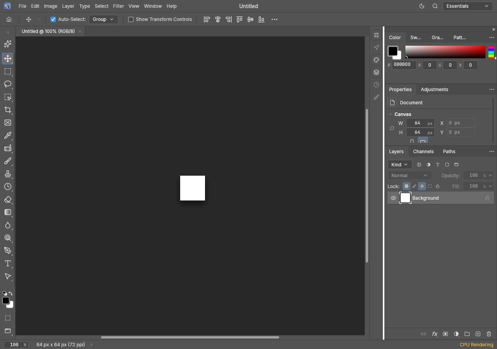
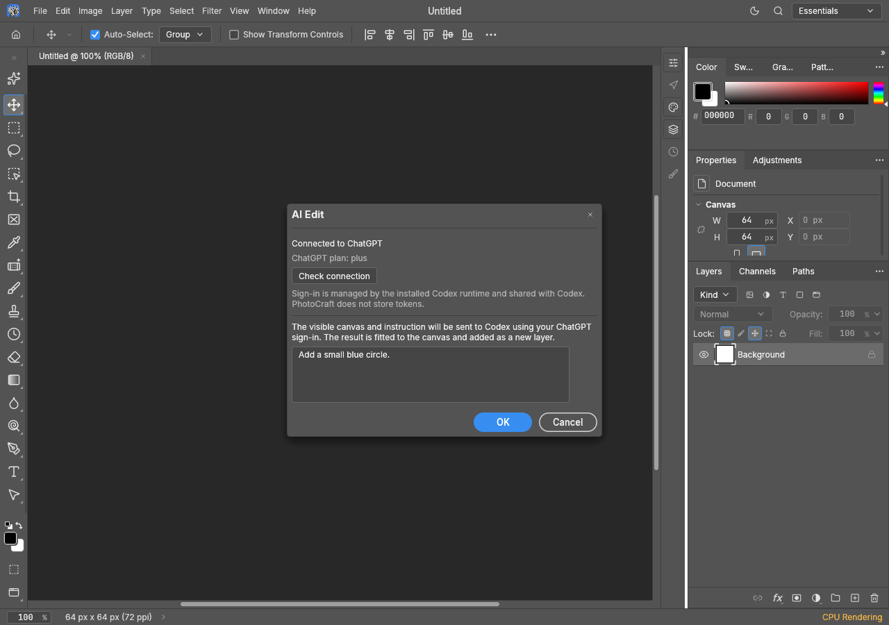
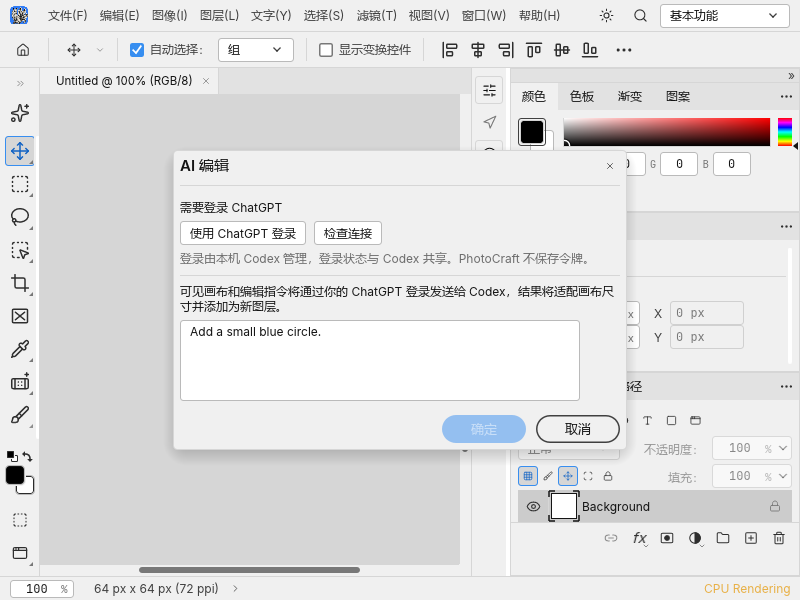
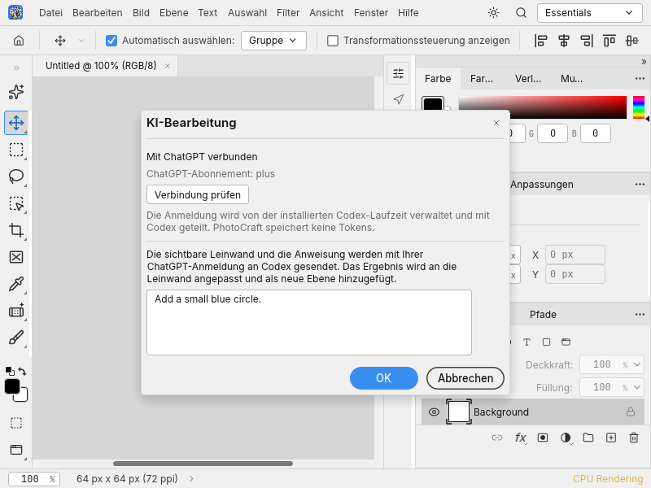

# Codex image editing (desktop prototype)

This optional backend edits the visible canvas using an installed Codex App Server and
its ChatGPT sign-in. It is an experimental contribution toward [#41](https://github.com/storytold/photocraft/issues/41),
not a claim of Generative Fill, Generative Expand or Photoshop AI parity. The upstream
provider decision remains open. No Codex executable or runtime is bundled.

## Use

Install and open the complete Codex desktop runtime. In desktop PhotoCraft, open a document
and choose **Edit > AI Edit...**, or the sparkle button at the top of the left toolbar.
The form shows the Codex account state. Existing ChatGPT sign-in can be reused; otherwise
**Sign in with ChatGPT** opens the browser through PhotoCraft's native URL service.
Checking the connection or opening the form does not generate an image. Enter an instruction
and confirm to submit the visible canvas. Success adds an **AI Edit (Codex)** top-level layer;
Undo removes it and Redo restores it. Existing layers are preserved.
Enter in the focused instruction field inserts a newline; use **OK** to submit.
Reopening the form while a cancelled sign-in is stopping automatically rechecks the
connection once that worker finishes. Confirmation through the UI or control channel
requires a connected account, no pending account operation and a nonempty instruction.

Runtime discovery runs for each connection: explicit `PHOTOCRAFT_CODEX_PATH`, known desktop
installation locations, then absolute PATH entries. Keep the executable in its complete
installation directory: a copied codex executable may lack image-editing components.
On platforms without a known desktop location, point the environment variable at a complete
installation. Discovery never downloads, copies or executes candidates to inspect them.

The same operations are available through CLI, the control channel and MCP:

- `edit.ai.codex {"prompt":"Make the sky a sunset; preserve the composition"}`
- `ai.codex.account {"action":"refresh|status|login|loginUrl|cancel"}`

The web build keeps compiling but returns an unsupported error for this desktop feature.
Menu and toolbar entry points require an open document.

## Data and authentication

`photocraft-gen` (L4) defines `ImageProvider`, `EditRequest` and `EditResult`; the provider owns
transport/authentication, while the engine owns document conversion, validation and history.
Only Codex is implemented in this contribution. It has no API-key backend or automatic fallback.

The engine exports a flattened visible canvas as an sRGB 8-bit PNG through the existing ICC
conversion path. Hidden layers, the document name, EXIF and XMP are omitted. The instruction
and exported pixels are sent to Codex/OpenAI only after confirmation. A private temporary
workspace lasts through the edit and import, then is cleaned up. Codex may retain its own
conversation, credentials and generated files according to its settings.

The complete installed runtime runs `app-server --stdio`. It must report ChatGPT authentication;
API-key login is rejected. The child forces the OpenAI provider and ChatGPT login method and
removes `OPENAI_API_KEY`, `OPENAI_BASE_URL` and `CODEX_API_KEY`. PhotoCraft does not read or store
OAuth tokens: login, callback handling and credential persistence belong to the installed
Codex runtime. No separate token-sharing authentication implementation is included.

The provider uses `initialize`, `initialized`, `account/read`, `thread/start`, and `turn/start`.
It requires a completed image-generation item with a `savedPath` for the matching thread and
a successfully completed turn. An installed runtime or account without that capability fails
explicitly. This depends on the installed runtime's image tool and is not a guarantee that every
Codex executable, account, plan or future runtime version supports image editing.

Shell and web-search tools are disabled; unsupported interactive requests are rejected.
Protocol messages, input/output dimensions and file sizes are bounded. Results accept one PNG
or JPEG under 64 MiB and 16 MP, with the canvas aspect ratio (a 1% rounding tolerance).
Same-aspect results are fitted using the existing Bicubic resampler, then converted to the
destination colour mode/depth and applied through one undoable engine edit. RGB/Gray/CMYK/Lab
are supported; malformed results, cancellation and failed requests add no layer. The background
job uses the engine's document lock and snapshot checks. The deadline is ten minutes.

## Verification

Offline tests use injected providers and simulated App Server processes, not real image
requests. They cover login completion/cancellation/expiry, native browser dispatch and failure,
secret-free account inspection, runtime discovery, protocol bounds, source pixel preservation,
colour modes/depths, result sizing, cancellation and undo/redo. The scoped translation test
requires all 26 non-English catalogs to contain the 26 Codex labels/command entries.
Translations need native-speaker review. Visual captures use synthetic canvases and account
fixtures; they do not prove real account connectivity.

```sh
cargo test -p photocraft-gen -p photocraft-engine -p photocraft-ui-egui
cargo clippy -p photocraft-gen -p photocraft-engine -p photocraft-ui-egui --all-targets -- -D warnings
cargo xtask layers
cargo xtask wasm
cargo xtask parity
cargo test -p photocraft-engine --test panic_hunt -- --ignored
```

A prior full AI fork was manually verified on Windows for real Codex editing, new-layer
application and undo/redo, and for browser sign-in and reuse after restart. That evidence does
not replace acceptance of this freshly extracted branch against its current upstream base.
The real-account test `crates/engine/tests/ai_codex_live.rs` is ignored by default and must be
explicitly requested; automated checks do not consume an image-generation allowance.

### Extracted-branch checks (Windows, 2026-11-01)

The initial complete three-crate run reported 7670 passed, one failed and 45 ignored.
The only remaining failure was the existing native-locale test querying a translated File
menu without its access-key suffix (for example, `文件(F)`). The test now uses the existing
localized-menu title helper while retaining its Auto/native-language assertions, and its
separate rerun passed. Together the final cases give 7671 passed and 45 standard-run ignores;
the unchanged passing suites were not rerun after this test-only selector correction.
The complete command's original failure is retained rather than represented as a green run.

The ignored full-registry `panic_hunt` was explicitly run and passed separately. Document
compilation, formatting, 32-crate layering, wasm's 25 crates plus HEIF, and the unchanged
631/631 Photoshop menu checklist passed. The parity checker was run with `--profile test`
to reuse the UI build; it is the same example invoked by `cargo xtask parity`.

Strict Clippy is not green: unchanged upstream IO code reports `drop_non_drop` and
`nonminimal_bool`; a diagnostic `--no-deps` run also finds existing `collapsible_match` and
menu-key/navigation `nonminimal_bool` findings in UI code. Those files were not edited, and
no lint allowances were added. These are recorded review limitations, not passing checks.

The snapshot tool built and the four captures below were inspected. Desktop build validation
is recorded separately when complete. No real account sign-in or image request was made.

### Review follow-up (Windows, 2026-11-02)

The six findings from the first automated review are addressed. Offline regression tests
cover Enter as a newline, confirmation during sign-in and with a stale connection display,
the allowed confirmation path, reopening during cancellation, closing a deferred refresh,
a missing native browser service, and creating a missing evidence directory. The UI
harness forbids image commands even if confirmation regresses.

The full UI run passed 4611 library tests and 146 graphical integration tests (21 and one
ignored respectively), plus the then-current 13 AI form tests. After adding two more
confirmation checks and the offline command gate, all 15 AI form tests passed separately.
The offline evidence-file test passed; the opt-in subscription test remained ignored.
Both conflicting snapshot-flag orders exited with code 2 before opening a missing input
file. Fresh English/Chinese synthetic multiline-form captures were inspected. Formatting,
32-crate layering and wasm's 25 crates plus HEIF passed. Strict Clippy remains blocked at
the same unchanged upstream IO and UI sites described above; no allowances were added.
The full engine run passed 2896 tests with 23 standard-run ignores; the ignored full-registry
`panic_hunt` passed separately (19.46 s). Both UI and engine documentation compiled.

### UI captures

Both English images show this extracted branch: the editor before and after opening the form,
not an old-versus-new application comparison. All images use a synthetic 64x64 white canvas.
Connected/plan and signed-out states are fixtures, not real account-connectivity evidence.






For a first-login check without signing out of the regular Codex session, set
`PHOTOCRAFT_CODEX_HOME` to a new private directory before launching PhotoCraft. The child uses
that as `CODEX_HOME` with Codex's file credential store for this isolated test. Use the same
directory after restart to test reuse. It contains credentials: keep it private and outside
version control. Normal operation leaves the installed runtime's credential store unchanged.

## Related work

The open [#9800](https://github.com/storytold/photocraft/pull/9800) addresses native first-frame
system-font fallback and broader GPU/font test readiness. This branch carries a separate minimal
font activation/regression prerequisite, plus the locale test's access-key selector correction,
so strict multilingual rendering checks can run without optional craft fonts. These tests do
not establish a visible first-frame defect in the shipped app. Prefer the existing upstream
font PR and drop the equivalent prerequisite after it lands.

[#730](https://github.com/storytold/photocraft/pull/730) proposes a separate API-key provider and
selection/expand/variation commands. This prototype is narrower (whole-canvas editing) and also
introduces a crate named `photocraft-gen`; the interface/name needs coordination before either
approach is merged. The closed [#1449](https://github.com/storytold/photocraft/pull/1449) mixed
contextual UI and account drafts; this contribution has an actual runtime-backed image path,
no coming-soon actions and no PhotoCraft-managed ChatGPT credentials. Backend/account policy
and cross-platform manual acceptance remain maintainer review items.
