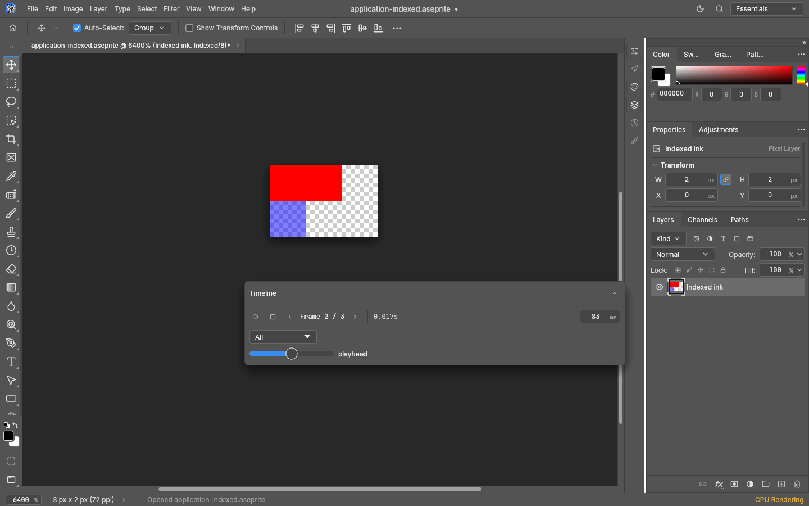
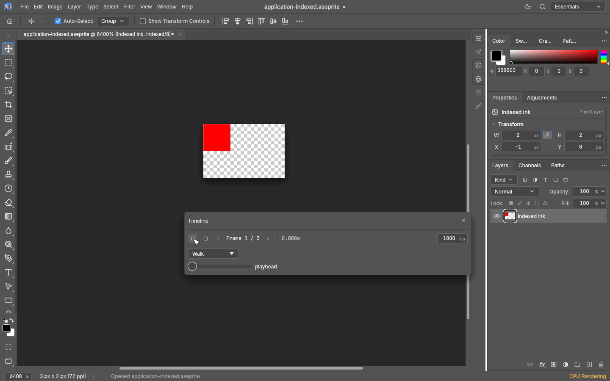
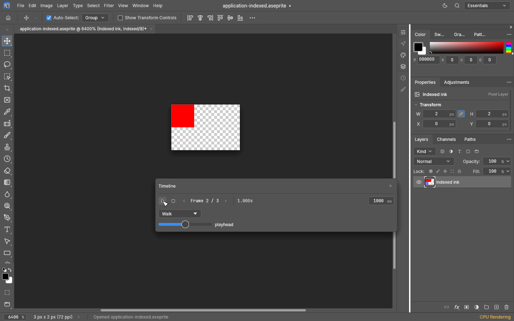

# Aseprite documents

PhotoCraft opens and writes `.aseprite` and `.ase` sprites as editable raster layers and
groups, including animation and indexed color ([#3811](https://github.com/storytold/photocraft/issues/3811)).
Open, drag-and-drop, CLI conversion/batches and existing automation use the same reader/writer.
Folder batches discover `.aseprite`; the ambiguous `.ase` alias is accepted explicitly but
is not scanned as an image. The desktop Save As picker offers `.aseprite`.

`.ase` also names Adobe Swatch Exchange. A validated Aseprite header routes sprites to
Open; an Adobe `ASEF` file still loads into Swatches. Document export prefers `.aseprite`.

## Pixels, layers and cels

RGBA (32 bits per pixel), grayscale-with-alpha (16 bits per pixel) and indexed (8 bits per
pixel) retain their original 8-bit samples. Raw and zlib cels keep their full rectangles,
including transparent borders and negative/off-canvas positions. Indexed sprites retain
actual index planes: duplicate palette colors keep distinct indices, names and alpha.
Per-frame palettes and transparent-index/background semantics survive native and Aseprite saves.
Painting uses the selected palette; unchanged pixels retain their original indices. A palette
edit recolors its frame without rebuilding indices from RGB. A newly created PhotoCraft indexed
document has expanded pixels; its first Aseprite export assigns indices from its color table.
An opaque indexed document reserves an unused transparent index for ordinary layers without
turning them into Background layers. If no index is available, or its pixels have transparency
but its color table has no transparent entry, export refuses with an explanation.

Layer names, hierarchy, original order, visibility, opacity, locks, collapsed groups, background
and reference flags, linked-cel preferences and UUIDs are retained. Cel opacity remains separate
from layer opacity in the sprite model; their product is the ordinary layer opacity shown by the
editor. It is not Photoshop Fill. Cel z-order follows the public specification's ordering rules.
Groups follow the header's pass-through/isolated policy. The 19 format blend IDs map to the
corresponding PhotoCraft modes. Mode/opacity round trips are tested. An original 19-mode fixture rendered by Aseprite
1.3.18.6 matches within 2/255 in premultiplied channels, including separate cel/layer opacity.
That finite sample does not establish exact rounding for every possible blend input.

Reference layers are locked. Precise bounds produce a nearest-neighbor display projection;
the original image and 16.16 bounds are saved, rather than exporting the scaled preview as
source pixels. Unlocking a reference layer is refused; detach a copy before painting it. Pixel aspect ratio and grid settings are retained as document properties.
The ordinary canvas still displays square screen pixels; this is not an aspect-corrected preview.

## Animation and editing

Window › Timeline selects and plays cel frames with their individual millisecond delays.
A tag selector follows forward, reverse, ping-pong and reverse ping-pong directions and finite
repeat counts. Zero-duration frames play as fast as the UI allows (at least 1 ms for scheduling),
while their stored zero duration is preserved. Navigation/playback do not add history steps.
A delay drag or numeric typing session is one undo step; a new gesture creates a separate step.
Pause keeps the displayed frame; starting a selected tag begins at its first playback frame.
Switching documents clears the selected tag and stops playback.

Painting and filters capture the selected frame's image; linked cels share that image, so an
edit propagates across links while retaining each cel's position/opacity/z-order and frame palette.
Unlink a cel to edit it independently. Copy-on-write tiles keep history snapshots unchanged.
Undo memory accounting includes off-playhead pixel/index tiles and retained metadata.

Existing `timeline.setFrame`, `timeline.nextFrame` and `timeline.previousFrame` select frames.
Additional engine/CLI/control commands are:

| Command | Parameters / behavior |
|---|---|
| `sprite.info` | Frame count, exact delays, palette, tags, aspect ratio |
| `sprite.playback` | `{elapsedMs, tag?}` → frame and finite-playback completion |
| `sprite.setDuration` | `{durationMs:0..65535, frame?}` |
| `sprite.setPaletteEntry` | `{index:0..255, rgba:[r,g,b,a], name?}` for the selected frame |
| `sprite.setCel` | `{layer, frame?, x?, y?, opacity?, zIndex?}` |
| `sprite.unlinkCel` | `{layer}` for the selected frame |
| `sprite.duplicateFrame` | Duplicate the selected frame independently |
| `sprite.deleteFrame` | Delete the selected frame, retaining linked images still in use |
| `sprite.setTags` | `{tags:[{name,from,to,direction,repeat,color}]}` |
| `sprite.rasterizeTilemap` | `{layer}` explicitly replaces tile data with editable pixel cels |
| `sprite.detach` | Explicitly keep only the selected frame as an ordinary document |

Cel edits, frame changes and palette edits are undoable. Cel property edits and unlinking
respect the layer's Lock All, including parent-group locks. Position locks also protect cel
coordinates and z-order; they still allow opacity edits. Palette changes are frame-global
color-table edits rather than painting on the active layer. Explicit tilemap rasterization
unlocks its own display cache, but requires unlocked parent groups. Frame insertion/deletion is
refused when retained slice keys would become stale; changing tag definitions is refused when existing
tag user properties would be reassigned. Canvas changes with retained slice coordinates are
also refused. These errors preserve the original document and explain the affected metadata.

## Save and metadata preservation

Save writes supported sprites back to their source; Save As `.pcraft` retains the complete
sprite model, including exact indices, cel links, frame palettes and all retained metadata.
Native bundles containing sprites use manifest version 2, which earlier builds refuse to open
instead of dropping animation on save. Static bundles continue to use version 1; current builds
read both versions.
The Aseprite → `.pcraft` → Aseprite path is covered by integration tests and an independent
reader. A PSD or flat export is a copy of the selected frame and warns that animation, exact
indices and Aseprite metadata require `.aseprite`/`.pcraft`; it does not become the sprite's
writable source. Photoshop-specific content, masks, clipping/effects or blending that Aseprite
cannot encode are refused with guidance to rasterize/convert a copy first.
Extra alpha/spot channels, named paths, notes, layer XMP and document text, XMP or EXIF metadata also require a native copy;
Aseprite export refuses to discard them silently. ICC profiles are validated before export.

ICC, sRGB, linear and other positive fixed-gamma profiles are retained. Untagged files stay
untagged. Palette names/alpha, tags/repeats, sprite/layer/cel/tag user data (including typed nested
properties), slices/pivots/nine-patch data, external references and legacy mask/path records are
retained in bounded native blobs and re-emitted with their object associations. External files
are never followed. Explicit layer/cel deletion removes metadata owned by the deleted object.
Canvas size changes, crops that move or resample the canvas, flips and rotations (including
Arbitrary) are refused while retained slice coordinates are present, since PhotoCraft cannot
yet transform those keys with the pixels. Background layers must be opaque in every frame;
export refuses transparent Background cels instead of discarding their alpha. Converting an
RGB or grayscale Background to an ordinary layer keeps it ordinary after export.

## Limits and evidence

Embedded tilesets and tilemaps are rendered and preserved: tile ids, empty-tile semantics,
X/Y/diagonal transforms, tileset indices/base settings, embedded images and object properties
survive native and Aseprite saves. The tilemap layer is locked and its raster appearance is a
cache. Editing another layer retains the original map records. `sprite.rasterizeTilemap`
explicitly converts its cels to editable pixels; export then writes an ordinary raster layer.
PhotoCraft does not reproduce Aseprite's tile-painting tools. External-only tilesets that are
needed to render the image are refused with an explanation; their paths are never followed.
Non-square diagonal tile transforms and background-flagged tilemaps are also refused.
Unknown rendering chunks are refused. These restrictions must remain visible in compatibility
claims rather than being represented as silent conversion. Mixed pass-through/isolated groups created in PhotoCraft cannot be represented
by Aseprite's one global group policy and are refused on export.

Limits: 512 MiB file, 10,000 frames, 4,096 layers/groups, 65,536 chunks/cels, the document nesting
limit, 256 MiB decoded tiles (including index planes) and 32 MiB retained metadata. Reference
display tiles have an additional 256 MiB cap per frame. Links, including forward links, resolve
without recursion; cycles/missing targets fail. Pixel inflation is row-wise, exact-size and
checksum checked, with cancellation between rows. Property trees are limited to 128 levels
and 65,536 entries/elements. Native data uses the existing content-addressed tile/blob store.

The implementation follows the [public binary specification](https://github.com/aseprite/aseprite/blob/main/docs/ase-file-specs.md).
No Aseprite application source/assets or new runtime dependency is used. The permissive
`aseprite-io` crate is an independent fixture generator/reader only; `asefile` is a second
independent visual reader used outside the repository. Its renderer does not establish all
linked offsets or tile transforms, so those have separate hand-computed pixel tests. Original layered, gray
animated/indexed and tilemap fixtures include hand-computable pixels. Tests cover native and Aseprite
round trips, edited linked images, indices/duplicate colors, palettes/timing/tags, metadata,
profiles, malformed records, decompression/allocation limits, cancellation and mutations.
Original Aseprite 1.3.18.6 application-saved fixtures and rendered PNGs cover indexed frames,
linked positions, tags/properties/slices, all eight tile transforms and all 19 blend IDs.
The application also reopens/saves PhotoCraft exports; scripting checks the retained object
properties. These finite tests do not establish compatibility with every real Aseprite document.

## Visual check

These are workflow captures from this implementation: a blank 2 × 2 document before opening
anything, then the imported synthetic fixture at the same zoom. The first is not a render of
an older PhotoCraft version. The second shows the expected pixel colors and the editable
Group / Top / Base tree. Captured offscreen with the CPU canvas at 6400% zoom.

The application-saved indexed animation on frame 2 of 3, with its 83 ms delay and editable
layer. The view is panned above the floating Timeline so the complete 3 × 2 canvas is visible.

The Pause regression uses the same synthetic fixture with its delays set to 1000 ms. Both
captures run identical tag-selection, Play and Pause inputs. Before the correction, Pause
jumps to frame 1; afterward, it keeps the displayed frame 2.

| Before | After |
|---|---|
|  |  |
