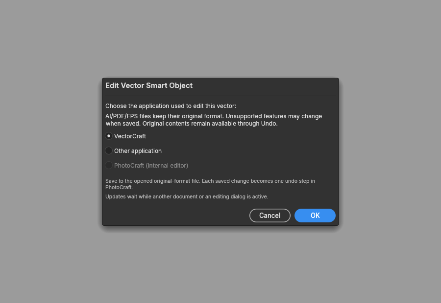
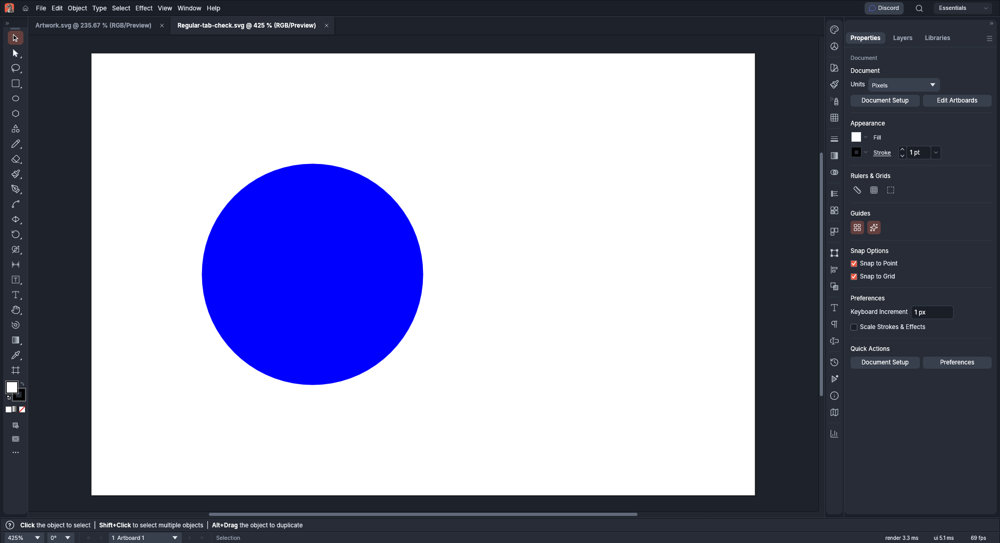

# Embedded vector smart-object editing

Layer > Smart Objects > Edit Contents offers VectorCraft editing for embedded SVG,
PDF-compatible AI, PDF and EPS, including payloads retained in PSD linked-layer tables.
Choose VectorCraft or a local executable. PhotoCraft creates a private working copy in the original format;
saving that file updates the original smart object when its parent is active and ready.
Each accepted save is one undo step, including all shared instances. Placement, masks,
filters and Undo/Redo remain in the existing smart-object transaction.

For a vector inside a nested PSB smart object, save the edited PSB contents back to its
parent as well. Raster/PSD/PSB internal editing retains its existing behavior.

## Format and platform limits

AI, PDF and EPS save-back retains the native file name and saved native bytes. A separate,
source-hash-bound SVG is a display preview, never a replacement for the embedded native file.
It is retained in `.pcraft` and a private PSD `pcVP` layer block; other PSD readers may ignore
that block and use the layer's cached pixels. Undo restores both the original source and preview.
No original file on disk is edited. Test on a PSD copy.

Format preservation is not a claim of lossless Illustrator editing: the editor regenerates
its supported AI/PDF/EPS content, and unsupported features or missing fonts can change appearance.
Native Adobe Photoshop/Illustrator Edit Contents acceptance remains unverified. The chooser
keeps that warning explicit. `updateSvg` only replaces SVG contents: it refuses an AI, PDF or
EPS source, which only `updateVectorSource` saves back, in its own format.

Native editing requires VectorCraft and its adjacent vectorcraft-cli for bounded previews,
even when another interactive editor is selected. The CLI runs headless in the background,
restricted to a fresh private temporary read/write root per snapshot, separate from the
interactive working directory. Open and export must both succeed, with cancellation and a
60-second timeout. Each stable native save is validated before PhotoCraft accepts it.

Foreign AI files ordinarily require Save As in VectorCraft to protect the source. When VectorCraft
is the editor, PhotoCraft regenerates only the private AI working copy with VectorCraft editing
data before launching it, so ordinary Save can be used without changing that general protection.
Illustrator and other editors get the original AI bytes. Merely opening the
editor never updates the embedded original. Ordinary EPS Save needs the companion VectorCraft
EPS-save support; older editors may require exporting EPS to the opened private file.

The PSD source-pixel frame is retained when PDF points differ from stored dimensions. The
native file retains its own geometry; the display preview fits the original placed frame.
Unsupported or oversized frames fail without changing the smart object.

Desktop integration supports an explicitly selected executable. Linux discovery checks
standard native locations and a user Flatpak deployment. On Linux, choosing VectorCraft
uses the desktop's Open With chooser to launch the regular application;
select VectorCraft there. The writable document portal shares only the private working
file. Working copies live in PhotoCraft's private cache because its isolated /tmp cannot
be exported. Ordinary VectorCraft launches retain preferences and existing-window
handoff instead of running a second payload inside PhotoCraft's sandbox. Reusing tabs
requires the installed VectorCraft build's Linux single-instance support.

Native AI/PDF/EPS previews still need vectorcraft-cli alongside the discovered
executable. The local Flatpak runtime test granted read-only access to the test
VectorCraft build for that invocation. A sandboxed distribution must arrange access to
its compatible converter; this source change adds no broad filesystem or host-process
permissions and does not establish default Flatpak packaging acceptance. SVG editing
through the portal does not require access to the VectorCraft deployment. Explicit
Other application executables retain their direct-launch behavior.

On macOS, VectorCraft discovery also checks `/Applications/VectorCraft.app` and
`~/Applications/VectorCraft.app` and runs the bundle's executable directly. Other application
accepts an application bundle (`.app`): its Info.plist `CFBundleExecutable` must name an
executable inside the bundle's `Contents/MacOS`. Bundles with the application identifier
`ai.storyteller.vectorcraft` run directly with the working file as an argument, matching
automatic discovery; other bundles use `/usr/bin/open -a` for open-document events. Adobe Illustrator is
offered when an `Adobe Illustrator*.app` is found in `/Applications` (at most one folder deep).
AI/PDF/EPS previews look for `vectorcraft-cli` in the same bundle's `Contents/MacOS`, then in
the other known locations; current VectorCraft macOS packages ship the CLI as a separate
download, so it must be placed there or installed beside a discovered executable. These paths
are unit-tested on Linux with synthetic bundles. Windows and macOS runtime acceptance has not
been performed. Browser and automation paths do not launch
editors; browser internal editing remains available.

This PR does not add clipboard discovery or Paste As. It stands alone on main, without
requiring the clipboard or Shape Tools work in #3409/#3446. Its source-watching and
bounded SVG rendering build on credited open-source work from #3409; the embedded
AI/PDF/EPS extension was first submitted in Skyfuller1303/photocraft#1.

## Safety

Artwork never supplies a program, command line or output pathname. Editor selection is
explicit, without a shell. The interactive editor runs with its normal desktop permissions;
the restricted MCP roots apply to preview generation, not to that editor process.
Working copies reject links and nonregular files; Unix opens
are no-follow and nonblocking. Unix save settling includes device/inode identity, including equal-time atomic replacement.
Reads remain byte-bounded even if another process grows the file. A save that changes while it
is being read is not reported as an error; the watcher waits for it to settle again and reads it.

Source input/output is limited to 16 MiB. Bounded SVG parsing permits one size-checked gzip
layer; nested gzip is rejected both at the top level and inside embedded SVG data URLs.
PSD preview validation caches shared sources and
uses a 96 million pixel-work budget across distinct previews; previews beyond that budget fall
back to the PSD cached appearance without changing the native source. The charge includes
raster decoding, eager layer caches and embedded-SVG intermediate surfaces. Raster-bearing
repeatable paint/effect resources reserve conservative repaint work; ordinary vector paths,
artboard clips and blur without image references do not multiply unrelated image decoding.
Decoded images and each canvas/cache component keep their independent 24 million pixel
limits, with separate bounds on SVG nesting. A new saved preview also has a 96 million
pixel-work validation limit. External file and URL images are not fetched. Missing system generic fonts fall back to installed families;
matching typography still requires the authored fonts.

Memory-only layer.smartObjects.exportSvg, layer.smartObjects.updateSvg and
layer.smartObjects.updateVectorSource validate
parent document, layer, shared-content identity and source fingerprint. They never
follow a linked disk pathname or launch processes. The native update command is unavailable
to untrusted automation because a caller-supplied preview is not evidence of native appearance.
Automation authorization also checks
visible stored smart filters on every shared instance before replay, so a desktop LUT
file parameter cannot inherit filesystem access. Malformed saves, locked targets and
conflicting edits retain existing content. Saved updates wait through masks, gradients,
other active previews and dialogs instead of interrupting an edit.

Frame recovery does not rasterize old previews or decode their embedded images just to
read their dimensions. It checks the actual native-source digest, memoizes shared immutable
preview identities and caps distinct old-preview XML at 64 MiB per update. Exhaustion
rejects the whole update without changing any instance. PSD preview import/export keeps
its separate 96 million pixel validation budget. Native and SVG source updates do not
append full artwork to the replay journal; document Undo/Redo remains available.

## Validation evidence

Eight contributor-owned logo PSDs were tested through their visible nested AI vectors.
A real VectorCraft edit/save reached PhotoCraft's native watcher and engine; child and
parent Undo/Redo and PSD export/reopen preserved the changed vector. Original SHA256
hashes were unchanged. This combines runtime editor/engine acceptance and separate UI
wiring tests; it is not a claim of manual full PhotoCraft GUI acceptance. Private artwork,
and private screenshots are excluded from this repository. The opt-in acceptance harness
accepts local paths through environment variables; it contains no private artwork.

Earlier SVG-only Linux Flatpak GUI acceptance verified an editor save through the writable document
portal reached PhotoCraft's watcher, with an ordinary document opening as a second tab
in the same VectorCraft window. Both launch orders were checked.

Separate isolated VectorCraft GUI tests saved AI, PDF and EPS back to the same paths
and opened a second document as another tab. The native-format watcher/engine test
also passed inside PhotoCraft's Flatpak runtime. These tests do not establish lossless
Adobe compatibility or Windows/macOS acceptance.

D-Bus tests cover
chooser success/cancellation/failure and reject symlinks and FIFOs before sharing.

Offscreen dialog capture with authored bytes and mock services; no private artwork.
