# Editing selected colour channels

Shift-click colour rows in the Channels panel to add or remove them from the editing
set. Only native colour channels can be combined. Selecting every colour channel
returns to the composite. Selecting a channel shows it alone; Shift-clicking another
shows exactly the selected set. The eye controls can then change visibility without
changing the editing target. A subsequent row selection resets visibility to its set.

Partial sets work with the existing raster drawing tools (Brush, Pencil, erasers,
stamps, Mixer Brush, retouching tools, Bucket, Gradient and raster Fill/Stroke Path),
destructive adjustments, and the supported native raster filters. Erasing paints
the toolbox background colour into the selected components, preserving transparency.
Copy, Cut, Paste, Paste Into and Paste Outside carry the selected component planes.
Each committed operation records one undo step. Live drawing previews protect the
same components as the committed edit.

Levels and Curves show a neutral combined entry (for example **RB**) followed by the
selected individual components. Colour adjustments that mix components and filters
retain the original native layer context,
including transparency textures, depth inputs and colour-valued settings, and restore
unselected encoded samples. The combined tone operation is applied to each selected
native plane; individual settings can refine those planes. Histograms use
the selected layer's native component values. CMYK channels display tone (the inverse
of stored ink); Lab chroma uses the native neutral encoding at each depth.

RGB, CMYK and Lab are exercised at 8-bit, 16-bit and 32-bit float depths. Unselected
encoded samples, including transparency and float NaN payloads, are preserved byte
for byte. Active pixel selections, including feathering, still constrain editing.

Move, Free Transform, rotate/flip presets and Warp also edit the selected set. One
box applies the same geometry to every selected native component, including partial
and feathered selections; the selection outline moves once and the edit has one Undo
step. Other encoded samples and layer transparency remain unchanged. Starting Free
Transform preserves all eyes and requires every selected component to be visible.
The complete target set stays locked until commit/cancel; every eye remains usable,
including hiding and revealing the selected components. Eye changes survive commit,
cancel and Undo. Eligible RGB previews cache one source and combine the selected
components in one GPU pass; different scalar sampling outlines retain the CPU oracle.
Move drags with a several-component pixel selection use the native CPU preview.
Their repaint bounds include the stationary transparency extent, so successive offsets
refresh colour changes there as well as the translated area. Their marching ants follow
the preview, snapping uses the selection frame without
snapping back to its starting outline, and Shift constrains movement to axes or 45° diagonals.
A shown Smart Filter mask keeps Move aimed at the whole object, even with colour rows
retained behind it. Copying that object keeps its mask view on the copy. Set-copy refusal
also applies to Cmd/Ctrl+Alt drags started with selection tools.
Cmd/Ctrl-dragging with a selection tool uses the same native Move path inside or
outside the selection. Native-set canvas drags cannot become whole-layer copies
by crossing another document's tab; Layers-panel transfers retain their explicit layer scope.
Show Transform Controls uses the same native channel frame as Free Transform, including
on Background samples, and other selected layers do not enlarge that frame. Implicit engine
Move commands honour viewed raster masks just as the UI does; explicit targets or an explicit
layer retain their precedence.
The engine and live Move preview share viewed-mask priority; Alpha and Quick Mask keep
their existing precedence. Copy refusal is checked after Auto-Select and before duplication,
and a refused pending copy cancels the gesture without moving the original or rolling back history.
Free Transform a Copy of a viewed raster mask retains that target and duplicates its full host,
even with a pixel selection. Cancelling restores the original mask view and keeps current eyes.
A pixel selection permits native-set movement within Background samples while preserving
Background identity; pixel/all locks and whole-Background position locking still apply.
Single-channel pointer drags retain the existing floating-selection and keyboard behaviour.
Transform → Again uses the active native colour frame even if other layer rows are
selected behind the Channels panel target, including an active Background.

Content-Aware Scale, Puppet/Perspective Warp, floating selections and Free Transform
a Copy on partial sets remain unavailable. Repeat-transform copies and copy-drag/nudge
of a set are also refused;
Copy and Paste can copy the selected native components. Camera Raw requires
the composite or one colour channel. HDR Toning requires the composite because it flattens
the document. Filters that generate transparency cannot edit
colour-only targets. Options that create a new layer, including Remove’s Create a new layer option, also
require the composite.
Rasterize a non-raster layer before editing its colour planes.
Vector path transforms and moving guides remain available. Channel-set geometry extends [#4648](https://github.com/storytold/photocraft/pull/4648).
The remaining scalar-target tone-dialog changes are tracked separately in
[#6864](https://github.com/storytold/photocraft/pull/6864).

## Automation

The UI uses the existing engine commands. Native component indices follow the
document colour mode: RGB 0–2, CMYK 0–3 and Lab 0–2.

```json
{"command":"channel.target","params":{"colors":[0,2]}}
{"command":"channel.target","params":{"channel":{"color":1},"extend":true}}
{"command":"image.adjustments.curves","params":{"target":{"colors":[0,2]},"points":[[0,0],[128,170],[255,255]]}}
```

`extend` toggles a colour row; from the composite it toggles that row out of the full
set. Alpha channels, masks and Quick Mask cannot join a colour set. An explicit
`target` overrides the panel selection. Without it, applicable pixel commands follow
the selected set. The channels reply exposes `selectedColors` in addition to the
legacy primary `target`. Dialogs capture their target when opened; changing the panel
while a dialog is open does not redirect its operation.

## Validation and performance

`crates/engine/tests/multi_channel_editing.rs` covers the native mode/depth matrix,
selected-plane math, byte preservation, live/committed drawing, selections, clipboard,
explicit layer targets, HDR Curves, selected-default masks, missing destinations,
errors, undo and redo. UI tests cover the selected tone
choices, captured drawing targets and guide/path interaction. A real pointer regression
checks normal clicks, Shift-clicks and independent eye overrides across RGB, CMYK and Lab,
including visibility persistence through an edit and the return to composite selection.

The 2026-10-26 main refresh integrates egui 0.37, the rebuilt Histogram panel,
live Mixer Brush and smart-filter mask painting. Additional regressions cover
selected-component Mixer previews, captured targets, exact commit/replay and undo
across RGB/CMYK/Lab at all three depths, plus filter-mask Cut/Clear and dialog
capture. The Art History Brush joins the drawing preservation matrix. The fused
tone kernel is unchanged; the measurements below retain their original date.

The 2026-10-27 main refresh carries the same implementation and regressions into
the upstream command, dialog, canvas and tool modules. Public engine/UI facades
and control-protocol commands retain their existing names.

The release benchmark is `crates/engine/examples/multi_channel_bench.rs`. It uses a
6000 × 4000 synthetic RGB16 raster, one warmup and six measured repetitions per case,
with target modes interleaved. Document setup is outside the timed interval; command
execution, pixel edits and history commit are inside. Eraser is the ordinary Brush
eraser. Live-update cases time one 50-pixel extension after stroke creation. Timings
exclude display refresh and do not claim end-to-end stylus latency.
The observed maximum of six samples is reported as p95 in the raw output.

Run with `RAYON_NUM_THREADS=8 cargo +1.99.0 run --release -p photocraft-engine
--example multi_channel_bench -- --subset`. For the unchanged base, use the same
fixture, parameters and timing loop and omit
`--subset`. The base cannot execute the new partial-set target. Add `--region` for the
five imaging cases through a 16 × 16 pixel selection; selection setup stays outside
the timer. Use `--clipboard` for a separate one-pixel paste case: copy and selection
setup stay outside the timer, while pasting edits the existing target layer.

Measured on 2026-10-25 on an AMD Ryzen 7 9700X (8 cores / 16 threads), Rust 1.99.0,
release profile with thin LTO and eight Rayon workers. The three target modes are
interleaved within each run. Retained runs had no concurrent Rust compilation or
engine/UI tests; a process watcher discarded any interrupted measurement.

The previous implementation at `15bf0873ba03622e54189e668df20a1403e41d56` was rerun
using its retained release binary (verified by SHA-256), with the same fixture,
parameters and timing loop. The original pre-feature baseline at
`6719f1813e84e96129fc31676cc945d51be0e736` is also retained in the raw data.

| Case (milliseconds) | All channels | Red only | Red + Blue | RB before fusion | RB maximum |
|---|---:|---:|---:|---:|---:|
| Invert | 75.23 | 21.78 | 26.37 | 126.81 | 28.98 |
| Threshold | 94.93 | 24.07 | 29.77 | 174.85 | 31.03 |
| Levels (gamma 1.4) | 102.88 | 23.44 | 29.06 | 218.91 | 29.52 |
| Curves (one midpoint) | 91.62 | 22.68 | 28.81 | 173.50 | 32.86 |
| Gaussian Blur (radius 8) | 184.71 | 320.05 | 288.82 | 298.25 | 293.23 |
| Brush commit (120 px) | 4.61 | 7.04 | 6.55 | 6.59 | 6.64 |
| Eraser commit (120 px) | 4.36 | 7.05 | 6.49 | 6.63 | 6.58 |
| Live brush (50 px extension) | 0.33 | 1.69 | 1.41 | 1.50 | 1.44 |
| Live eraser (50 px extension) | 0.30 | 1.70 | 1.41 | 1.49 | 1.42 |

Timings are p50 except the final column, which is the observed maximum of six samples
(the legacy raw field is named `p95_ms`). R+B tone edits take 1.21–1.27× Red-only
and are 4.8–7.5× faster than the rerun before fusion. The composite uses its existing
generic full-colour adjustment path and is an interleaved control.

Scalar adjustments visit native tiles once for the complete selected set, cloning each
destination tile once and writing only the selected components. Large integer edits prepare
exact sample-code tables through the existing adjustment math once per distinct channel
record; fully selected pixels use encoded lookups. Float and small-selection edits use bounded
tile buffers to retain HDR formulas and avoid full-image channel extraction. A test-only copy
of the previous scalar path checks the mode/depth/selection/default matrix byte for byte.
Filters retain the original native context and restore unselected encoded samples
after filtering. These runs establish no new performance budget or readiness percentage.

| Case, 16 × 16 selection | RB p50 (ms) | RB maximum (ms) |
|---|---:|---:|
| Invert | 0.98 | 1.08 |
| Threshold | 0.98 | 1.08 |
| Levels (gamma 1.4) | 1.61 | 2.08 |
| Curves (one midpoint) | 1.15 | 1.19 |
| Gaussian Blur (radius 8) | 0.92 | 0.99 |

The small-selection cases use the same 24 MP layer. They measure bounded region work,
including the filter halo, with selection creation outside the timer.

The separate one-pixel Paste case measured **0.46 ms** for one channel
and **1.00 ms** for RB. Copy and selection setup are outside the timer;
the paste edits the existing 24 MP layer. Destination extraction is bounded to the paste.

The complete harness peak RSS was 650.0 MiB after fusion and 674.3 MiB
before fusion. These are process peaks across all three target modes, not per-operation
allocation measurements.

Raw samples: [original pre-feature base](benchmarks/multi-channel-editing/baseline.json),
[before-fusion rerun](benchmarks/multi-channel-editing/before-fused-rerun.json),
[candidate](benchmarks/multi-channel-editing/candidate.json),
[small selection](benchmarks/multi-channel-editing/candidate-region.json),
[one-pixel paste](benchmarks/multi-channel-editing/candidate-clipboard.json),
[environment and binary hashes](benchmarks/multi-channel-editing/environment.json).
The three `candidate*-before-fused-original.json` files preserve the original feature run.

Validation after the main merge and review fixes: 6,542 engine and UI tests passed
(38 ignored), including 58 focused engine regressions. Strict all-target Clippy,
formatting, layering, wasm, parity generation and the adversarial command panic hunt passed.
The complete `cargo xtask perf --quick` runner now finishes successfully after the main
merge; its report still lists unrelated, non-enforced budget overruns. Six further local
review/fix rounds followed the latest CodeRabbit review; the last found no actionable issues.
All visual captures were rendered offscreen and inspected.

The additional 24 MP RGB16 Liquify benchmark uses
`crates/ui-egui/examples/multi_channel_preview_bench.rs`, with eight Rayon workers and
no concurrent builds, tests or performance scenarios. It measures field deformation plus
the dirty CPU proxy render; GPU uploads/presentation are excluded. One warmup and six
measured updates use interleaved target modes. The field's nonzero displacement is checked.

| Liquify, 120 px brush | All channels | Red only | Red + Blue |
|---|---:|---:|---:|
| Preview update p50 | 0.111 ms | 0.345 ms | 0.447 ms |
| Maximum of six updates | 0.120 ms | 0.360 ms | 0.461 ms |
| Open workspace, one setup measurement | 22.6 ms | 246.6 ms | 317.7 ms |

Opening a component workspace builds its native proxy once. Open timings are sequential
single observations, not medians; setup is excluded from update timings. The whole process,
including all three workspaces, peaked at 380.5 MiB RSS. [Raw samples](benchmarks/multi-channel-editing/liquify-preview.json)
and [source/binary hashes](benchmarks/multi-channel-editing/environment.json) are retained.


## Visual evidence

The images below use an original synthetic gradient, rendered offscreen without
opening a window. Their JSON scripts are adjacent to the images. Reproduce them with
`cargo run -p photocraft-ui-egui --example snapshot -- --safe-gpu --size 1440x900
--scale 1 --out <image.png> --script "$(cat <script.json>)"`; add `--click-at 720,242`
for the Curves dropdown capture.

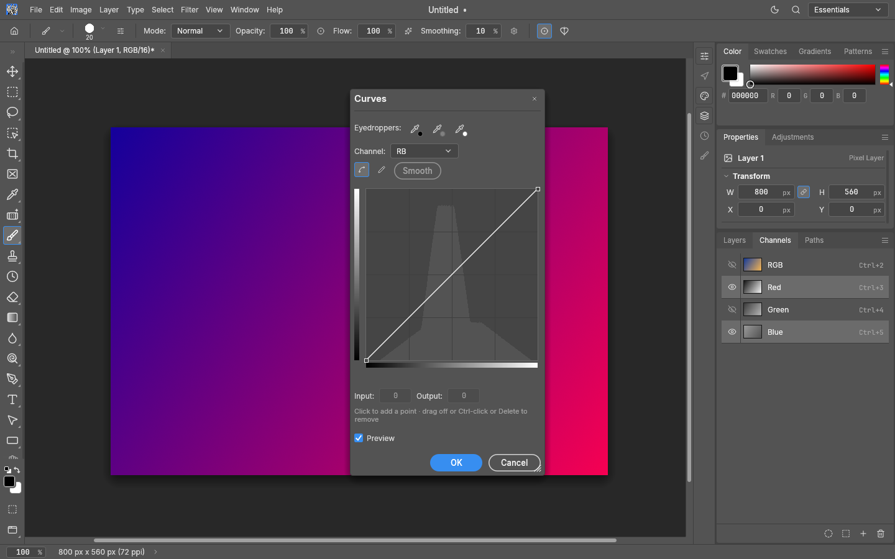

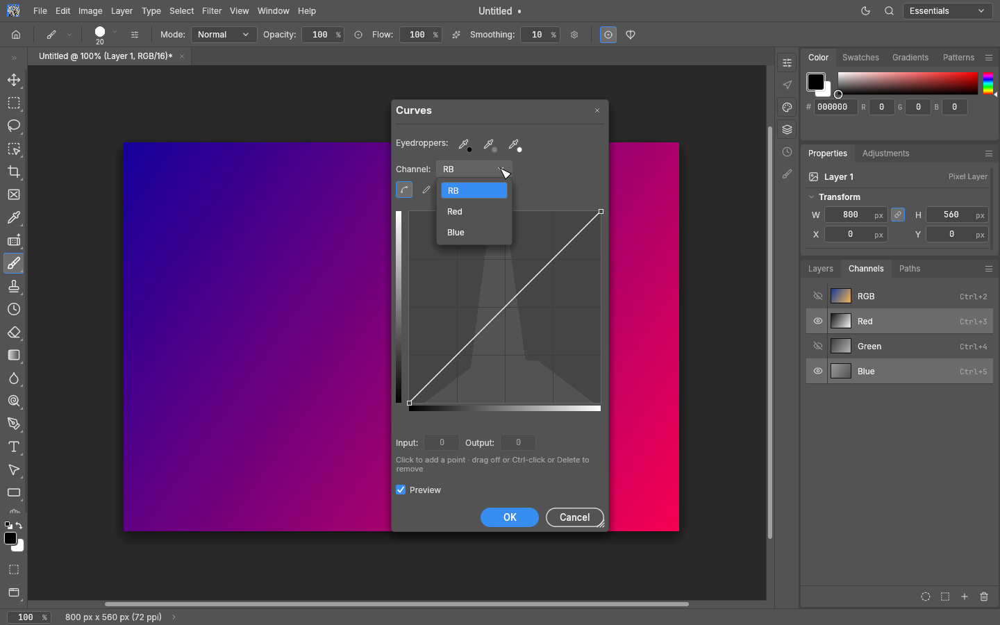

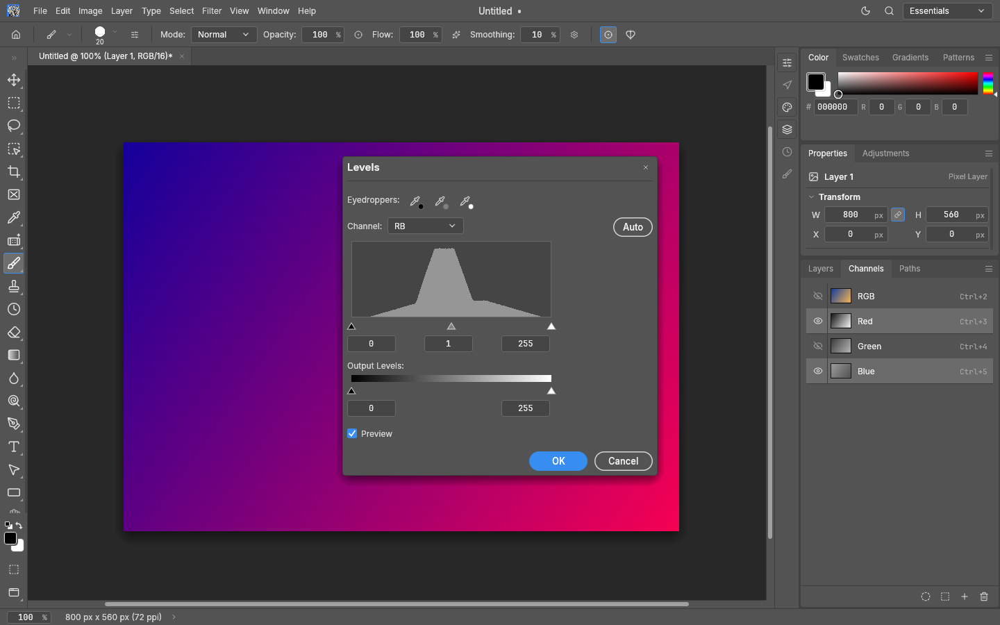

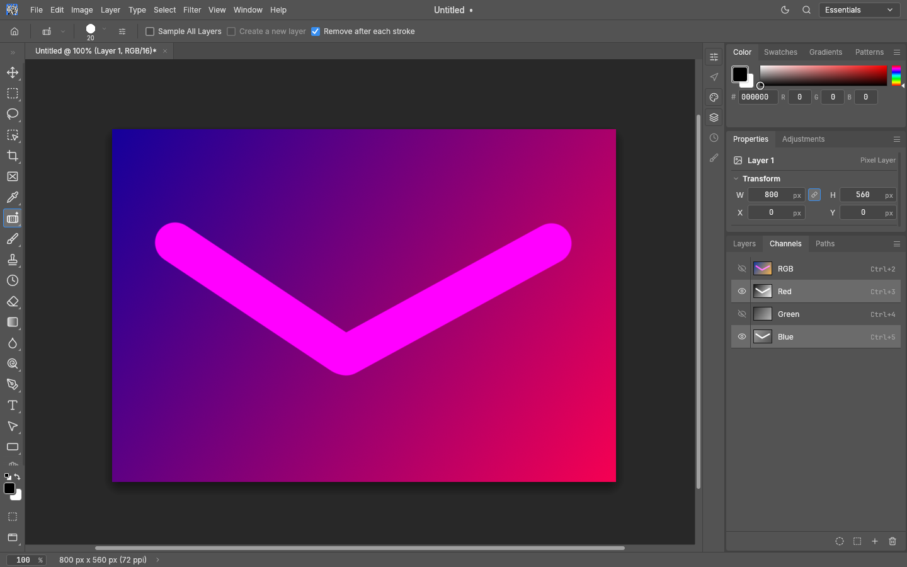

### Public-domain image captures

These captures use Hokusai’s *The Great Wave off Kanagawa*, c. 1830–1832, a public-domain
work reproduced by the Metropolitan Museum and distributed through
[Wikimedia Commons](https://commons.wikimedia.org/wiki/File:Tsunami_by_hokusai_19th_century.jpg).
The unchanged source image, public-domain notice and scripts are adjacent to the captures.
These captures show the default visibility: only the selected R+B, CMY or a+b
components are visible. The remaining component eyes are off. The open Curves dropdown
shows the neutral combined entry and only its selected component choices.

Reproduce with the snapshot command above, adding `--open docs/images/multi-channel-editing/great-wave.jpg`
and using `rgb-script.json`, `cmyk-script.json` or `lab-script.json`. For the dropdown, add
`--click-at 700,243` for RGB or `--click-at 695,226` for CMYK/Lab.

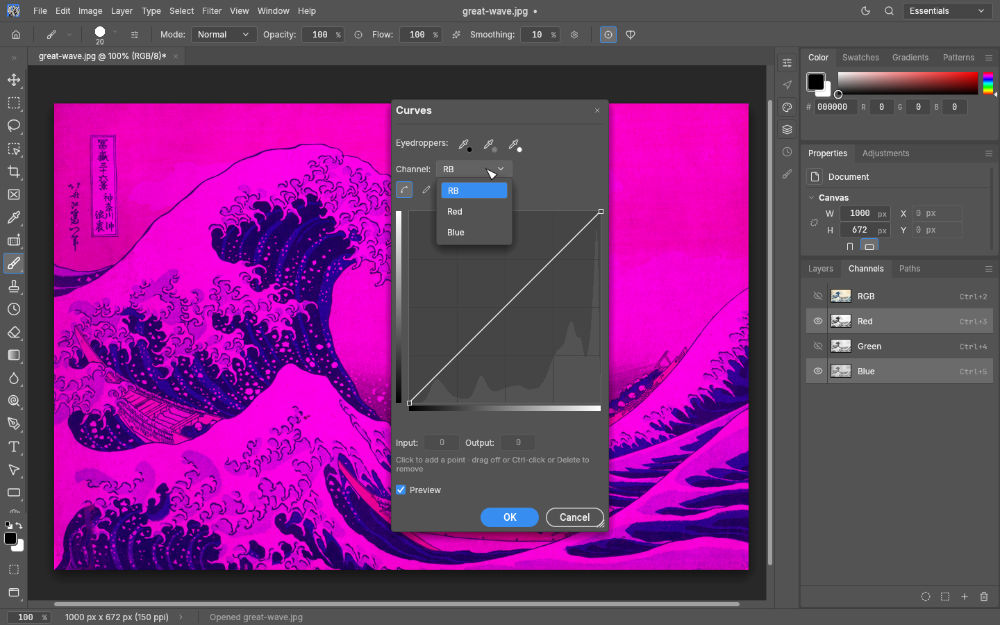

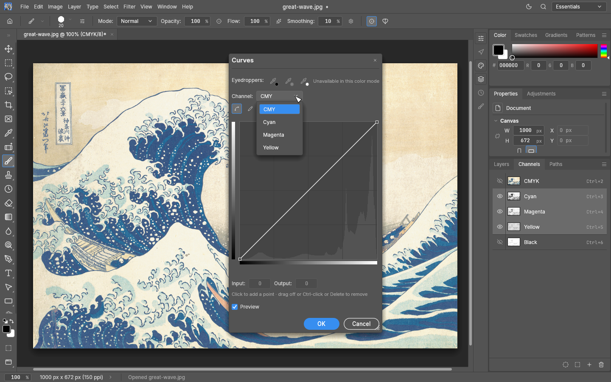

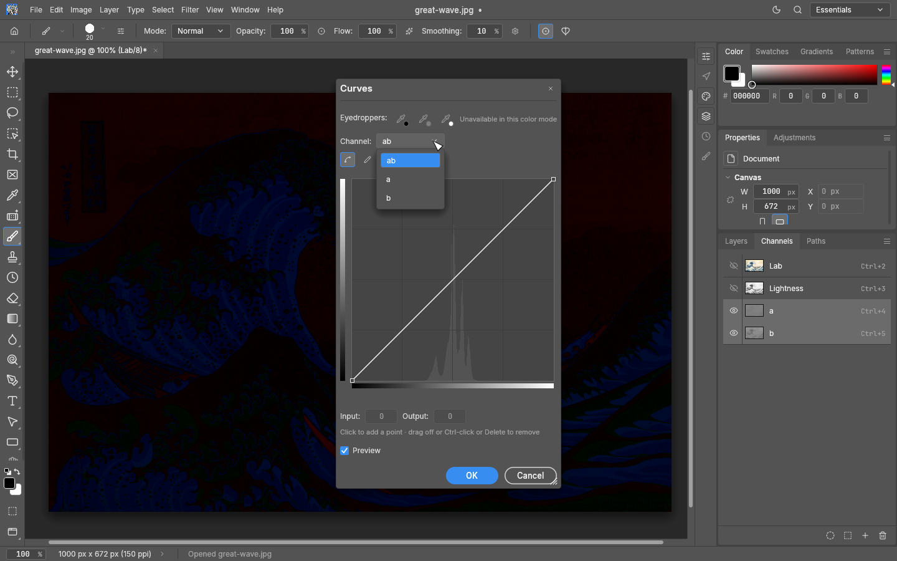

### CodeRabbit findings

The initial review’s Last Filter non-object parameter panic and first single-channel live
retouch-preview restriction issues are fixed, with regression tests. The proposed extra CMYK
clipboard inversion is unnecessary: destination extraction and scatter already convert
between tone and ink. Tests cover implicit/explicit singleton copying into explicit targets
and normal/Paste Into/Paste Outside paths at 8/16/32-bit depths without adding an inversion.

The post-merge review identified missing Copy/Cut parameter documentation; both commands
now describe explicit colour targets and layer ids/names. Auditing that contract also found
that Copy ignored an explicit layer with an implicit single-component target. Copy now
resolves that layer just as Cut does, with a regression that failed before the correction.

The proposed Lab histogram index change is unnecessary: `HistSource::Colors` reserves
slot 0 for the combined selection and stores native components at `k + 1`, including Lab.
Ordinary Lab histograms instead use slots 0–2 for L/a/b. The histogram accessor returns
empty bins for an unavailable slot, rather than panicking. New tests use actual native
subset histograms for components `[0, 2]`, render every choice in both editors, and check
Levels Auto against those bins in RGB/CMYK/Lab at 8/16/32-bit depths.

The next local review found that viewing a layer mask after selecting colour channels
could still send canvas strokes to those colours. Mask view now takes priority in canvas
painting, implicit engine commands and captured tone-dialog targets. Regressions cover
live previews and commits plus adjustments/filters at all depths, while explicit native
targets can still override the viewed mask. Selecting colour rows again leaves mask view
and restores their editing target and visibility.

A further review caught mask Cut/Clear falling back to layer pixels, dialog capture retaining
the old colour set over a viewed mask, and Desaturate dropping explicit target parameters.
Cut/Clear now copy/fill only the selected mask samples, respecting locks and feathering.
Adjustment/filter dialogs preserve their captured mask through preview, confirmation and
Curves Reset, and Desaturate forwards its target and layer parameters. Tests cover pixel and
clipboard preservation, undo/redo, refused edits and changed panel selections.
Move/Free Transform still work on the viewed unlinked mask when colour rows remain selected
behind it; native colour subsets retain their geometry restriction. Curves canvas-point
gestures also honour the captured scalar target after the panel selection changes.

The named-destination visibility guard now resolves layer names just as painting does.
Filter Gallery, Liquify and Adaptive Wide Angle capture the native colour target, preserve
unselected components and alpha in their specialized previews, and retain the target for OK.
Liquify samples only the dirty proxy or detail viewport, with a native proxy built once.
These full-window workspaces require layer pixels or native colour channels; masks, saved
channels and Quick Mask remain available through ordinary filter commands/dialogs.
Geometric writeback retains the original alpha layout, copying selected native bytes even
when the warp produces an alpha-bearing surface. Changed defaults materialize only within
the supplied document/preview extent, under the same bounded-pixel limit.

The public-domain Filter Gallery comparison uses R+B with Green manually made visible.
The original preview filters Green too; the corrected preview retains its original detail.
The [capture script](images/multi-channel-editing/gallery-channel-preview-script.json)
records that explicit visibility override.

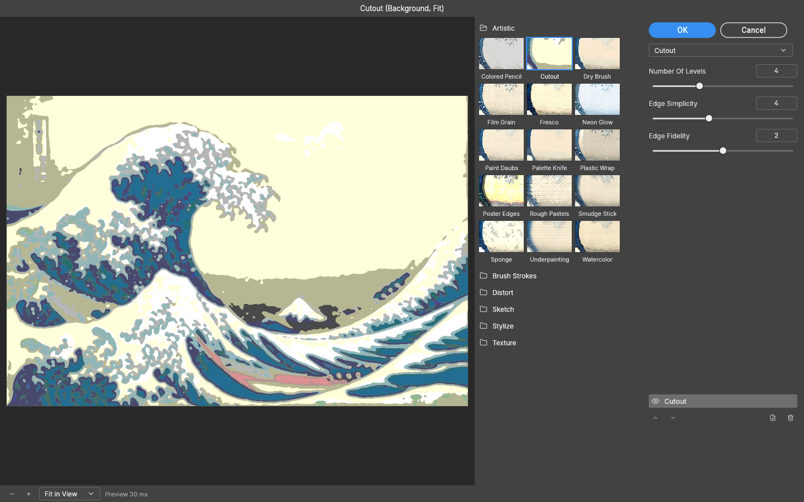

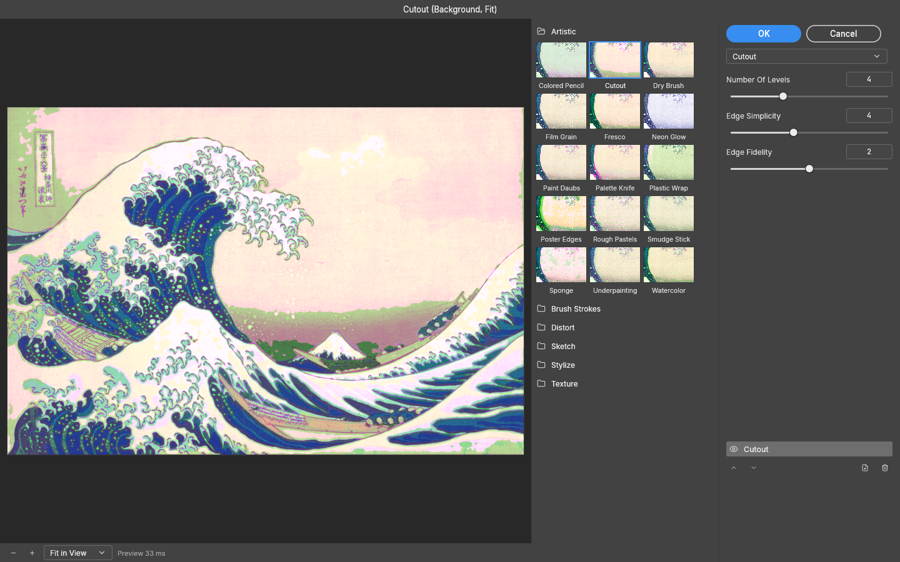

The same synthetic gradient and [pointer script](images/multi-channel-editing/mask-view-script.json)
show the correction: before, the mask stays white while the stroke changes the layer;
after, the stroke paints the mask while the layer's gradient stays intact.

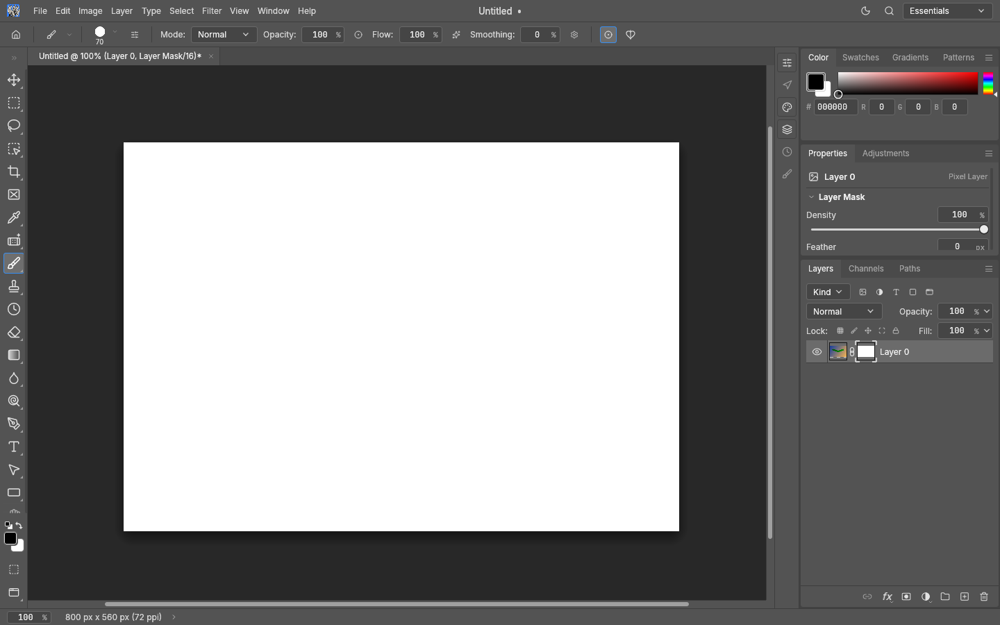

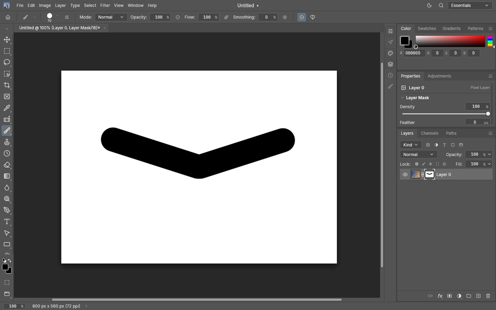

## 2026-11-01: channel-set geometry

The transform branch extends #9274's colour sets to Move, Free Transform, rotate/flip
and Warp. Native component planes share one geometry and the original selection;
the selection outline and history are committed once. Aggregate captured colour
source buffers are capped at 512 MiB including tile padding, in addition to the
100 MP logical / 128 Mi-pixel padded working-area limits. Extreme aspect ratios
are rejected before materialization. Eligible RGB previews sample all selected components in one cached GPU pass.
Different scalar source outlines and other unsupported GPU cases retain CPU sampling.
The regression matrix compares a set operation with independent single-component
oracles across modes, depths, selections and geometry, and covers late allocation
rollback, target/visibility capture, preview/commit and undo. The earlier performance
measurements above describe drawing/tone/filter work, not this geometry extension.

Synthetic R+B transform captures, with all channels visible initially and a black
background colour for vacated samples. The target rows stay selected; Green stays
in place. Hiding R+B keeps Warp controls active and shows the unchanged Green plane.

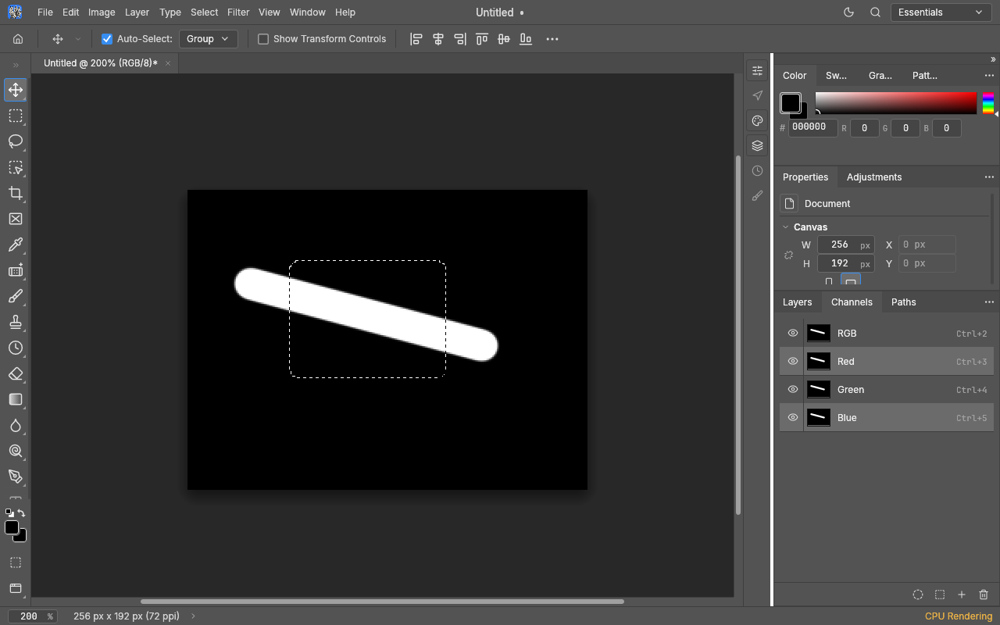

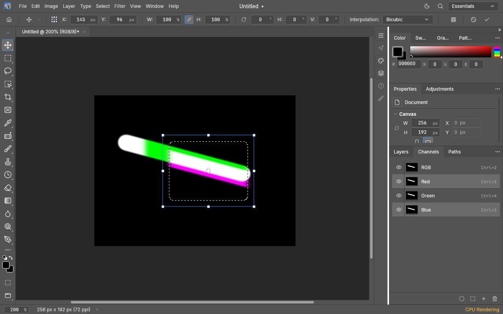

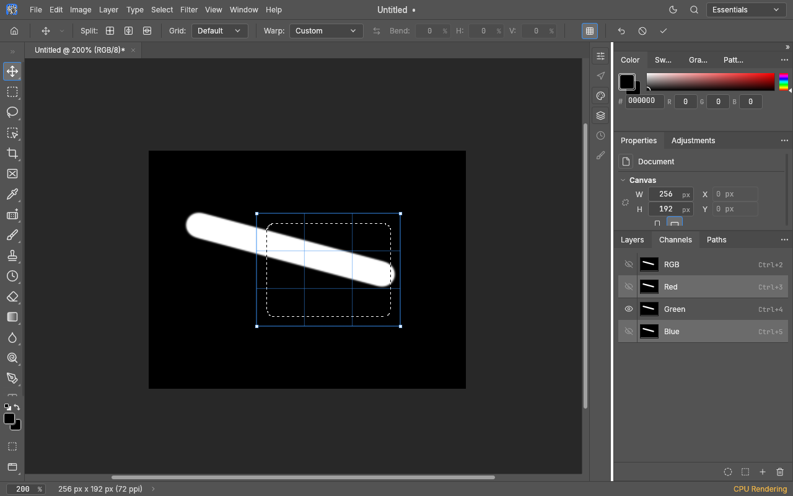

## Channel-set geometry measurements, 2026-11-01

The extension of #4648 to merged #9274 was compared against the previous PR head
`edfb403cfc192a341b5e4de1101a43b251d85141`, using identical harness sources on
both versions. The baseline cannot execute an R+B geometry target; that column
measures the new feature only. These are **software-rendered** measurements on an
AMD Ryzen 7 9700X, Rust 1.99.0 release with thin LTO, two Rayon workers and two
llvmpipe workers. No physical GPU was used. They do not replace the earlier
hardware measurements or establish a performance budget.

Every fixture is a synthetic 6000 × 4000 RGB8 image without a pixel selection.
Preview cases use a 1000 × 700 offscreen viewport and include completed rendering
and readback. CPU preview means the app's CPU fallback, still presented through
software Vulkan. Six alternating baseline/candidate runs provide 54 measured
frames per case after preview warmup. The native commit harness runs three times
per target, with three affine commits and one of each Warp frame per run; it has
no separate warmup. Commit timers include the command, full-resolution pixel edit
and history commit, with document creation outside the timer.

Each entry below is **p50 / p95 milliseconds**. Native affine has nine samples;
each native Warp frame has three, so its p95 is the observed maximum.

| Case | Red before | Red after | R+B after |
|---|---:|---:|---:|
| Shader preview (llvmpipe), affine | 19.81 / 20.91 | 19.78 / 20.32 | 19.88 / 22.28 |
| Shader preview (llvmpipe), Warp | 54.60 / 56.08 | 54.42 / 55.46 | 61.78 / 63.85 |
| Shader preview (llvmpipe), Move | 19.04 / 19.88 | 18.83 / 19.72 | 19.69 / 20.46 |
| CPU preview, affine | 70.59 / 76.16 | 70.60 / 75.93 | 121.51 / 125.57 |
| CPU preview, Warp | 85.31 / 87.47 | 85.64 / 87.58 | 152.59 / 155.88 |
| CPU preview, Move | 159.94 / 180.18 | 164.71 / 189.37 | 211.63 / 259.52 |
| Native affine commit | 1019.12 / 1034.25 | 1004.68 / 1013.65 | 2000.81 / 2013.96 |
| Native full-frame Warp commit | 1193.64 / 1197.93 | 1191.42 / 1195.66 | 2353.13 / 2408.34 |
| Native inner-frame Warp commit | 391.27 / 403.12 | 389.70 / 391.03 | 765.86 / 778.19 |

The complete results also include whole-layer controls, Red-only and R+B-only
visibility, plus cold Move frames. See the [summary](benchmarks/channel-set-transforms-20261101/summary.json),
[raw samples](benchmarks/channel-set-transforms-20261101/samples.jsonl) and
[environment, source hashes and binary hashes](benchmarks/channel-set-transforms-20261101/environment.json).
The harnesses are `channel_transform_gpu_bench` (`--sets`, optionally `--cpu`),
`channel_move_gpu_bench` (`--set`, `--whole`, optionally `--cpu`) and
`channel_transform_bench` (`--commit-only`, optionally `--set`).

The RGB set shader uses the existing source/selection/moved/output textures and
resampling passes, replacing the selected components with a bitmask. The uniform
grows from 128 to 144 bytes; no extra full-image texture or per-component draw pass
is added. Both variants share the interpolation source: scalar previews retain their
original `vec2` sampler and sets use `vec4`. Pipelines compile lazily for the required
variant. CPU Move retains tile-local native copies with fixed sample widths. CPU
transform commits retain native scalar resampling per selected component, so
editing two components naturally does more commit work than editing one. Unsupported
GPU source outlines, other colour modes and selected-set Move drags retain the CPU
oracle. All untargeted samples and transparency remain protected.

The final command review added a repeat-copy availability guard after measurement;
the native sample-copy, resampling and GPU sampling loops measured above are unchanged.
The guard is covered separately by native command and adversarial tests.
Subsequent reviews corrected outline offsets, selection snapping, temporary-Move shortcuts,
mask dispatch, copy guards and transform-control frames without changing those pixel kernels.
The table retains the recorded build's provenance; later dispatch, frame and native reduced-Move
sampling changes are validated separately. It is not a new measurement of the current head.

## 2026-11-02: transform review follow-ups

Native colour geometry includes off-canvas samples and preserves other encoded components,
including transparency. Default frames include the canvas and stored native extent; source
and writeback allocations remain bounded. Isolated Warp commits run through cancellable jobs.
A refused interactive commit keeps its box and captured target available for retry. Its last
valid pixel preview continues to follow channel eyes and display-profile changes.
Both Warp command IDs keep explicit scalar targets locked while their eyes remain editable;
Smart Objects Warp keeps its default whole-object behavior.
Whole-layer rotate/flip presets use the same selected-layer frame as Free Transform, including
the selection outline and implicit Background exclusion; explicit layer targets stay scoped.

GPU previews retain pending WebGPU validation until both scopes settle, reject the same
perspective horizons as commit, and apply display encoding to partial linear-RGB views.
Unsupported sources use the CPU preview. Display-profile and background-colour changes
invalidate the corresponding view caches. Deferred native and web canvas drops retain their
original destination document. Inactive destinations keep their queue until the document
is active again; closing the destination discards those drops. Eligible active-document
drops are processed without reordering another document's queue.

Affine channel extraction runs inside the cancellable worker. Scalar affine resampling,
selected lifting/compositing and the selection outline share its interruption flag. Isolated
Warp prices its destination grid against Preferences › Performance › Memory Usage before
extracting native planes. Frame queries use the compositor's tile-identity bounds cache.
Ordinary layer transforms and tiny selected scalar edits retain their existing sparse extent
semantics. Queued drops also wait for command-started isolated jobs that have no interactive box.

A recovered CPU preview clears only the error it owns. After a CPU refusal, the canvas
keeps the last valid CPU pixels until the geometry passes the oracle, even if the GPU can
draw the refused quad. The main GPU Move canvas retains the CPU document preview used by
secondary displays and Navigator, and a GPU drag commit refreshes the main compositor.

Reduced RGB Move previews retain compact native byte planes (one RGBA8 integer texture-array
layer per byte of an 8/16/32-bit sample). Each output pixel reads the native integer source
coordinate for the current drag offset, including offsets between reduced-preview samples.
The shared display shader still protects stationary transparency and unselected components;
warm drags change uniforms and draw once. Capture is bounded by the GPU memory budget and
texture limits. Unsupported adapters, selections, stacks, profiles or native sources use the
CPU oracle. The reduced path uses the same float-render capability requirement as other
channel GPU previews; OpenGL adapters without it retain CPU rendering.

Regression coverage includes native sample phases at all depths, HDR values, scalar/set
targets and eye combinations; unsupported-renderer fallback; deferred pipeline readiness;
live target changes during Move; per-display cache reuse; uploaded profile-converted pixels;
worker capture, cancellation and output pricing. Fallback is also forced on capable test
adapters, and shader specialization is checked with both LF and Windows CRLF checkouts.
The Move benchmark accepts `--step 21` to
measure offsets that are not multiples of the preview reduction factor.

### Native Move measurements, 2026-11-02

The corrected reduced Move path was measured in release on a 6000 × 4000 synthetic RGB8
layer, with completed 1000 × 700 offscreen frames, software Vulkan llvmpipe and two Rayon
and llvmpipe workers. Three processes per case supplied 27 warm frames. Builds and tests
were idle during the measurements. The retained baseline binary is from `0543ba6b`;
its Move implementation and harness are identical to `8a214f50`. The candidate is the
local review diff on `8a214f50`; source and binary hashes are retained below.

| Warm completed frame, milliseconds (p50 / p95) | Before, 20 px steps | Corrected, 20 px steps | Corrected, 21 px steps |
|---|---:|---:|---:|
| One channel | 19.27 / 20.54 | 17.99 / 21.37 | 18.20 / 21.45 |
| Red + Blue | 20.43 / 21.32 | 19.07 / 22.70 | 18.83 / 23.51 |
| Whole-layer control | 301.39 / 321.38 | 312.59 / 318.41 | 311.02 / 321.63 |

Channel-drag medians remain comparable while sampling the correct native pixels at odd
offsets. Tail observations vary by about 1–2 ms; this small software-renderer run does not
establish a statistical speedup or a hardware-GPU guarantee. Warm dragging still changes
uniforms and draws once; native byte capture happens once. First-frame medians were
88.24 → 84.64 ms for one channel and 96.30 → 88.36 ms for Red + Blue at 20 px steps.
The separate CPU-fallback observations at 21 px steps were 189.92 and 226.49 ms respectively.

Offscreen screenshots were inspected. At aligned offsets, both the CPU and GPU renderers
are individually byte-identical before/after. The existing difference between the CPU
canvas's area-averaged texture and the GPU preview's nearest source reduction remains;
the native sample-phase regressions compare like-for-like texels instead.
See [summary](benchmarks/channel-move-native-20261102/summary.json),
[raw frames](benchmarks/channel-move-native-20261102/samples.json) and
[environment and provenance](benchmarks/channel-move-native-20261102/environment.json).


### Review follow-ups (2026-11-03)

Windows' legacy HLSL compiler rejects dynamically indexed vector stores in the channel
shader. Scalar and colour-set shader variants now use fixed component stores, including
the native Move shader. A Naga IR regression checks every generated variant for this
portability constraint.

Reduced channel, mask and Quick Mask previews price native geometry before returning a
GPU texture, using the same reach, output-memory and writeback-area limits as commit.
Affine preflight normally uses enclosing source bounds. When those overestimate a sparse
colour component, exact encoded-component bounds are captured once and reused for later
geometry changes. Custom Warp normally prices its control hull without traversing the
full native mesh grid. Refused geometry retains the previous pixels and editable handles;
visibility and display changes still refresh that preview.

Unselected colour Move writes the union of the original and shifted native content,
preserving shifted samples beyond the previous bounds while keeping other components
and transparency stationary. Its GPU preview checks the same native work-area limits.
The explicit `layer.translate` selection flag carries the outline for a single component;
selected colour-set moves always carry their selected samples and outline together once.


Before merging main `655295b2a`, the reviewed fixes were compared with published
`8d695d4b2` on the same 24 MP fixture, software Vulkan adapter and two-worker setup.
Each row has three processes and 27 warm completed frames per build, interleaved
before/after. Times are p50 / p95 in milliseconds.

| Move target / renderer | Published build | Reviewed fixes |
|---|---:|---:|
| One component / shader | 18.25 / 21.42 | 18.81 / 21.19 |
| Red + Blue / shader | 18.70 / 21.48 | 18.07 / 21.36 |
| Whole layer control / shader | 283.55 / 290.29 | 289.90 / 302.58 |
| One component / CPU | 143.71 / 162.17 | 141.85 / 159.40 |
| Red + Blue / CPU | 194.22 / 220.02 | 200.75 / 217.25 |
| Whole layer control / CPU | 107.09 / 119.22 | 117.60 / 149.15 |

Channel medians changed by approximately −3.3% to +3.4%, with no material channel
slowdown observed in this run. The unchanged whole-layer CPU control varied by +9.8%,
so these measurements do not establish a speedup. Source uploads remain cached; native
preflight adds bounded geometry checks to ordinary GPU drags. The six matched Move
captures were pixel-identical within each renderer. These figures describe the recorded
pre-merge build, rather than later upstream scratch-storage changes.

[Raw Move frames](benchmarks/channel-review-20261103/move-samples.json),
[summary](benchmarks/channel-review-20261103/move-summary.json),
[environment and source/binary provenance](benchmarks/channel-review-20261103/environment.json),
and [24 MP affine/Warp frames](benchmarks/channel-review-20261103/transform-samples.json).


### Scratch-storage integration (main `655295b2a`)

Channel captures and bounds use main's scratch generation and document-health checks.
Unreadable placeholders cannot become a reduced proxy, GPU source, exact component
bounds, CPU texture memo or Move damage frame. Capture errors remain retryable. An active
transform retries at most eight failed tiles per batch, with a 250 ms repaint/backoff gate,
including tiles owned by its native source, reduced proxy and last shown document. Repairing
the backing file can recover the open transform without changing its geometry or target.
The regression restores the file without manually reloading tiles and exercises all native
sample depths, an interior scalar proxy tile, off-canvas RGB samples and subsequent Move
damage rectangles. The test runs in an isolated process because scratch configuration is
process-wide.


### Scratch merge measurements, 2026-11-03

The reviewed pre-merge build `e5e5f49a6` was compared with tested code `d2db062b3`,
which includes main `655295b2a` and the scratch integration. Both use the identical
release harnesses, a synthetic 24 MP RGB8 document, completed 1000 × 700 offscreen
frames, software Vulkan llvmpipe and two Rayon/software-renderer workers. These
measurements include all merged upstream changes; they do not isolate the cost of
the integration guards or compare against bare main. No physical GPU was used.

An initial two-component Move increase was repeated with all three accelerated
Move cases and their whole-layer control. CPU transforms were also repeated with
all targets and the composite control. No samples were excluded: Move has nine
processes per build/target in accelerated mode (81 warm frames) and three in CPU
mode (27 frames); Transform has three accelerated processes (27 frames per geometry)
and six CPU processes (54 frames). Build order alternates, and confirmation Move
cases rotate within each round. Builds and tests were idle while timing.

| Move path | Before p50 / p95, ms | After p50 / p95, ms | p50 change |
|---|---:|---:|---:|
| One channel / GPU enabled | 19.83 / 24.48 | 20.02 / 24.49 | +1.0% |
| Red + Blue / GPU enabled | 19.62 / 24.15 | 20.14 / 24.25 | +2.6% |
| Whole-layer control / GPU enabled | 335.75 / 371.66 | 332.85 / 378.16 | -0.9% |
| One channel / CPU preview | 153.19 / 167.32 | 160.83 / 178.01 | +5.0% |
| Red + Blue / CPU preview | 207.40 / 219.22 | 214.78 / 228.97 | +3.6% |
| Whole-layer control / CPU preview | 128.34 / 138.52 | 135.11 / 141.71 | +5.3% |

Transform medians follow; Warp uses the harness's 1 × 1 affine-patch deformation.
Tail values and every raw frame are in the linked summaries.

| Target / preview renderer | Affine before → after, ms | Warp before → after, ms |
|---|---:|---:|
| Composite control / GPU enabled | 12.77 → 12.46 | 17.74 → 17.59 |
| Red, all visible / GPU enabled | 21.53 → 21.47 | 57.72 → 58.10 |
| Red only / GPU enabled | 21.05 → 20.83 | 57.65 → 57.47 |
| Red + Blue, all visible / GPU enabled | 21.38 → 21.25 | 65.18 → 65.34 |
| Red + Blue only / GPU enabled | 21.58 → 21.64 | 65.34 → 65.28 |
| Composite control / CPU | 11.75 → 11.96 | 16.45 → 16.57 |
| Red, all visible / CPU | 75.67 → 76.84 | 94.67 → 106.80 |
| Red only / CPU | 107.80 → 109.17 | 128.59 → 139.78 |
| Red + Blue, all visible / CPU | 127.40 → 131.91 | 168.94 → 190.31 |
| Red + Blue only / CPU | 172.07 → 176.18 | 212.80 → 236.69 |

Accelerated channel Transform medians changed by at most 1.1%, and accelerated
channel Move by +1.0% / +2.6%. CPU Move changes (+3.6% to +5.0%) were similar to
the whole-layer control (+5.3%). CPU channel Warp remained 8.7% to 12.8% slower
after the main merge, including the confirmation runs; this is an observed
fallback limitation, not an unchanged-performance claim. These software-renderer
runs do not establish a hardware-GPU guarantee or statistical equivalence.

All six Move and ten Warp before/after screenshots were byte-identical within
each renderer; representative screenshots were inspected. The final quick
performance gate passed with no enforced failures and was uncontended. Its
automatic regression comparison was skipped because the committed baseline is
from another machine; non-enforced budget overruns remain in that report.

[Environment, commands and quick-gate provenance](benchmarks/channel-scratch-merge-20261103/environment.json),
[Move summary](benchmarks/channel-scratch-merge-20261103/move-summary.json),
[Move raw frames](benchmarks/channel-scratch-merge-20261103/move-samples.json),
[Transform summary](benchmarks/channel-scratch-merge-20261103/transform-summary.json),
[Transform raw frames](benchmarks/channel-scratch-merge-20261103/transform-samples.json).


### Selected sparse scalar targets and source admission

A selected mask, saved channel or Quick Mask is framed and checked using its selected
region. Unselected distant samples remain stationary. Scalar transform targets must
contain one component without alpha; malformed layouts are refused before capture.

All retained native colour planes are priced together, including tile padding and
their actual sample depth, against Memory Usage and the existing 512 MiB source cap.
Each resampled output retains its separate Memory Usage check, since outputs are
written one at a time. These limits do not describe the entire process's peak memory.
Affine previews cache immutable source-byte estimates and recheck the current limit;
Warp preview and commit use the same admission.

When reducing a sparse source would traverse an excessive bounding rectangle, the
preview keeps its sparse native snapshot and resamples only the selected region.
The displayed image is sampled separately in bounded bands, including partial-colour
views after eye changes. This fallback admits canvases up to 100 MP and bands up to
64 MiB; oversized canvases are refused before allocation. With Low Resolution
Previews disabled, its native display also has a 512 MiB working limit. Normal
captures retain their existing reduced-source path.

### Final main integration measurements, 2026-11-03

Tested code `48bbe4cb7` includes main `e3a84b628`, retained-source Memory Usage
checks and selected sparse-scalar previews. The baseline is the earlier tested
integration `d2db062b3` (main `655295b2a`). This comparison includes upstream
changes, including viewport streaming; it does not isolate a single fix or
compare the feature against bare main.

Both builds use the same release harnesses, 6000 × 4000 RGB8 synthetic document,
1000 × 700 completed offscreen frames and software Vulkan llvmpipe, with two
Rayon/software-renderer workers. Three interleaved processes per build/target/renderer
provide 27 warm frames per case/geometry. All 324 Move and 1080 Transform frames
are retained. Builds and tests were idle during these timings. Warp uses the
harness's 1 × 1 affine-patch deformation.

| Move path | Before p50 / p95, ms | After p50 / p95, ms | p50 change |
|---|---:|---:|---:|
| One channel / GPU enabled | 20.14 / 23.12 | 18.66 / 23.56 | -7.4% |
| Red + Blue / GPU enabled | 18.86 / 23.49 | 19.19 / 23.63 | +1.7% |
| Whole-layer control / GPU enabled | 339.66 / 371.31 | 341.73 / 395.24 | +0.6% |
| One channel / CPU preview | 166.46 / 190.65 | 173.03 / 189.82 | +3.9% |
| Red + Blue / CPU preview | 211.25 / 224.56 | 217.60 / 241.25 | +3.0% |
| Whole-layer control / CPU preview | 137.56 / 143.70 | 124.19 / 132.96 | -9.7% |

| Target / preview renderer | Affine before → after, ms | Warp before → after, ms |
|---|---:|---:|
| Composite control / GPU enabled | 12.07 → 12.18 | 17.10 → 17.35 |
| Red, all visible / GPU enabled | 20.89 → 21.18 | 57.34 → 58.61 |
| Red only / GPU enabled | 20.50 → 20.00 | 57.15 → 56.65 |
| Red + Blue, all visible / GPU enabled | 20.74 → 20.35 | 63.73 → 84.58 |
| Red + Blue only / GPU enabled | 20.65 → 20.36 | 63.32 → 84.38 |
| Composite control / CPU | 11.49 → 11.66 | 16.36 → 16.05 |
| Red, all visible / CPU | 76.00 → 75.56 | 104.05 → 102.99 |
| Red only / CPU | 106.99 → 103.85 | 139.16 → 135.15 |
| Red + Blue, all visible / CPU | 130.25 → 130.82 | 186.82 → 186.06 |
| Red + Blue only / CPU | 174.08 → 172.55 | 232.03 → 228.71 |

Two-channel software Warp rose by 32.7% to 33.3% in the primary comparison,
while accelerated affine and single-channel Warp medians stayed within 2.5%.
CPU Transform medians changed by less than 3%; CPU Move rose by 3.0% / 3.9%,
while its whole-layer control fell by 9.7%. These are observations from a small
software-renderer run, not statistical equivalence or a hardware-GPU guarantee.
The two-channel Warp slowdown is unresolved; no code cause has been isolated.
The identical shared WGSL source is embedded in both binaries; this does not
prove generated SPIR-V or driver machine code is identical.

The earlier main-655 CPU Warp slowdown above remains a separate comparison;
this run starts from that integration and does not erase the earlier result.
The intermediate `49257cd75` measurements are retained separately, since main
advanced during validation. Its standard quick gate was stopped during compilation,
and no quick-gate pass is claimed for that intermediate build.

The confirmation used the same binaries and all five targets, including the
composite control, with `MESA_SHADER_CACHE_DISABLE=true`: another 540 frames in
three interleaved processes per build, retained separately from the primary
samples. No samples were excluded.

| Cache-disabled Warp target | Before p50 / p95, ms | After p50 / p95, ms |
|---|---:|---:|
| Composite control | 16.92 / 17.42 | 16.98 / 17.66 |
| Red, all visible | 57.02 / 59.06 | 56.58 / 57.88 |
| Red only | 56.22 / 57.68 | 56.22 / 57.20 |
| Red + Blue, all visible | 63.66 / 65.88 | 83.72 / 85.49 |
| Red + Blue only | 63.96 / 65.90 | 84.02 / 86.08 |

The two-component slowdown persisted at 31.4% to 31.5% with the cache disabled;
single-component and composite Warp controls stayed within 0.8%.
[Confirmation summary](benchmarks/channel-main-memory-20261103/warp-confirm-summary.json),
[raw frames](benchmarks/channel-main-memory-20261103/warp-confirm-samples.json),
[confirmation environment](benchmarks/channel-main-memory-20261103/warp-confirm-provenance.json).


All sixteen before/after benchmark screenshots are byte-identical within each
renderer, and representative CPU/GPU captures were inspected. The final snapshot
passed 3,263 engine, 4,961 UI and 421 compose tests (8,645 total, 46 ignored), strict
all-target Clippy, formatting, layering, wasm/HEIF, doctests and adversarial commands.
The conditional corpus check skipped unchanged corpus paths relative to main.
Software GL passed 58 Transform and 43 Move tests; Vulkan matrices passed on the
reported llvmpipe adapter. Two fresh independent integration reviews found no
actionable issues. Windows/DX12 still needs fresh CI verification.

The standard `cargo +1.99.0 xtask perf --quick` run completed uncontended with
no enforced failures. Automatic regression comparison was skipped because its
stored baseline is from a different machine; non-enforced overruns remain in the
[full report](benchmarks/channel-main-memory-20261103/quick-perf.json).
A 6 MP synthetic mask with feathered selected pixels and a distant sparse sample
was also inspected before transformation, during affine translation and in Warp.

[Environment and validation provenance](benchmarks/channel-main-memory-20261103/environment.json),
[Move summary](benchmarks/channel-main-memory-20261103/move-summary.json),
[Move raw frames](benchmarks/channel-main-memory-20261103/move-samples.json),
[Transform summary](benchmarks/channel-main-memory-20261103/transform-summary.json),
[Transform raw frames](benchmarks/channel-main-memory-20261103/transform-samples.json).
