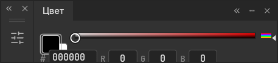
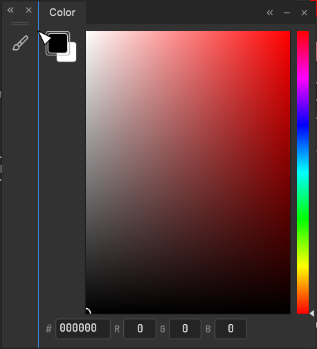
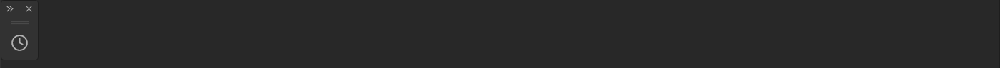
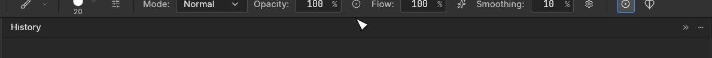

# Panel docking repair demonstrations

## Complete gesture gallery

The gallery now contains 13 caption-free GIFs. Each shows recorded pointer input,
one fixed close crop and pauses around the action, rather than only settled
before/after states. These are offscreen replays of the repaired runtime, not a
native desktop video or a performance measurement.

| Interaction | Recording |
|---|---|
| Compact grouping, flyout and tear-off | [Replay](images/panel-repair/group-flyout-detach.gif) |
| Insert and reorder compact tabs | [Replay](images/panel-repair/compact-tab-order.gif) |
| Move a whole compact group between the left and right docks | [Replay](images/panel-repair/side-docking.gif) |
| Change the vertical divider between full panels | [Replay](images/panel-repair/vertical-divider.gif) |
| Dock below document tabs and toggle the attached row | [Replay](images/panel-repair/below-document-tabs.gif) |
| Restore normal compact-group heights | [Replay](images/panel-repair/compact-group-height.gif) |
| Resize the outer bottom corner and edge without changing width first | [Replay](images/panel-repair/floating-bottom-resize.gif) |
| Resize the middle part while neighbour widths stay fixed | [Replay](images/panel-repair/middle-part-width.gif) |
| Collapse and expand the left/right parts independently | [Replay](images/panel-repair/independent-parts.gif) |
| Move the whole Tools palette, resize both axes and redock it | [Replay](images/panel-repair/tools-floating-resize.gif) |
| Join/detach a full editor beside a compact palette without losing height | [Replay](images/panel-repair/full-editor-join-detach.gif) |
| Dock an upper row, expand it and collapse it while it stays attached | [Replay](images/panel-repair/attached-row-collapse.gif) |
| Insert and reorder tabs in a collapsed upper row | [Replay](images/panel-repair/attached-tab-insertion.gif) |

To capture the raw replays, from the repository root:

```powershell
$env:PHOTOCRAFT_PANEL_SHOWCASE = "$PWD/plan/panel-showcase"
cargo test -p photocraft-ui-egui --lib current_version_showcase -- --test-threads=1
Remove-Item Env:PHOTOCRAFT_PANEL_SHOWCASE
$env:PHOTOCRAFT_PR_FOLLOWUP_REPLAY = "$PWD/plan/panel-showcase"
cargo test -p photocraft-ui-egui --lib pr_followup_pointer_replay -- --test-threads=1
```

Source provenance, playback/encoding limitations and licenses are adjacent to the
images. Captures use synthetic blank documents only. Runtime code is unchanged
from the reviewed integration; the later additions are test-only replay helpers.

## Join and attached-collapse regressions

A full editor keeps its normal height when joined to a short compact owner and when
subsequently detached. A collapsed top/bottom group stays attached as a tab bar;
expanding and collapsing it no longer turns it into a floating miniature. Closed
bars offer insertion slots before, between and after their visible tabs.

| Transition | Before | After |
|---|---|---|
| Full editor joined to a compact owner |  |  |
| Collapse a top-attached group |  |  |

Before images are contributor captures; after images are deterministic offscreen
pointer replay. They show equivalent transitions rather than identical theme or
localization settings. The capture scenes contain no document artwork or personal
photos. Image provenance and licenses are next to the images.

To reproduce the after states in PowerShell, from the repository root:

```powershell
$env:PHOTOCRAFT_FINAL_REVIEW_CAPTURES = "$PWD/plan/panel-final-captures"
cargo test -p photocraft-ui-egui --lib capture_final_review_transitions -- --nocapture
```

The capture test covers three Pro themes and 100/125/150/200 percent scale, with
fitted rectangles saved beside the PNGs. Functional regressions live in
`crates/ui-egui/src/panels/panel_docking/final_transition_tests.rs`. The sanitized
problem-workspace matrix and physical-pixel seam checks live in the other panel
regression modules. See [the docking contract](panel-docking-contract.md) for the
host/shared-framework boundary and dependency update checks. Optional upstream
shared-crate test inputs are documented in `vendor/craft-ui/PATCH.md`.
