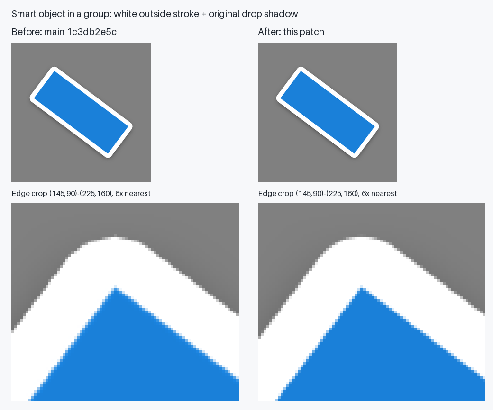
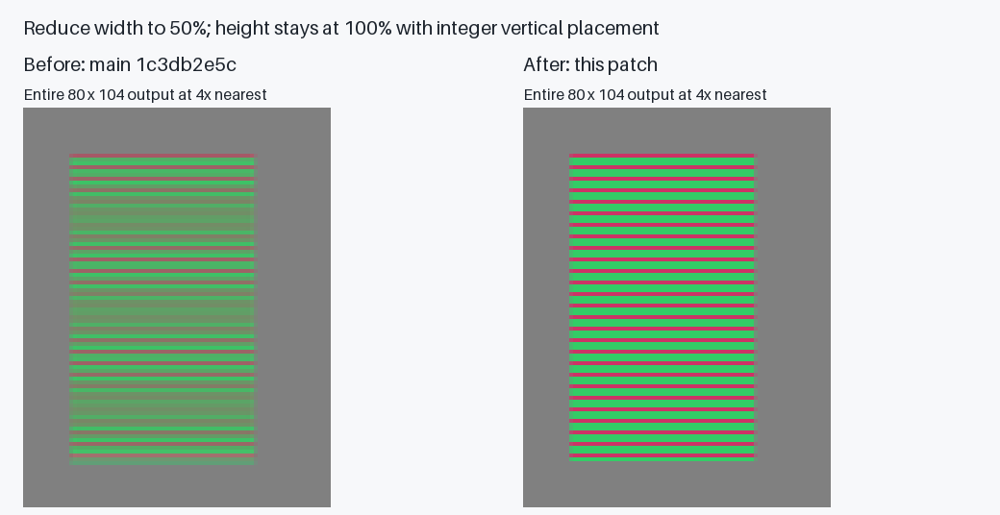

# Smart-object rendering fixtures

These original procedural pictures demonstrate group outside-stroke coverage and detail
preservation during axis-aligned smart-object reduction. They contain no imported artwork or
fonts. The baseline is upstream PhotoCraft `1c3db2e5c35a4f8c544011e57c8026ccb9741926`;
the after images use the contour and original-grid sampler corrections in this change.
These are PhotoCraft revision comparisons, not Photoshop reference exports.



The blue bar is embedded in a smart object inside a pass-through group with a white outside
stroke and black drop shadow. Its native 784 × 784 source is placed at 75% with a
quarter-pixel translation on a 588 × 588 canvas. The group has an 18 px outside stroke;
the shadow uses Normal, 96% opacity, 90° global light, 6 px distance, 16% spread and 36 px size.
Both columns use the same settings. The overviews are reduced to 50% with Lanczos only for
presentation. The crop `(145,90)-(225,160)` uses 6× nearest-neighbour enlargement to expose
the exported pixels. Transparent output is displayed over RGB `(128,128,128)`.



The stripe source is 96 × 80. Its placement scales width by 0.5 and height by 1.0, with
translation `(12.25,12)` on an 80 × 104 canvas. Horizontal lines must keep their original
vertical samples. Both complete outputs use 4× nearest-neighbour enlargement over the same grey.

Generate the PSD/PSB inputs and unmodified PNG outputs into a directory outside the repository:

```sh
cargo run -p photocraft-io --example stroke_repro -- /tmp/stroke-repro
cargo test -p photocraft-compose --test stroke_edge
cargo test -p photocraft-algo --test affine_reduction
```

`shifted.png` and `detail.png` are the inputs to the two comparison figures. To reproduce
the baseline, run the same `stroke_repro.rs` and `stroke_fixture.rs` generator sources with
the baseline revision's crates. `bar.psb` and `detail.psb` are byte-identical between the two
revisions; the renderer, rather than the source artwork, changes. Generated PSD/PSB files
stay outside Git. License: [MIT](LICENSE-MIT) OR [Apache-2.0](LICENSE-APACHE).
