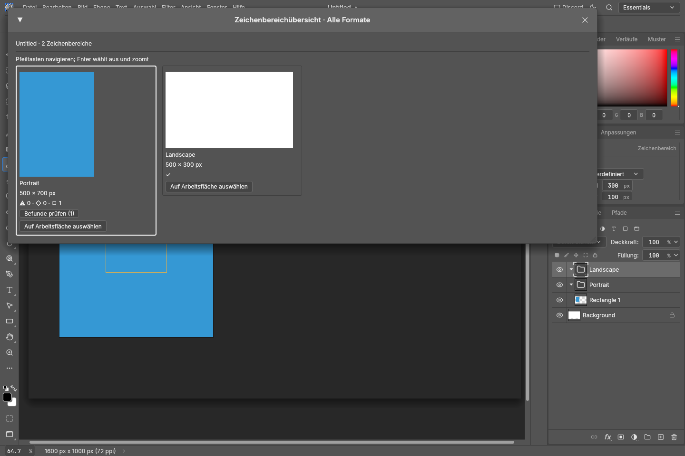

# Responsive artboards

PhotoCraft's responsive workflow keeps one editable design and produces additional artboards from it. A user classifies a layer's purpose, chooses how it should adapt, reviews every format in the overview, and exports selected artboards. Suggestions never replace explicit choices.

## Current architecture

An artboard is a top-level group with a pixel rectangle. `photocraft-doc::responsive::ResponsiveLayout` stores a master artboard ID, variant-to-master links, per-layer layout rules, per-variant overrides, and safe-area definitions. The engine owns mutations and diagnostics; the UI dispatches stable command IDs. Native responsive variant creation runs as a cancellable background job with progress, committing only when the complete reflow succeeds; WASM runs inline through the same job interface. `.pcraft` manifest v2 persists this program and v1 migrates to an empty layout. Loading remaps IDs and discards dangling references. PSD carries only the namespaced semantic-role annotation; it does not claim to preserve layout rules or variants.

Rules describe a 3×3 anchor, fixed/stretch/fill/fit resize mode, optional minimum/maximum dimensions, text-flow behavior, a minimum shrink size, and optional stack layout. Text flow can preserve, rewrap, rewrap with measured auto-height, or rewrap and shrink to a font-size floor. Coordinates are document pixels. Groups are treated as local units; PhotoCraft does not use a graph constraint solver. Resized layer bounds have a one-pixel floor so narrow targets cannot invert or collapse stretched content. Safe-area insets are fractions in the inclusive range 0–0.5; the artboard Properties panel supports multiple named custom zones with add/delete controls. The master panel shows the current variant count against the 64-variant document limit; up to 65 safe-area definitions are accepted per document. View › Show › Safe Areas toggles themed safe-area outlines and labels on the canvas. View › Snap To › Guides also snaps gestures to safe-area edges and centers. The overview renders one thumbnail per UI frame and yields between cards so opening many formats does not monopolize a frame. Its findings window is virtualized and capped at 500 displayed entries per artboard; the all-formats review is capped at 5,000 entries. Both report truncation, filter by finding-category chips, and jump to the selected layer while naming its artboard. The selected finding filter is stored in UI state and restored on the next launch. Semantic collisions appear for both involved layers. Arrow keys move through the grid, Enter selects and fits the artboard, and double-clicking a preview does the same. The active variant name stays visible in the status bar while editing it.

Reflow honors effective position locks, including locks inherited from a parent group. Native master propagation is cancellable and asynchronous, commits all refreshed variants in one undo step, reuses mapped layer IDs, and keeps variant-only subtrees when refreshing from the master. Its `conflicts` result identifies retained local layers, master layers that no longer map, and orphaned overrides; the UI notice reports each case separately, and the full result remains available to agents and callers. The active variant name remains visible in the status bar. Automatic role suggestions expose a confidence percentage and their evidence signal. Explicit roles show whether they came from a PSD file or a manual edit; older explicit role metadata with no provenance is labeled as document data. “Apply role to similar layers” is an explicit, undoable bulk action limited to matching layer kinds and role suggestions on the same artboard, with a 10,000-layer safety cap.

View › Show › Responsive Warnings overlays cached overflow, semantic-collision, and safe-area markers on the canvas. The cache is keyed by document identity and revision, capped at 5,000 markers, and rebuilt only after an edit while the overlay is enabled. Overflow uses a warning outline, collisions use danger dots, and safe-area violations use accent dots so several findings on one layer remain distinguishable.

The engine caps each diagnostics category at 1,000 returned entries and stops collision candidate comparisons after 100,000 pairs per artboard. When either budget is reached, the response sets `truncated: true`; clients should show that the findings list is partial rather than imply that no more issues exist.

## Using the workflow

1. Create the master artboard from **Layer › New › Artboard** or turn an existing group into an artboard. Select it and choose **Set as master** in Artboard Properties.
2. Select each important layer and assign a semantic role in Layer Properties. Automatic suggestions show their confidence and evidence; selecting a role applies it only after an explicit choice. Use **Apply role to similar layers** for a bounded, undoable same-artboard bulk change.
3. Set each layer's anchor, resize mode, optional size clamps, and text flow. Use stack spacing only for a simple linear group; groups are not connected by a general solver.
4. Create the common formats from Artboard Properties. Choose semantic role-aware placement or proportional fit, then inspect **Overview · all formats**. Add named safe-area zones where a composition needs custom margins; enable **View › Show › Safe Areas** and **View › Show › Responsive Warnings** while reviewing.
5. Open the findings review from a card or the overview to filter overflow, collision, and safe-area findings across every board. Select a finding to jump to the layer and board that produced it.
6. Update variants after editing the master. PhotoCraft retains variant-only content and reports conflicts for review. Export selected boards with **File › Export › Artboards to Files**; raster outputs are fully prepared before writing begins. The interactive Files and PDF export dialogs run a layout review for the current revision and let you opt into skipping boards with findings or incomplete checks. By default, every board remains included.
7. Use **File › Import/Export › Responsive Template** to move a role/rule/safe-area mapping to another document. Templates use relative layer paths, validate before editing, and never run implicitly.

For a campaign across many source documents and sizes, `photocraft-cli responsive-batch --presets presets.json --in source-folder --out export-folder --format png` applies every preset to every supported layered document. The JSON file is `{ "presets": [{ "name": "Story", "width": 1080, "height": 1920, "layout": "semantic", "template": "story.responsive.json" }] }`; `layout` defaults to `semantic`, and a template path is resolved relative to the preset file. The command validates preset fields and reads referenced template JSON before processing, then writes each source document's results into a separate numbered output directory. Template schema is validated by the engine when applied. Preset count is capped at 64 and dimensions use the same 36-megapixel limit as interactive variant creation.

## Compatibility and degradation

| Format or editor | Semantic role | Responsive rules / variants | Evidence |
|---|---|---|---|
| `.pcraft` v2 | Preserved | Preserved and versioned | Roundtrip tests |
| `.pcraft` v1 | Defaults to automatic | Empty program after migration | Migration test |
| PhotoCraft PSD | Private namespaced `shmd` item, unknown roles ignored | Not represented | PSD corpus and structural parser tests |
| Unknown PSD `shmd` data | Preserved verbatim | N/A | Block preservation tests |
| Photoshop / Photopea / GIMP / Affinity | Not yet externally verified | Not represented | No compatibility claim |
| psd-tools | Expected to parse generic PSD and preserve unknown item | Not represented | `cargo xtask test-corpus` |

PDF and vector exports retain the existing single-artboard semantics. Multi-artboard image export uses the formats supported by the existing encoder and builds every output before writing files. No implicit sidecar, cloud preset, or telemetry is used. Portable user-controlled templates are versioned JSON files (`.responsive.json`) available through **File › Import/Export › Responsive Template**. A template contains the source artboard's explicit semantic roles, master layout rules, and safe areas. Layer identity uses child-index paths relative to the artboard, so document-local IDs never leak into the file. Import applies matching paths to a selected target artboard, reports unmatched layers, and replaces that board's safe-area set. Files are capped at 1 MiB, templates at 10,000 layer entries, nesting at 256 levels, and 65 safe areas. Unsupported schema versions and invalid roles, rules, or insets are rejected before any document edit.

## Decisions and known follow-up work

The design decisions, including bounds semantics, PPI, RTL, duplication and compatibility, are recorded in [decisions.md](decisions.md). The active delivery checklist lives in the local ignored `plan/responsive-artboards-delivery.md` until its implementation is complete; this file is the stable contributor and user-facing architecture reference. Current visual review captures are `target/responsive-artboards-review.png` (all formats plus visible safe area and a reported violation), `target/responsive-artboards-findings-review.png` (the virtualized findings window, with a jump target), `target/responsive-warning-overlay.png` (canvas warning outlines and distinct safe-area marker), and `target/responsive-export-preflight.png` (layout preflight in the Files export dialog); these local artifacts are generated with the offscreen snapshot example and are ignored by Git.

The solver must remain deterministic, bounded, and undoable. Overflow and collision findings are advisory; the interactive export dialogs surface them before writing and leave all boards selected unless the user opts into skipping affected boards. Effects are excluded from layout bounds until their visual extents are reliable for every layer type. A hard variant cap is an input-safety bound; a lower practical UI recommendation remains follow-up work.
