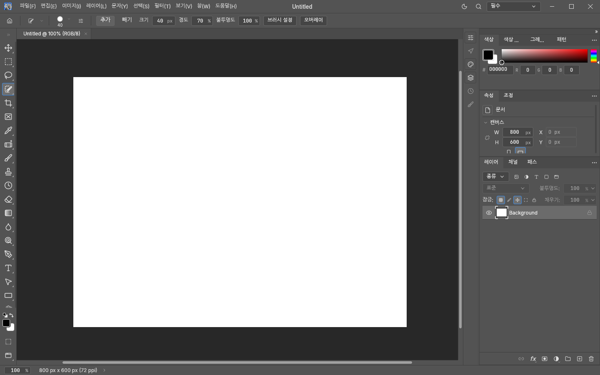
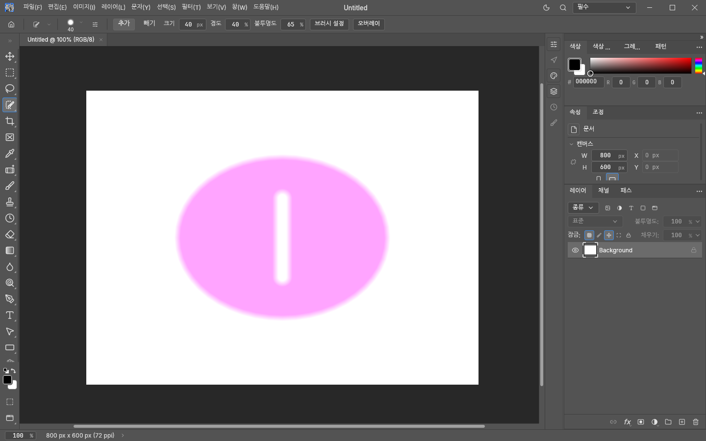

# Selection Brush implementation and acceptance criteria

This proposed native tool paints selection coverage independently of image content. It uses
PhotoCraft's existing selection, history and mask pipeline. No AI service is required.

## Controls and defaults

Selection Brush Tool is in the W tool group. The options bar offers Add and Subtract,
Size (1–5000 document pixels, initially 60), Hardness (0–100%, initially 70), and Opacity
(0–100%, initially 100). The Overlay menu offers colour, Display Opacity (initially 40%),
and Fill Closed Strokes (initially on). The initial overlay colour is red; magenta can be
chosen in the colour picker. Bracket keys and the existing brush resize gesture adjust size.

Alt held at pointer-down temporarily forces Subtract. It does not reverse persistent
Subtract into Add. The normal temporary Hand/Zoom controls remain available between strokes.
Each tool retains its own brush settings; selection-specific settings are serialized UI state.

## Coverage contract

The brush is a continuous round capsule between successive document-coordinate samples.
Hardness controls the full-strength core and linear soft falloff. Opacity scales coverage;
repeated samples within one stroke combine by maximum, so slow movement does not darken it.
Add computes `max(existing, stroke)` and Subtract computes `max(0, existing - stroke)`.
These are PhotoCraft's established selection semantics. In particular, separate subtract
strokes can progressively remove soft coverage, while separate Add strokes never exceed
their coverage ceiling. This intentionally resolves the supplied specification's alternative
`min(existing, 1 - stroke)` subtraction rule in favour of consistency with existing tools.

Only pointer release dispatches `select.brush`, producing one undoable selection edit.
Layer pixels are unchanged. The selection remains editable with existing selection tools;
switching tools restores marching ants. Overlay colour and display opacity affect drawing
only, never coverage, document revision, or undo history. Selection Opacity is a distinct control.

Changing or closing the source document, or editing its revision before release, invalidates
the uncommitted stroke. Document object identity is checked as well as its id and revision.

With Fill Closed Strokes enabled, at least four samples, a path length of at least three
brush diameters, and endpoints within `max(size / 2, 2)` document pixels qualify as closed.
On release the even-odd polygon interior is unioned with the stroke, at the same selection
opacity. Open paths stay open, self-intersections use even-odd filling, and changing zoom
does not change closure or the committed mask. This closure rule is a PhotoCraft design
choice, not a claim about Photoshop's internal algorithm.

## Architecture and limits

`algo::selection::brush::StrokeMask` incrementally rasterizes sparse GRAY8 coverage tiles.
Selection coverage is independent of document colour model and pixel depth. The engine
validates parameters and combines the resulting mask using existing selection operators.
The UI caches a display texture capped at 1024 pixels on its longest side, feeds only new samples
into a full-resolution stroke, and samples that coverage exactly like the committed selection.
Scaling brush geometry before rasterization would change pixel centres and antialiasing on release.
The UI uploads changed rectangles. Idle frames and overlay tint changes do not rerasterize it.
Document-size changes recreate the display texture when its extent changes; full-resolution
stroke bounds are also refreshed when the document size changes within the same display extent.
The full-resolution mask is computed by the command at release.

Strokes accept at most 65,536 finite samples, coordinates within ±10,000,000, and bounded
tile/pixel work. Closed fill bounds are limited to 64 megapixels. Excessive work returns an
error before history changes. These limits prevent hostile automation input from causing
unbounded work; they are not a claim that every valid stroke fits an interactive frame budget.

## Automation

`select.brush` accepts `points: [[x,y], ...]`, `size`, `hardness`, `opacity`, `fillClosed`,
and `mode` (`add`, `subtract`, or `replace`). Hardness and opacity are percentages.
Zero opacity is a no-op without history. Invalid numbers, modes or boolean types are errors.

`ui.set {selectionBrush: {subtract, overlayColor, overlayOpacity, fillClosed}}` merges a
partial settings object atomically. RGB colour components are in 0–1 and display opacity
is in 0–100. `tools.setBrush` controls size and normalized hardness/opacity. `ui.inspect`
exposes settings under `toolOptions.selection_brush`. Existing selection export and mask
commands consume the committed selection; this change adds no AI-specific export protocol.

Saved settings ignore unknown future fields, while automation patches reject unknown keys
before changing any tool or option.

## Acceptance evidence

Native screenshots on a synthetic canvas, before painting and after a 65%-strength closed
stroke with 40% hardness, magenta display at 55%, and Alt subtraction:

Regression tests cover incremental/batch equivalence, soft edges, non-accumulating overlap,
closed and open paths, even-odd intersections, clipping, sparse long diagonals, bad input,
zero opacity, add/subtract, history and 8/16/32-bit documents. UI tests cover settings
validation/serialization, persistent subtract with Alt, unchanged layer pixels, zoom-invariant
closed masks and dirty-rectangle texture uploads with no uploads on idle frames.
Preview-versus-commit regression coverage compares open strokes and closed exterior pixels
exactly at both document and reduced display scales, in Add and Subtract modes.

`selection_brush_bench` compares incremental samples with rebuilding each prefix, and times
closed fill at 24 MP in its full release run. Its raster timings exclude presentation and
must not be reported as UI FPS. A 4K/30 FPS claim additionally requires measured input-to-frame
or presented-frame evidence on a stated machine; it is not inferred from this benchmark.
