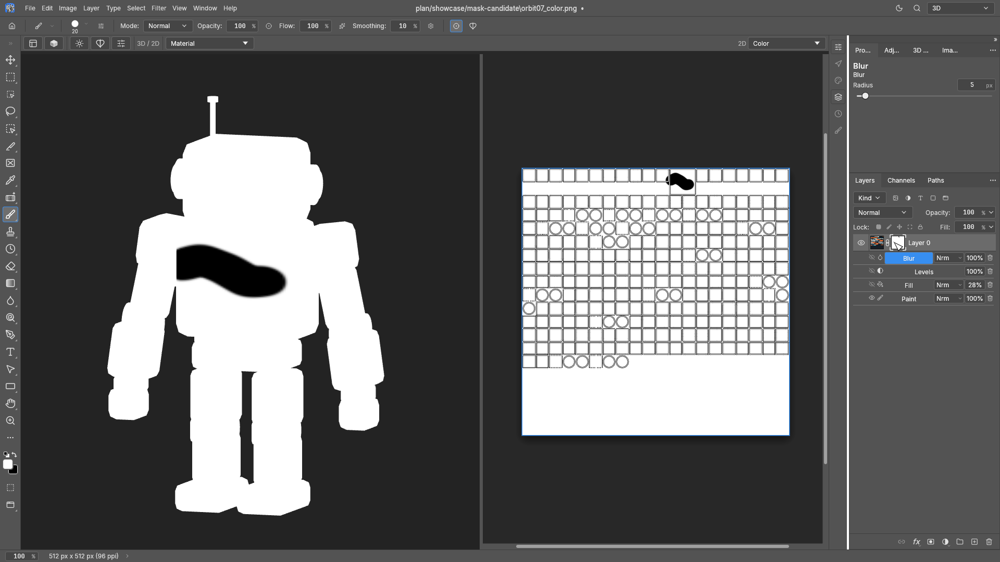
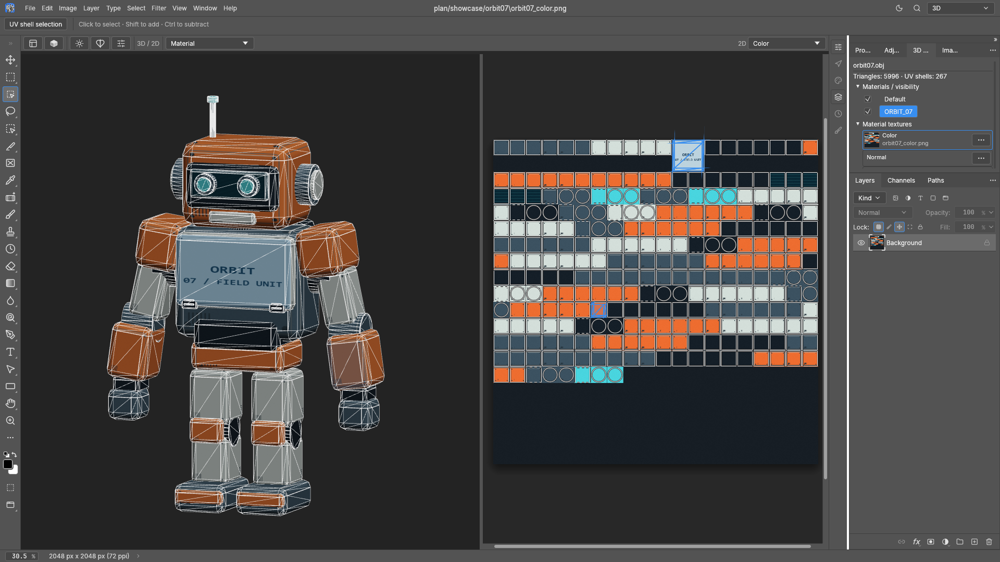
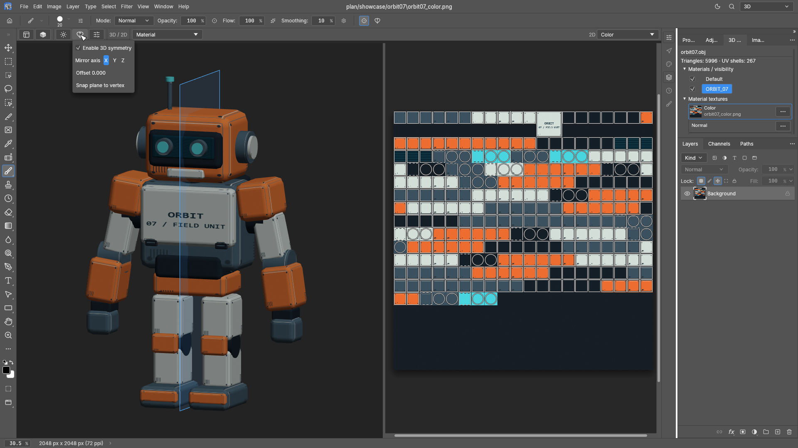

# PhotoCraft 3D / UV workspace

An optional 3D viewport paired with PhotoCraft's editable 2D texture workspace.
The overview screenshot is contributed by `veteraros-ai`; feature captures use
the CC0 ORBIT-07 sample robot.

## 1. Overview

Inspect the textured model and its UV map side by side, with material bindings
and the native Layers panel available.


## 2. Mask sublayers

Build an editable mask stack with Paint, Fill, Levels and Blur effects.



## 3. Polygon wireframe

Inspect mesh topology with an adjustable wireframe overlay.


## 4. Model selection

Select connected model regions or individual polygons for texture edits.



## 5. 3D mirror

Paint across an adjustable mirror plane with axis and offset controls.



## Try the workspace

```sh
cargo run -p photocraft --features uv-workbench
```

Choose the **3D** workspace, then **File → 3D Import → Import Model**. Download
the [ORBIT-07 sample files](samples/uv-workbench/orbit-07/README.md) as a ZIP or
import the OBJ directly.
See the [workspace guide](uv-workbench.md) for supported formats and controls.
