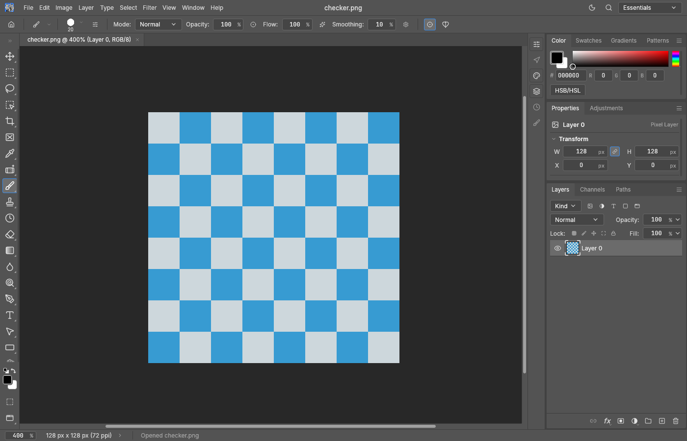
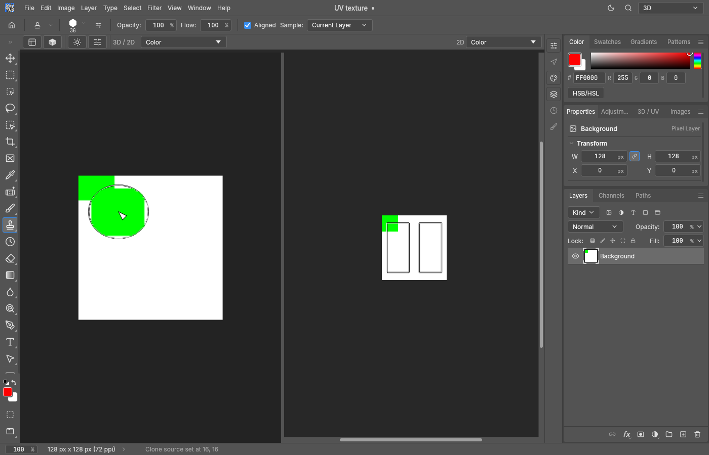

# Optional integrated 3D / UV workspace

See the [illustrated presentation](uv-workbench-presentation.md) for the current
workspace overview, editable mask sublayers, polygon wireframe and model selection.
The [update validation](uv-workbench-validation.md) records the 0.16.0 checks and
the remaining integration work against current upstream.

Build the native application with `cargo build -p photocraft --features uv-workbench`.
Window > 3D / UV Workbench reveals a tab in the right Properties dock, including without
an open document. The 3D title-bar preset opens that tab by default. File > 3D Import
contains model/project operations; texture relinking stays in the material dock. File
selection uses the host's asynchronous native file dialogs.

The ordinary Essentials editor and the optional split 3D/2D paint view are shown
below using synthetic test assets. The second capture includes a clone-source
preview; it is a behavior example, not a performance measurement.

The main area shows the ordinary 2D texture editor, a depth-tested orthographic/perspective
3D model view, or both side by side. Either view can use a separate native window (embedded
window fallback on hosts without native viewports). UV boundaries remain on bound 2D texture documents, including
normal-map documents. The left-rail shell selection tool consumes clicks before the brush; selecting an ordinary
tool restores texture editing. Shift adds, Alt subtracts in 2D; Ctrl subtracts in 3D, where Alt is reserved for navigation. Hide UV leaves selection/layer masks intact.

Static binary FBX 7.4+ and OBJ/MTL import preserves control-point identity, per-corner UV,
authored split normals, materials, external/embedded base-color and normal textures.
FBX normals use the inverse-transpose transform; mirrored transforms retain outward
winding. Polygon triangulation preserves source orientation in every projection plane.
Missing normals use geometric face normals. The preview interpolates authored normals,
constructs a tangent basis with mirrored-UV handedness, and supports tangent-space normal
maps, strength and DirectX green inversion. Normal-map numeric RGB bypasses display ICC.
Height/bump maps are not interpreted as normal maps. Material visibility omits triangles
from rendering, depth and picking without modifying the mesh or UV.

Ctrl+D clears shell IDs and still-owned UV selection masks across map documents, preserving
manually replaced selections in other documents. Project manifests persist ownership using
binding slot indices, with conservative defaults for legacy files. Shift+F5 opens native Fill
in shell and paint modes: camera F1–F6 shortcuts require an exact unmodified key press.
Ctrl+RMB drag changes only brush size in both 2D and 3D (feature-enabled builds). The gesture
latches until RMB release; hardness/opacity, texture pixels, document history and Maya camera
navigation are unaffected. Alt+RMB retains dolly navigation in 3D.

The right dock contains material visibility and base/normal texture cards. Each card opens
the native picker on click or accepts one local image dropped from the OS. Its ellipsis
menu offers 2D editing, choosing the paint channel, active-document binding and creation.
Source thumbnails (up to 64 px) are cached per document/channel, independently of live
brush revisions; the viewport still refreshes edited texture regions in real time.
The shell-selection tool opens a flyout with general, horizontal and vertical pixel margins
and inward feather. Effective X/Y margins are general + horizontal/vertical. The same flyout
is available from its options bar. Selection is applied automatically, with margin drags
rasterizing on release rather than every frame. Explicit apply/protected-layer buttons,
open-border checkbox, help and overlap rows have been removed. Legacy open-border settings
and the protected-layer engine command remain compatible with saved projects.
The compact chrome bar owns layouts, projection, UV visibility, normal/display settings
and camera navigation. Its Material / Color / Normal selector offers only bound map
types. Material retains lighting and normal mapping; map views show raw RGB without
lighting, material tint, normal strength or DirectX inversion. Alpha cutouts and material
visibility still apply. Choosing Color/Normal also activates the matching 2D document and paint channel. Missing normals on individual materials display neutral blue.
UV 2D views omit document tabs, including split and detached views. Ordinary workspaces
retain their normal document tabs. The 3D view supports Maya-style Alt-left orbit,
Alt-middle track, Alt-right dolly, scroll zoom, F frame-selected, A frame-all and shell picking.
Camera state is pure UI state. Material selection, visibility and seam settings are
engine commands. Source mesh data never changes during texture edits.

Shared original 3D edges determine neighboring islands. Hard margins use an anisotropic ellipse in source pixel space (equal axes retain legacy isotropic behavior). Guard widths are measured in
source texture pixels; inward feather never reopens the hard guard. Non-manifold edges
are protected boundaries. Disconnected coincident positions are not automatically welded.
Apply selection uses the ordinary undoable editor selection; deselection removes its
protection. A protected paint layer retains a raster mask after deselection; edit pixels,
not the mask. Filters still sample their context in 2D UV space, not across surface seams.

The live canvas snapshot includes strokes, adjustments, layer changes and undo/redo.
Composites are cached by document revision and temporary preview key. Refresh interval:
33 ms, not a measured FPS guarantee. The GPU preview fits physical viewport pixels (including OS DPI), at most
4096 px on its larger side / 16M pixels and the backend texture limit. Static per-corner geometry and original-resolution maps stay GPU-resident: display-encoded RGBA8 colour and numeric RGBA16Float normals. Mip levels are built on the GPU; trilinear/anisotropic sampling preserves the original level when magnified. Hardware face culling and a discard-free opaque pipeline allow early depth rejection; only cutout materials use discard. Shell selection is read in the vertex stage. Navigation updates camera uniforms and defers document refresh. The default-on, optional smooth-navigation checkbox caps the rendered frame at a 1600px larger side during an Alt gesture, retaining original-sized material maps. Releasing the mouse restores the physical-pixel frame with up to 4x MSAA. Disabling the checkbox keeps full-size frames during motion. A two-size target cache retains motion/idle color and depth attachments, with lazily allocated MSAA attachments, across gestures. Shell picking traverses a cached BVH and respects visibility, culling and alpha cutouts. Changed maps and affected mip regions are updated; the CPU compositor still composes the affected document. A CPU reference/fallback retains idle 2x supersampling and reduced maps up to 2048 px / 256 MiB. GPU maps use the source dimensions within device limits and a 4 GiB host float-cache guard; exceeding that guard reports an error instead of silently shrinking maps. Indexed vertex-cache optimization remains future work. Source documents
retain full resolution, native depth, profile and layers. The GPU Material view supports metallic/roughness PBR, AO, emissive and prefiltered HDR environment lighting.

The native model/texture/project picker resets scene caches while retaining the renderer
attached at startup. The toolbar explicitly reports GPU or CPU; a GPU-enabled 2D canvas
alone does not prove that the model viewport uses the GPU. Regression coverage imports
through the picker after GPU attachment, including cancellation, errors and scene changes.
An opt-in `profile_local_model_zoom` test clicks the actual import button with a fake native
picker, reads a user-supplied model in place (`PHOTOCRAFT_UV_PROFILE_MODEL`) and separately
reports CPU UI/submission wall time, completion wait and asynchronous GPU timestamps for
1x/3x/8x zoom with MSAA on/off. It does not measure native presentation or final UI rendering.

Version-1 `.pcuv` ZIP projects store mesh, Color/Normal and auxiliary document bindings, hidden materials,
active channel, shells, guard settings and complete embedded `.pcraft` documents. Shared
bindings restore one document. New fields have defaults for older projects. Undo is not stored. Camera and 2D transforms are stored as bounded shell view metadata;
native document autosave does not preserve model bindings.

Scope: one imported UV set, tile 1001, Color/Normal/ID/AO/CV/Opacity/Metallic/Roughness/Emissive maps.
No ASCII FBX, glTF/GLB, UDIM, skinning/animation evaluation, procedural material shaders,
height/displacement, clearcoat or transmission. Nondefault FBX inheritance is approximated. Stacked UVs share pixels.
Limits: 1M triangles, 3M positions, 16M mask pixels, 256 MiB model input / 2 GiB project files, 128 MiB
manifest. Binary FBX is structurally checked before constructing its parser tree: at most
256 nesting levels, 1M nodes, 2M attributes, 128 MiB per decoded array and a 384 MiB
budget for declared decoded data plus estimated tree metadata. These are admission budgets,
not a hard process-memory or execution-time limit; parser overhead and geometry copies add
memory. Import remains synchronous, without cancellation or process isolation. Normal maps
require RGB documents. A missing file stays unbound for relink.

Architecture: standalone `crates/uv`, optional `engine/src/uv_cmds.rs`, thin shell
`ui-egui/src/uv_ui.rs`, small canvas/dock/menu hooks. Upstream's WASM plug-in ABI v1 only
supports stateless pixel filters; the extension requires a feature-enabled source build.
Native filesystem commands are denied by the remote automation ambient-path gate.

ReImport (`uv.model.reimport`) rereads and validates the source mesh before publishing any
changes. Unique material names preserve both texture document bindings and hidden materials
across reordered slots. Existing documents, layers, pixel edits and history are not reopened
or replaced; new/ambiguous names remain unbound. Shell selection resets and changed UVs warn
about retained seam masks. `uv.model.checkSource` compares size/mtime at roughly 1s UI intervals,
outside active strokes, showing a notification without automatically replacing geometry. The
baseline and chosen UV set round-trip in pcuv; legacy projects establish a baseline on first
check. Malformed, unavailable or mid-write files retain the old mesh. Both source-reading
commands stay behind the remote ambient-filesystem gate.

The 3D Draw/Shells controls select surface painting or island picking. Surface painting feeds
barycentrically mapped UV points into the ordinary canvas tool state machine and live engine
stroke, including pressure/tilt, native brush settings, targets, layers, selections and masks.
Supported live tools: Brush, Pencil, Eraser, Clone Stamp, Healing/History Brush, Color Replacement,
Blur, Sharpen, Smudge, Dodge, Burn and Sponge. Ctrl-click sets a clone/healing source; Alt remains
Maya navigation. A gesture stays on its first material and coalesces native paint commands into
one undo step, with discontinuities breaking the path. Native paint errors and rasterization
dialogs remain authoritative. New Layer creates an ordinary raster layer; Protected Layer
retains the existing seam-mask workflow. Paint mode suppresses shell colour tinting.

This is UV-space stamping centred on the visible surface, not full screen-projective painting:
UV distortion affects footprint, and a large unmasked stamp can affect nearby UV regions.
The cursor projects the local UV footprint onto the hit face. Off-tile UVs, Mixer Brush and
non-brush tools remain unsupported in 3D. Live/committed damage bounds drive partial CPU
composition and keyed GPU map-region/mip updates; stale region hints fall back to full refresh.

Commands: `uv.model.import`, `uv.inspect`, `uv.material.select`, `uv.material.visible`,
`uv.model.reimport`, `uv.model.checkSource`,
`uv.settings`, `uv.texture.open/create/bind` (channel `baseColor` or `normal`),
`uv.shell.select`, `uv.mask.apply`, `uv.layer.create`, `uv.project.save/load`.

Surface orbit navigation defaults to **View center → surface**: at each Alt+LMB press,
the camera-center ray chooses the nearest visible BVH hit as a world-space orbit target.
Pan compensation preserves the current projection; the target stays fixed until release.
The toolbar also offers **Under cursor** and **Fixed** (F/A targets). Background misses
retain the previous target; hidden materials, culled faces and alpha cutouts are skipped.
This is a single query at gesture start, without GPU readback or geometry rebuild. Pan
uses the prepared geometry diameter rather than scanning every source vertex on each move.
The preference is serialized as shell view state; legacy settings default to view center.

Behavior references: [Maya Tumble on object](https://help.autodesk.com/cloudhelp/ENU/MayaCRE-Basics/files/GUID-A3305185-DFBD-42BF-8A70-59208C2C9887.htm)
and [Substance Painter viewport navigation](https://experienceleague.adobe.com/en/docs/substance-3d-painter/using/interface/viewport/viewport).
The center-ray default is our adaptation for close detail work; Painter documents the
cursor position as its orbit center. The 2026-10-21 revision adds perspective projection
with the same camera-preserving surface target behavior.

Blender's [Auto Depth](https://docs.blender.org/manual/en/latest/editors/preferences/navigation.html) likewise uses surface depth under the mouse for navigation.

Workspace revision (2026-10-21): the title-bar preset **3D** reveals the right dock by default.
File > 3D Import owns model import/reimport, UV-set import settings and project open/save.
The chrome-coloured compact icon menu bar owns layout (F1 split, F2 3D, F3 2D, F4 swap),
projection (F5 perspective, F6 orthographic), UV visibility, display and navigation preferences.
Split cells have a draggable divider; separate 3D/2D native viewports use the existing egui
immediate-viewport path, with floating embedded windows where native viewports are unavailable.
The left rail exposes UV shell selection as a dedicated button below marquee; explicit ordinary
tool selection cancels it, including choosing the previously active brush. The floating canvas
controls were removed. The 3D/UV dock retains materials, maps and seam protection.
Perspective includes clipped, perspective-correct CPU reference rendering, resident GPU rendering,
BVH hit testing, camera-preserving surface retarget and the projected UV brush cursor.
Split painting keeps one input owner so the texture canvas cannot replay a 3D stroke.
Shell commands: file.uv.import/reimport/settings/openProject/saveProject; window.workspace.threeD.

2026-10-21 — extended maps and tangent wrapping:
* Map slots: Color, Normal, ID, AO, CV, Opacity, Metallic, Roughness. Native editable documents, compact immutable source thumbnails, plain named empty cards, picker/drop assignment, synchronized unlit channel/2D views, project roundtrip and name-based reimport retention. Bare sibling names are auto-detected only for a single used material; ambiguous names are not guessed. Metallic/Roughness are evaluated by the optional PBR Material shader. Emissive is a ninth editable map slot.
* Opacity numerically multiplies the cached preview alpha. GPU, CPU reference, hit testing and shell selection consume the same cutout image. Source documents remain unchanged.
* Wheel zoom uses raw scroll input and the Alt+RMB navigation quality path with a 120 ms settle interval. Source texture dimensions are retained.
* The 3D brush preset popup adds Paint UV / Paint Wrap below hardness. Wrap supports Brush/Pencil/Eraser; retouch tools retain UV mode. A local chart unfolds manifold shared edges, preserving per-face UVs across seams. It stops at material boundaries and disconnected geometry. Native stamp masks feed sparse StrokeRenderer coverage, retaining flow/opacity, blend modes, colour format, selection, layer targets and coalesced undo. Limits: 4096 visited faces, 4M visited texels per stamp. Source position/UV budgets are validated before publishing an edit.
* Eyedropper samples the bound texture through the same native document sampling command as 2D. Before document Undo/Redo the shell completes an active 3D stroke; viewport presses release stale numeric-field focus.
* Import accepts earcut output with redundant/degenerate corners omitted and reports a warning rather than requiring exactly n-2 triangles. Non-finite coordinates and invalid indices remain errors. Read-only diagnostics: Character_low.fbx 61,865 triangles/838 shells; Pick.fbx 938 triangles, four 2048² maps.

Behavior reference: [Adobe Paint brush — Alignment](https://experienceleague.adobe.com/en/docs/substance-3d-painter/using/painting/paint-tools/paint-brush). No proprietary source or assets were used.

Final integration notes: Wrap latches world-space texel density for the complete gesture,
so a different UV scale on the next face does not resize the brush. The brush popup belongs
to its opening viewport; dismissing it over the mesh never paints. Native live-brush commits
with unchanged target pixels (including fully masked strokes) do not add empty Undo entries.
The pending 3D stroke enables keyboard Undo even before its first history entry exists.
Advanced directional/smoothing brush dynamics in Wrap are not an exact replay of the 2D
trajectory; UV mode retains the complete native stroke route. Opacity is a cutout channel,
not sorted translucent-glass blending. The current Material renderer remains lit Color + Normal.

### Environment and PBR

The right-hand Environment / PBR panel offers an original procedural studio, a native HDR/EXR file picker, a panorama preview, light brightness/rotation, independent background brightness and emissive strength. PBR is enabled by default and can be disabled to restore legacy lighting. Authored model normals are always enabled in the workspace; normal-map strength and DirectX Y remain editable. Scalar metallic and roughness fallbacks apply only without a bound map.

Environment preparation is bounded (256 MiB input, 32 MP decoded, 16K dimension, finite half-float radiance) and runs in a background worker. A GGX-convolved mip pyramid, cosine-weighted diffuse irradiance and integrated Smith/GGX split-sum BRDF LUT remain GPU resident. Orbit performs no environment convolution or texture reupload. PBR source Color/Emissive composites use CMS into linear sRGB; numeric maps bypass CMS. Reinhard tone mapping is followed by a monitor-profile LUT. Single-channel views remain unlit. The panorama remains an external view resource; its path and lighting settings round-trip in .pcuv, along with material Emissive. HDR environments are assumed linear sRGB/Rec.709 equirectangular panoramas. Shadows, bloom, transmission and clearcoat are outside the supported scope.

PBR math follows the public [Khronos metallic/roughness specification](https://github.com/KhronosGroup/glTF/blob/main/specification/2.0/Specification.adoc); the shaders, environment generator and convolution are original implementations. No third-party environment assets are bundled.

### Painting latency and complete scene resaves

PBR source caches now propagate native compositor damage through linear CMS and retained half-float GPU subregion updates/mips. Small strokes retain full-sized image/encoded-map allocations and leave untouched texels alone; skipped/stale hints fall back to a full refresh. Commit and undo damage are respected. 2D autoscroll requires the 2D canvas to own tool input; a live mapped 3D stroke is excluded, including both split-view orders.

Scene input/save is capped separately at 2 GiB; mesh import remains 256 MiB. The previous shared cap prevented a real 372 MiB character scene with twelve 4K maps from being saved again. Atomic overwrite is retained. Optional, bounded view metadata (64 KiB, depth 16) preserves camera/PBR/Normal settings, channel and layout, per-bound-document 2D transforms and an HDR/EXR reference (new container saves also embed the panorama bytes). Original texture source paths survive project load and resave; texture pixels and layers remain embedded. Old version-1 projects without these fields still open. Save errors are retained in the UV workspace. The external character diagnostic reads source assets in place and saves/deletes only its D-drive temporary copy.

### Texture writeback, separate 2D map and shell rectangles (2026-10-22)

File > 3D Import > Export Textures (formerly Save All Textures) finishes an active paint gesture and atomically writes only dirty, bound texture documents to their existing file paths, using the normal native exporter (original format, depth, encoding and profile). Shared bindings save a document once. Flat map writeback is explicit; editable layers remain in the .pcuv project. There are no file pickers or confirmation dialogs. Maps without paths are skipped and counted in the status line; errors remain in the UV panel and failed maps stay dirty. Conflicting documents targeting one path are refused. New .pcuv saves preserve which embedded maps still need writeback after reopening; legacy files without that metadata mark linked embedded maps as needing one explicit writeback (saving the scene did not save their source images).

The right side of the view toolbar now selects the 2D map separately, without a Material entry. Changing a global 3D map follows it in 2D; choosing the 2D map leaves the 3D display mode alone. Choosing Material retains the current 2D map. The selected 2D map remains the native editable document/paint target. Both channel preferences round-trip in scene view metadata.

The UV shell tool supports LMB rectangle drags in the texture canvas and model viewport. Its options choose touched or entirely enclosed shells; Shift adds and Ctrl subtracts (Alt subtraction remains available for 2D clicks). Rectangle picking operates on the active material/texture set, using exact triangle/rectangle intersections. In 3D it selects by projected geometry, including back-facing portions; it is not a visible-fragment-only lasso. The mask is rasterized once on release. Single shell clicks, transformed 2D canvases and Maya navigation retain their existing routes.

Clone Stamp/Healing source picking in 3D uses Ctrl+LMB so Alt+LMB remains Maya orbit. The temporary Ctrl Move tool no longer intercepts the source pick. Clone Stamp shares its native source image/transform/overlay settings with a UV-triangle projection on the model; a BVH visibility query rejects occluded preview triangles without GPU readback. Retouch painting retains Paint UV mode.

Seam refresh now retains COW document snapshots and compares tile identities across several commits in one frame. Separate atlas islands are composed, color-converted and uploaded as separate rectangles, including incremental mip updates. Unknown structural/profile changes still use conservative compositor damage. UV segments flush batched native samples before committing; tangent Wrap rejects sub-spacing samples before chart traversal. RGB destructive adjustments skip zero-selection tiles and preserve their COW storage. Other color modes keep their established conversion behavior. While Levels/adjustment sliders are changing, the native 2D GPU preview responds first; the secondary CPU-to-3D material refresh settles after 180 ms. Original maps remain at native resolution.

Validation on 2026-10-22: 42 focused native UV/UI tests, 19 clone/retouch checks, 19 UV/reimport integration checks, dirty-writeback/legacy-scene coverage and the 10 adjustment pixel-regression tests pass (overlapping filters are not a combined test count). All-target Clippy, native/default checks, wasm, panic-hunt, layer boundaries, menu parity and release `cargo xtask perf --quick` pass. Native offscreen capture verifies the right-hand 2D selector and source projection across triangle boundaries.

Controlled two-island 4K U16 seam benchmark (four surface samples per frame, CPU brush + PBR source-cache refresh, excluding GPU presentation): Paint UV 5.96 ms average / 6.93 ms maximum, Paint Wrap 8.92 / 9.82 ms. At most 4,140 / 2,450 texels are recomposited; adjacent update rectangles merge, distant islands remain separate. These are synthetic processing timings, not full-frame performance on a production mesh.

The 24 MP RGB selection microbenchmark compares the original parallel processing of all tiles with skipping zero-coverage tiles: 275.62 ms versus 9.36 ms in the optimized test profile, for Invert through a 32×32 selection, with pixel equality checked. The standalone release example `uv_selected_adjustment_bench` runs actual Levels commands plus history on a 6000×4000 document: warm p50 9.34 ms (8-bit), 11.97 ms (16-bit), 10.03 ms (32f), excluding canvas refresh. No user assets are opened by these benchmarks; build/temp/perf output uses the D-drive build tree.

### Project containers and isolated 3D documents (2026-10-22)

`.pcuv` is the project save destination. The archive embeds model geometry, editable native texture documents with layers/masks/depth/profiles, material bindings, original export paths, visibility, UV selection/margins, camera/PBR and 2D-view settings. New saves also embed the original HDR/EXR panorama and image-library sources. Source images and the panorama are not needed to reopen a saved container; the original FBX/OBJ is needed only for a later ReImport. Old version-1 archives still load.

In the 3D workspace, Ctrl+S saves the container in place, choosing its path only on the first save; Save As chooses another container path. File > 3D Import > Close 3D Project closes the scene. Closing a modified scene or quitting asks once about the project. A successful container save checkpoints its embedded documents, so it does not ask separately to write every texture on close. Export Textures remains explicit, writes only changed bound maps with existing paths, and keeps a separate content revision across project saves/reopens. Exporting a flattened texture does not save project/layer changes. The compatibility command id remains `file.uv.saveAllTextures`. Save errors leave checkpoints untouched. The 2 GiB project limit still applies.

The Images tab beside 3D / UV accepts multiple OS file drops or a native file picker after importing a model. It caches a small original-image preview once. Drag a preview into Layers (or double-click it / choose Add to layers) to create a native editable raster layer, centred and fitted using PhotoCraft's placement preferences; Undo removes the placement. Removing a shelf source does not remove layers already placed from it. The library is embedded in the container, capped at 256 images / 512 MiB, with a 256 MiB per-source input limit. No extracted project images or thumbnails are written to a temporary directory.

### Historical Windows package for PhotoCraft 0.14.0 (2026-10-23)

The following notes describe a legacy package built for upstream `v0.14.0` (`ff4738810134d7f7e68b49f2e4f231b686282ff3`). They are historical and do not describe a Windows package supplied by this PR. The current source baseline is PhotoCraft `v0.18.0`; build the optional workspace from source with `cargo build -p photocraft --features uv-workbench`.

The old Windows x64 package replaced the main executable with a tested build for that exact release. It retained a verified official executable for restoration, backed up preferences, checked payload/target SHA-256 before replacing anything, refused unknown or newer binaries, and never terminated running PhotoCraft processes. Normal shortcuts and the ArtCraft Launcher still launched the main installation. Its payload and source patch remained outside that installation, so an official reinstall could not erase them. Existing `.pcuv` scenes and per-user preferences stayed in place.

An official launcher update could replace the main executable. Reapplying the old package was supported only for the identical official release. Updating to another release required porting and testing a new package; it was not an arbitrary-version binary plug-in. The upstream WASM plug-in ABI supports image filters, not a native 3D viewport or shell integration.

### English package and workspace language (2026-10-23)

The 3D/UV workspace follows PhotoCraft's interface language. English and Russian cover its controls, tooltips, navigation, environment settings, image shelf, project prompts and status messages. Other languages retain their existing native PhotoCraft translations and use explicit English fallbacks for extension strings that have no translation. English can be selected in Edit > Preferences > Interface > Language. Switching languages does not alter scene or texture data.

The separate `-EN.zip` distribution contains an English README and English installer messages, plus the multilingual application and source patch. It uses the same version and hash guards as the original package. Creating it does not overwrite the original Russian archive, the installed executable or user preferences. The narrow environment panel adapts its slider widths to fit translated labels.

Leaving the 3D workspace parks its documents and restores the ordinary workspace's own document bank. 3D maps do not appear in ordinary document tabs, Window menus or canvases; native document identity, layer history and each canvas transform survive switching back. UV overlays, selection input, navigation and floating 3D views are inactive outside the 3D workspace. Unsaved hidden 3D work is still checked on application exit. Replacing/reopening an active project releases its previous document bank after successful decoding.

The native Channels/layer-mask display is projected onto affected 3D materials, including grayscale mask solo, rubylith overlays, live brush previews and undo. The GPU uses a per-material unlit mask display and bypasses opacity cutouts for it; other materials retain their normal lighting. This view does not overwrite source texture maps. Layer-mask display revisions are tracked as view changes, so changing mask visibility alone does not mark a map for export.

### Imported asset paths and external writeback

Model-provided texture and MTL references resolve only to regular files inside the model directory (including its subdirectories). Absolute exporter paths can relink to a matching local filename; paths and symlinks escaping the directory are not opened automatically. Missing maps can still be assigned explicitly through the texture picker.

A loaded container preserves external texture paths and all embedded edits, but Export Textures refuses writeback outside the container directory until that document is explicitly rebound using the material controls. This trust is not inherited from container metadata. Explicitly opened textures remain supported.

### Editable mask effects and local preview

Mask Paint, image/constant Fill and Levels effects are preserved in native `.pcraft`
documents embedded in `.pcuv`, including order, opacity, source pixels, Fill bounds,
rotation and Repeat/Mirror settings. PSD stores the resulting raster mask, not this editable
effect stack; use `.pcuv`/`.pcraft` to retain editable mask effects. Texture export writes
the rendered result. Saving a project also includes unbound 3D documents when the 3D
workspace is parked; an absent bound document causes a save error before file replacement.

Image Size, Canvas Size, Crop, Trim and canvas rotation are unavailable while any editable
mask Paint stack exists. Layer Move and Transform are refused when they would move a mask stack
through its flattened surface. The command reports the restriction before changing the document;
remove the affected stack before applying that geometry change.

An environment is restored from the embedded resource only. Legacy projects with an external
environment path but no embedded map use studio lighting and request explicit reselection;
opening or resaving such a project does not automatically follow that stored path.

Fill moves with the left mouse button inside its transformed rectangle; handles resize or
rotate it. Repeat and Mirror use the transformed rectangle as one tile, including after
rotation and at negative UV coordinates. Changing those flags does not move the base tile.
GPU Fill sources are cached across transforms and uploaded in bounded strips. A source that
exceeds the GPU dimension or dedicated 256 MiB source limit uses the CPU fallback.
While moving, resizing or rotating a Fill, mask previews are sampled in the background at
up to 20 updates per second into a shared temporary image capped at 256 pixels on its longest
side. The manipulator reads the latest pointer transform every UI frame independently of
the image's sampling rate. The opaque mask preview skips the full image composite it covers;
other material views retain their previous image until the gesture ends. This changes display
quality only; the gesture commits the original-resolution mask and source image without
downsampling them. Rotated resize keeps the opposite handle anchored and the gesture can
finish outside the canvas or after a missing pointer-release event.

### Wireframe, polygon selection and mask Levels

The viewport can overlay the imported polygon wireframe with adjustable color and
opacity. The shell tool can target UV shells or individual polygons. Polygon
highlights belong to the selected texture document; switching tools converts the
highlight into an undoable native UV-space selection. An outside-only selection
stays empty rather than allowing edits over the whole texture.

Mask Levels effects expose their histogram, input/output controls, reset, visibility
and 2D/3D pipettes in Properties. Selecting an effect sets its edit target without
forcing a grayscale display; Alt-clicking the parent mask opens the mask view and
expands its editable stack. Other materials use a checker display in this mask view.
